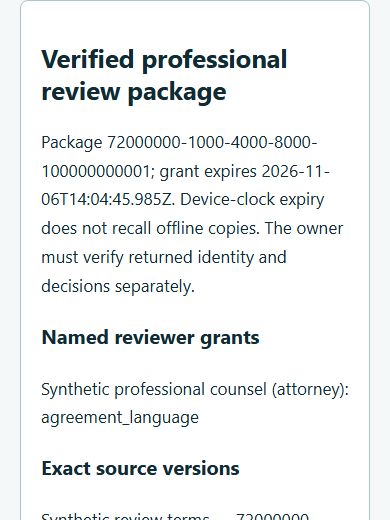

# Testing and BDD

## Repository checks

```sh
python -m pip install -r requirements-dev.txt
python -m playwright install chromium
npm test
npm run screenshots
```

`npm test` builds customizers, validates static output/CSP/asset versions, runs unit/contract tests, E2E and the UX audit. The screenshot command generates the multi-surface board at `screenshots/preview-board.png`; inspect the image, not just assertions. Use `CHROMIUM_PATH` only when intentionally selecting an available browser executable.

## Native partner behavior

```sh
npm run test:partner:postgres
npm run test:partner:browser
npm run validate:partner:qa
```

These test commands require the documented isolated native infrastructure. Review [partner deployment](../../../docs/PARTNER-DEPLOYMENT.md) and the source test harness before execution. Never substitute a live database or real partner account. Synthetic screenshots, fixture-based presentation checks, native integration cases and hosted smoke checks prove different things; label them accurately.

The [60-scenario catalog](../bdd.md) includes descriptions, actual assertion summaries and screenshots. Each flow identifies its source test. A screenshot records a state; assertions establish behavior. Missing capture evidence is not a passing scenario.


*Synthetic decrypted review fixture. Production review packages remain private.*

## Handbook checks

```sh
python -m pip install -r requirements-docs.txt
npm run docs:build
npm run docs:check
python -m unittest tests.integration.test_docs_site
python -m pytest tests/integration/test_docs_site_browser.py -q
```

Strict build and link checks fail for missing generated pages/assets. Browser checks cover 390-pixel layout, keyboard navigation, local search, theme selection and loaded screenshots on the real GitHub Pages subpath. Keep documentation build output separate from storefront release output.
