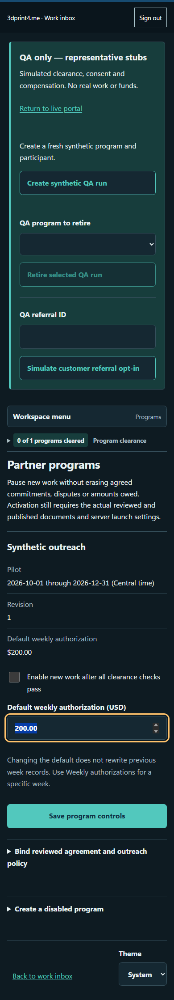

# Getting started

## Choose your first task

### Request fabrication

Open [3dprint4.me](https://3dprint4.me). For an early question, use the quick inquiry. For a defined project, choose printing, design, printer repair or consultation in the guided request. You can ask for help without a finished model. Follow the [customer guide](guides/customer.md).

### Manage shop work

Open [work.3dprint4.me](https://work.3dprint4.me) and choose **Continue with GitHub**. Access requires an authorized operator identity; owning a GitHub account alone does not grant access. Select a request from **Incoming work**, read its next step and open the job sheet. Follow the [work guide](guides/work.md).

### Join as a partner

Use the exact live or QA origin supplied with your invitation. The owner provides a single-use code privately; do not put it in a URL or screenshot. Redeem it and choose a private passphrase. Live and QA accounts are separate. Follow the [partner guide](guides/partner.md).

### Test while forms are reviewed

The owner signs into the work inbox and opens **Partners → Open QA workspace**. Confirm **QA only — representative stubs**, then create a synthetic run. The tester redeems its invitation in the QA participant portal. Follow the complete [QA journey](guides/qa.md) and [BDD catalog](bdd.md).

*Synthetic owner QA fixture. The persistent notice and stacked controls identify the testing workspace.*

### Develop locally

Install Node 22 and the documented Python test tooling. Clone the repository, run `npm ci`, build the customizers and start the loopback workspace. See [local setup](developers/index.md).

## Before you begin

Use a current browser. Choose light, dark or system theme with the portal's theme control. All portals support keyboard navigation; Tab moves between controls and Enter activates a focused action. The partner app may be installed, but installation is optional. Connectivity is required for sign-in and server submissions; an offline draft is not a submitted record.

If access or a save fails, use the [troubleshooting guide](guides/troubleshooting.md) before repeating an action.
