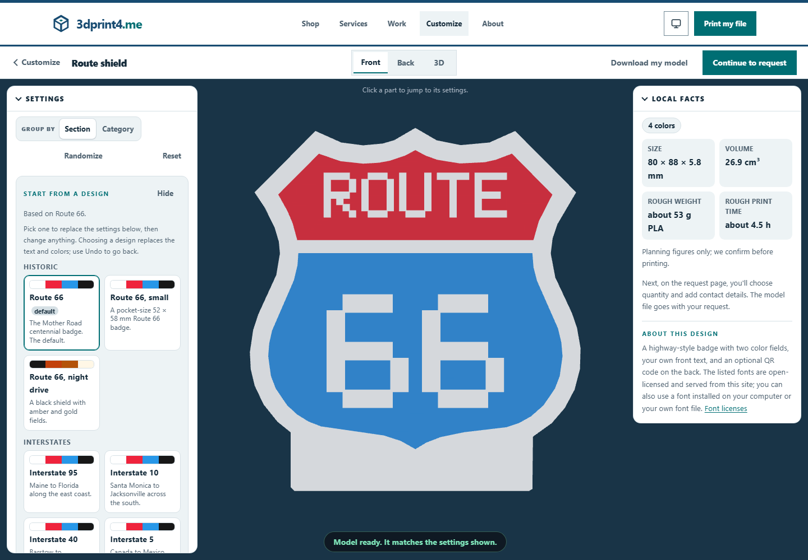

# Request a project

Use the storefront for printing, design, printer repair and project consultation. The shop reviews feasibility and the final scope before committing to production.

## 1. Choose a service

Open the storefront and use a quick inquiry for a question, or start a detailed project request. Choose the service that matches the result you need. Each path asks its own questions; repair does not require printing fields, for example.

## 2. Describe the outcome

Give the project a useful title, explain how the part will be used and include dimensions, quantity and constraints you know. For design, describe the required deliverables and reference dimensions. For repair, describe the printer and symptoms. For consultation, describe the decision or project you need help with.

## 3. Add a model or make one

Attach relevant files when available. Customer uploads are private by default. A printable STL or 3MF can contribute geometry facts and a rough estimate; an analysis warning means the shop needs to review it, not that the model is guaranteed printable.

The [Customize catalog](https://3dprint4.me/customize/) builds models in your browser. Choose a generator, change its fields, inspect the preview and choose **Continue to request**. Review the model and request fields after the handoff.

*Synthetic customizer example. Generated geometry is a starting point for a reviewed print request.*

Sensitive customizer fields such as a Wi-Fi password stay in the browser as values. Their geometry can exist in the model, so treat the finished model as private too. Do not include credentials in filenames, descriptions or reference images.

## 4. Review and send

Read the summary, contact details and permissions before submitting. Browser estimates are **non-binding**; final material, model repair, production and delivery decisions can change the quote. Keep the confirmation or recoverable copy supplied by the site.

If integrations are unavailable, the site offers a recoverable request through the available email/download handoff. Save that copy and follow its instructions; a local draft alone does not prove the shop received it. A payment return page alone does not prove settlement.

## After submission

The shop may contact you to clarify dimensions, materials or production choices. Reply through the channel it provides. Do not resend private model links publicly. If the browser closes before completion, reopen the request to check for a saved local draft; downloaded recovery files may contain your project and contact details, so store them privately.

[Print estimation reference](../../../docs/PRINT-ESTIMATION.md) · [Customizer reference](../../../docs/GENERATORS.md)
