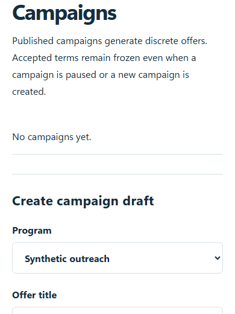
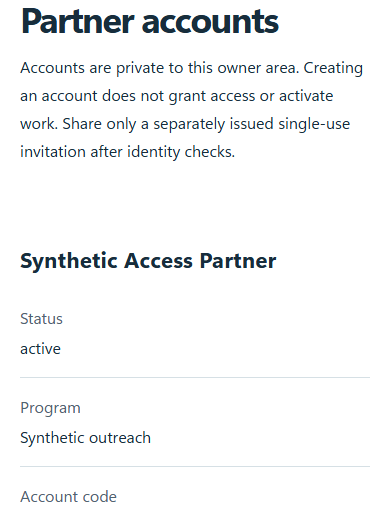
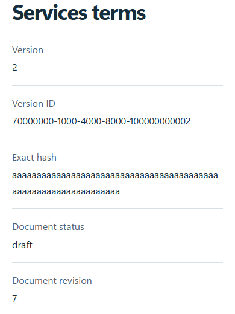
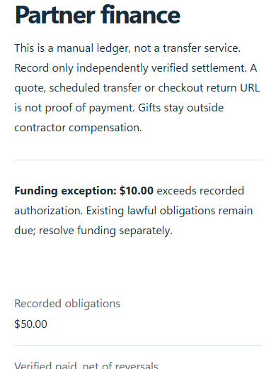

# Manage partner programs

Open **Partners** from the work inbox. Owner administration uses the existing GitHub owner session. Participant accounts use a separate realm. Start in [QA](qa.md) while forms and actual clearance remain under review.

## Confirm the workspace and clearance

QA has a persistent **QA only — representative stubs** notice. Live program controls require actual clearance records and server launch settings. A simulated reviewer, sample acknowledgment or checked box cannot replace professional approval. Pausing new work preserves existing obligations.

## Programs, campaigns and offers

Choose **Programs** to review the pilot, revision and authorization controls. Use **Campaigns** to define the objective work and frozen compensation terms, then **Gigs** for offers. Review the full fee and any deterministic bonus before offering work. Accepted terms remain frozen; changing a campaign does not rewrite an accepted offer.

*Synthetic campaign fixture. Publishing in live operation remains subject to actual clearance.*

Weekly new authorization defaults to $200 and has a $400 hard maximum. The week boundary uses Central time. These controls reserve commitments; they do not erase earned pay. The pilot's new-engagement cutoff is December 31, 2026.

## Accounts and invitations

In **Accounts**, complete the required identity acknowledgment before issuing a private single-use enrollment code. Hand it off through the approved private channel. Never paste codes or passphrases into docs, screenshots or public issues. Recovery and revocation affect access, so read the current account state first.

*Synthetic account fixture; no enrollment secret is shown.*

## Documents and professional review

Use **Legal** to maintain draft versions and exact clauses. Export private professional review packages using the normal review workflow. Actual attorney/CPA decisions must identify the reviewed versions. The [15 representative form sources](../../../docs/partner-qa/forms/README.md) are discussion drafts and remain nonissuable.

*Synthetic versioned document editor.*

Use **Issued agreements** to inspect frozen text and read acknowledgment. Acknowledgment is not an electronic signature. A new version requires a new issue when the workflow calls for one; preserve the earlier frozen record.

## Review work, referrals and finance

Review submissions against the accepted objective criteria. A correction, approval, payable and settled payment are separate steps. Record independent settlement evidence in Finance. Check referral permission and attribution before evaluating a bonus; replay must not create a second award.

*Synthetic finance view. Amounts shown are fixtures, not real transfers.*

Use **Spend forecasts** and **Weekly statements** for distinct planning and immutable balance views. Contact correction or withdrawal must remove follow-up eligibility. Preserve audit history and earned obligations when pausing or suspending access.

[Professional review reference](../../../docs/PARTNER-REVIEW-HANDOFF.md) · [Current launch readiness](../../../docs/CONTRACTOR-RELEASE-READINESS.md)
