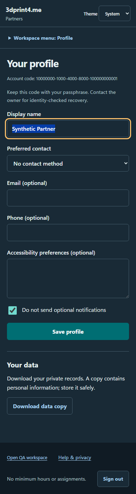
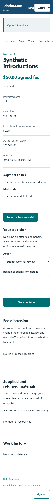
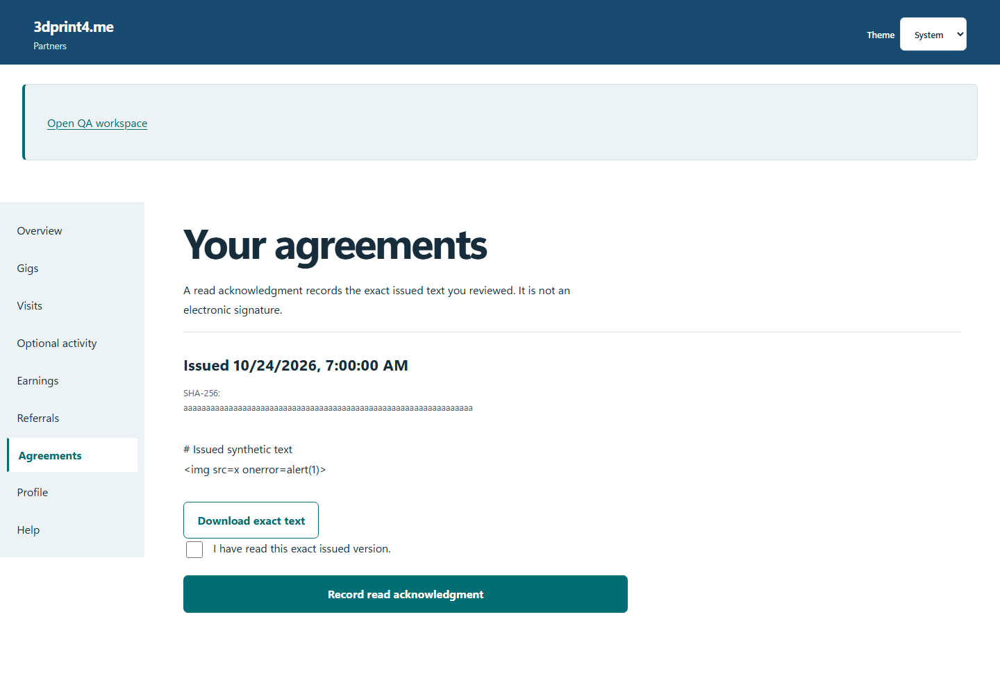
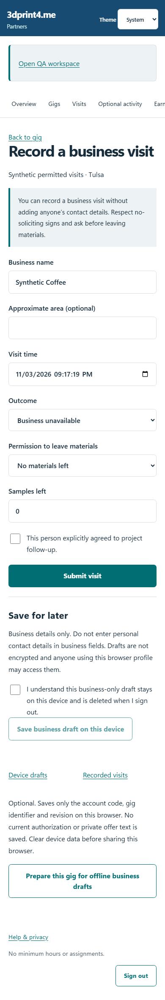
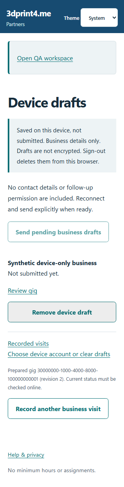
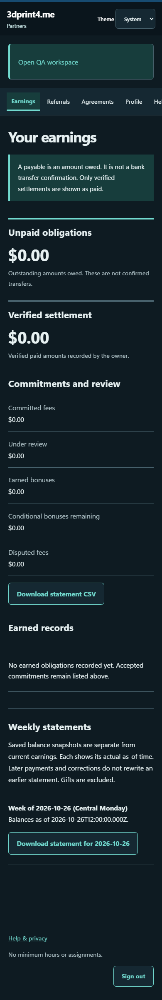

# Use the partner portal

The [live partner portal](https://partners.3dprint4.me) and [QA partner portal](https://partners.3dprint4.me/qa) are separate. Use the origin and private enrollment code provided by the owner. QA is for fictional test activity only.

## Join and sign in

Redeem the single-use invitation on the correct join page and set your private passphrase. Keep your account code available privately for future access. Do not share screenshots containing codes or credentials. If a code is expired or already used, ask the owner for the appropriate recovery path rather than repeatedly submitting it.

*Synthetic participant profile with accessible form spacing.*

## Read offers before accepting

Open your available gigs. Read the task, fee, bonus criteria and scope. Use the available accept, decline or counterproposal controls deliberately. A counterproposal is not acceptance and does not silently change the offered fee. Inspect the accepted snapshot afterward.

*Synthetic accepted gig showing frozen terms.*

Open the issued agreement and inspect its exact text. Record read acknowledgment only after reading it. QA samples have no legal effect, and read acknowledgment is not signing.

*Synthetic agreement example; review labels identify its status.*

## Record permitted visits

Open the accepted gig's visit form. Record accurate business-only facts. Personal contact information requires the specific permitted purpose and affirmative permission shown by the form. Do not put contact details into business-only fields. If permission is withheld, do not submit a contact record.

*Synthetic business visit. A business record and a permissioned personal contact are separate.*

Contact correction and withdrawal have their own workflow. A withdrawal ends follow-up eligibility. Do not continue outreach on the basis of an older stored permission.

## Prepare for offline work

While online, open an accepted gig and choose **Prepare this gig for offline business drafts**. Read the device-storage warning. Reopen the same origin and browser profile offline, choose the prepared account/gig and save business-only drafts. Device records are not encrypted. Keep personal contacts out of offline fields.

*Synthetic drafts awaiting online review and replay.*

Reconnect, sign in, inspect each draft and replay it. A locally saved draft is not a server submission. Do not clear browser data until you have confirmed the intended records were received. If the device cannot prepare the cache, arrange the owner's no-app alternative.

## Submit and review balances

Submit completed work for objective review. Optional activity tracking never substitutes for submission and is not required to submit work. Review correction requests and the status of any payable or settled amount. Weekly statements are immutable snapshots; a balance is not proof that a payment has arrived.

*Synthetic statement history with downloadable balances.*

[Offline reference](../../../docs/PARTNER-OFFLINE.md) · [Help with access or synchronization](troubleshooting.md)
