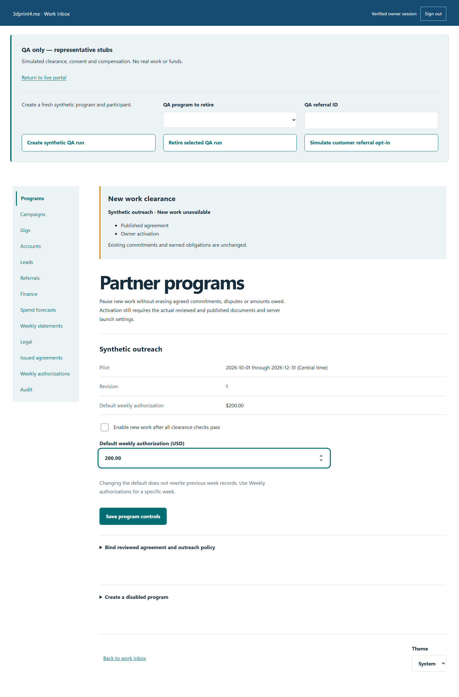
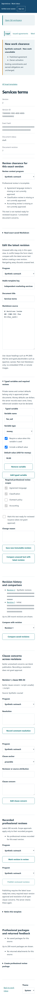

# Live QA and representative forms

Test in the deployed production portals using the isolated QA workspace. The software is live; the programs, participants, approvals and financial events in this journey are synthetic.

!!! warning "No professional approval yet"
    The fifteen canonical contracts and forms are **REPRESENTATIVE STUB — DRAFT — UNREVIEWED — QA/DISCUSSION ONLY**. Simulated clearance does not authorize real work, outreach, execution or payment. Real launch settings remain off.

## 1. Create a synthetic run

Sign into [the work inbox](https://work.3dprint4.me) with the existing owner GitHub identity. Open [the QA workspace](https://work.3dprint4.me/partners/qa), verify its persistent warning, then choose **Create synthetic QA run**. Keep the returned program and participant references privately.

*Synthetic presentation fixture. The three QA tools create, retire and simulate referral permission within QA.*

If access is checking or unavailable, the controls remain hidden/disabled. Sign in through the work inbox and use **Check access again**. During a request, wait for the status message; a sanitized failure leaves a retry path.

## 2. Inspect the form catalog

In QA Legal, seed the [fifteen canonical discussion drafts](../../../docs/partner-qa/forms/README.md). Read their purpose, typed fields, fictional completed examples and unresolved review decisions. Confirm repeat seeding preserves owner edits and canonical stubs cannot be issued. Use the separate **QA SAMPLE — NO LEGAL EFFECT — NOT FOR REAL SIGNING OR WORK** specimen for issuance tests.

*Synthetic editor. A draft version and an issued frozen document are different records.*

## 3. Enroll a fictional participant

In QA Accounts, perform the identity-check acknowledgment and issue a private single-use invitation. Redeem it at [QA join](https://partners.3dprint4.me/qa/join) in a separate browser profile. Keep the code and test passphrase out of URLs, reports and captures.

Issue the separate QA specimen with fictional bindings. As the participant, inspect its exact text/hash and record read acknowledgment. Confirm a later issue does not erase the frozen earlier text.

## 4. Exercise the work journey

Create a QA campaign, offer a gig and test decline/counterproposal/acceptance. Confirm the frozen fee, deterministic bonus criteria and authorization reservation. Record ten distinct synthetic business visits. Use `.invalid` email addresses and the fixed synthetic phone `+12025550100` only where permission is explicitly tested. Never contact a real business.

Test permission denial, renewed permission on correction, withdrawal and deletion. Optional activity should remain optional. Record materials separately from compensation.

For referral testing, use **Simulate customer referral opt-in** with the QA referral ID. Use the resulting synthetic request and consent receipt in Referrals. Simulated settlement references must start `QA-SIMULATED-`. Confirm replay awards once and never rewrites accepted bonus terms.

Submit work, request a correction, approve it, make it payable and record simulated settlement as separate states. Preserve earned obligations under pause/suspension. Verify statement ownership and immutable downloads.

## 5. Retire the run

Choose the intended QA program and **Retire selected QA run**. Check that history remains and the participant session is denied/requires sign-in. A retired run is not reusable; create a fresh synthetic run for the next test. Do not delete historical evidence to make a run appear clean.

## BDD flows and screenshots

The [complete catalog](../bdd.md) contains **60 scenarios**, descriptions, concrete assertions and **142 redacted screenshots** from the native browser suite. Native tests run on isolated infrastructure and are labeled separately from hosted smoke checks. Start with [QA-060: isolated QA lifecycle and canonical stub denial](../../../docs/partner-qa/flows/QA-060.md).

The final November 3 UI release passed 1,277 unit tests, 408 E2E tests (one existing Windows skip), 241 UX checks and all 60 native scenarios. These results establish software behavior, not legal or accounting approval.

## Hosted verification

The production-portal smoke exercised actual owner sign-in, synthetic enrollment, fifteen seeded draft forms, QA specimen issuance/read acknowledgment and run retirement. The later UI release verified authenticated owner controls and twelve anonymous responsive/theme views against deployed static bytes. The native BDD suite remains a separate isolated run. See the [repository evidence](https://github.com/JerrettDavis/3dprint4me/blob/docs-source/docs/partner-qa/README.md#hosted-verification) for dated identities and scope.
