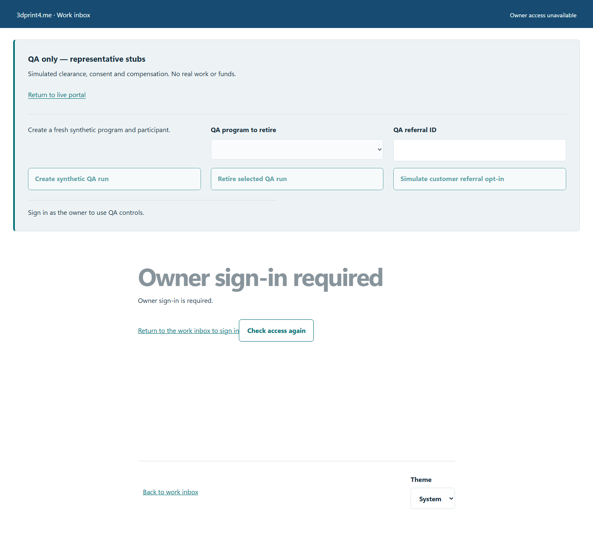
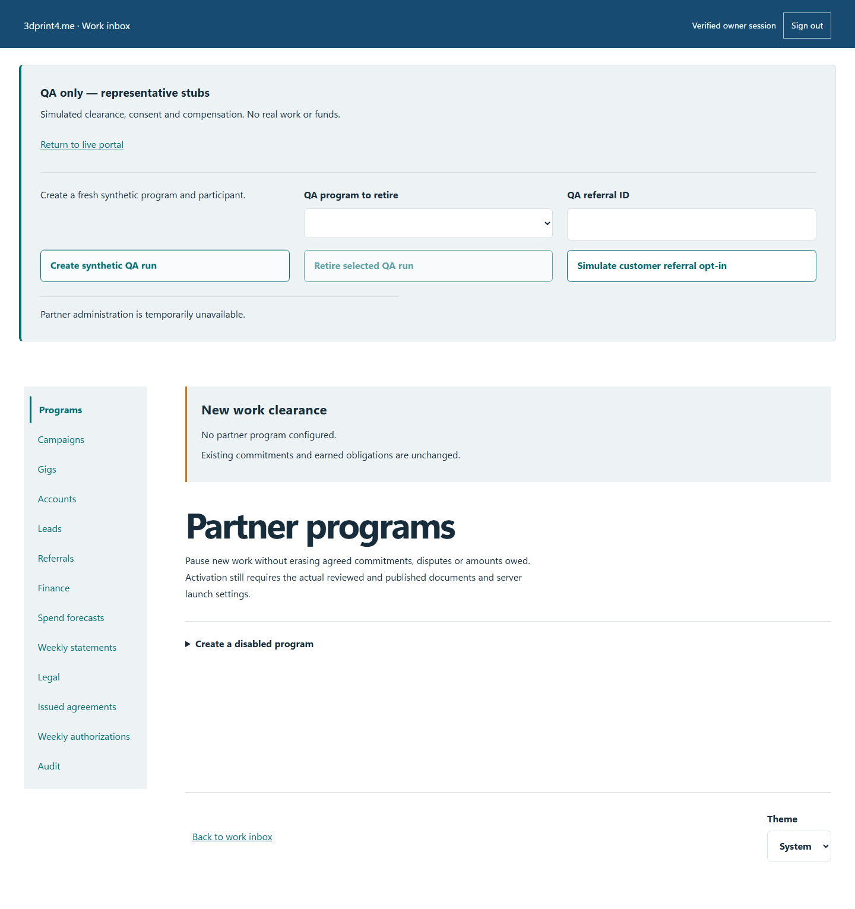

# Troubleshooting

## I cannot sign in

Confirm the hostname and realm. Work/owner access uses an authorized GitHub identity. Partner live and QA credentials are separate. A GitHub login alone does not grant owner permission. For expired invitations, lost partner access or revocation, use the owner's private recovery process. Never publish a passphrase, invitation or session value in a support request.

## QA controls are missing

The workspace waits for verified owner access before showing QA tools. Return to the work inbox, sign in and use **Check access again**. If access is denied, ask the owner to verify the identity binding. Do not change launch flags or bypass access checks to expose a button.

*Synthetic access-required state. The recovery actions remain separate and keyboard reachable.*

## A save or network request failed

Read the status message and keep the current draft open. If a conflict is reported, reopen the latest record and compare changes before retrying. If the result is uncertain, inspect the record/history first to avoid duplicate actions. Do not treat a spinner ending or an offline draft as server acceptance.

*Synthetic temporary failure with controls restored for retry.*

## My offline visit is not submitted

Reopen the same browser profile, sign in when online, inspect the saved business-only draft and replay it. Confirm the server record before clearing storage. Browser data loss or storage restrictions can remove local drafts; they are not encrypted backups. Read the [offline guide](partner.md#prepare-for-offline-work).

## Email or payment looks incomplete

Provider email acceptance is not delivery. Use the existing message's state and retry controls. For payment, inspect independent settlement evidence; a checkout return URL is insufficient. Contact the owner privately with an opaque record reference and the observed state.

## Report a reproducible bug

Include the portal/realm, approximate time, browser, viewport, expected behavior, actual behavior and exact safe steps. Link a [BDD scenario](../bdd.md) when applicable. Use a synthetic fixture and redact personal information, private notes, prices/costs where inappropriate, contact data, signed links, codes and credentials. Do not attach raw console/network dumps containing secrets.
