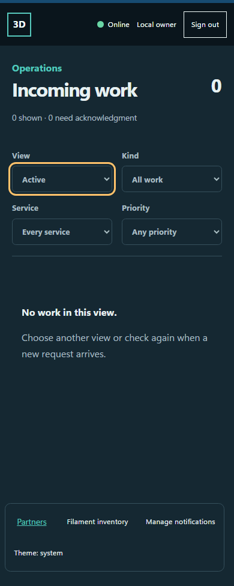
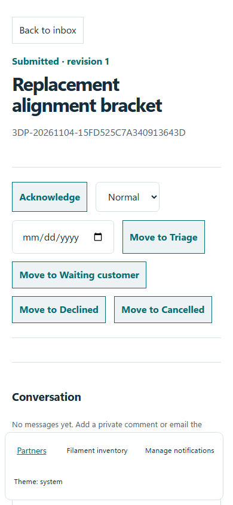
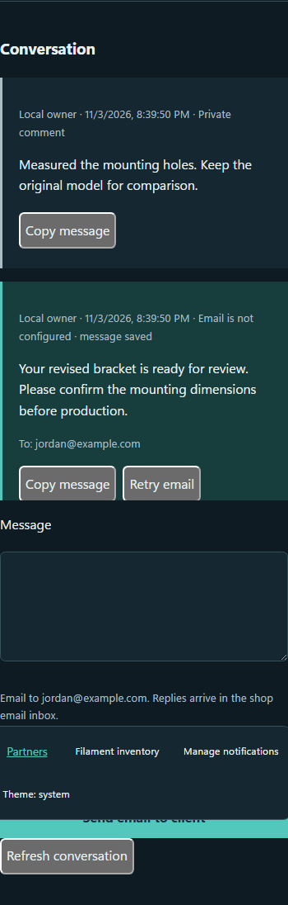
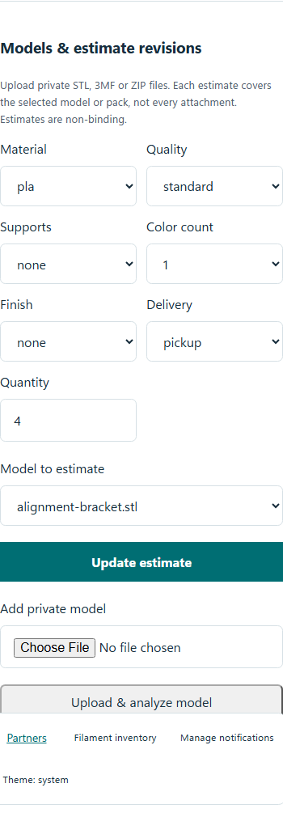
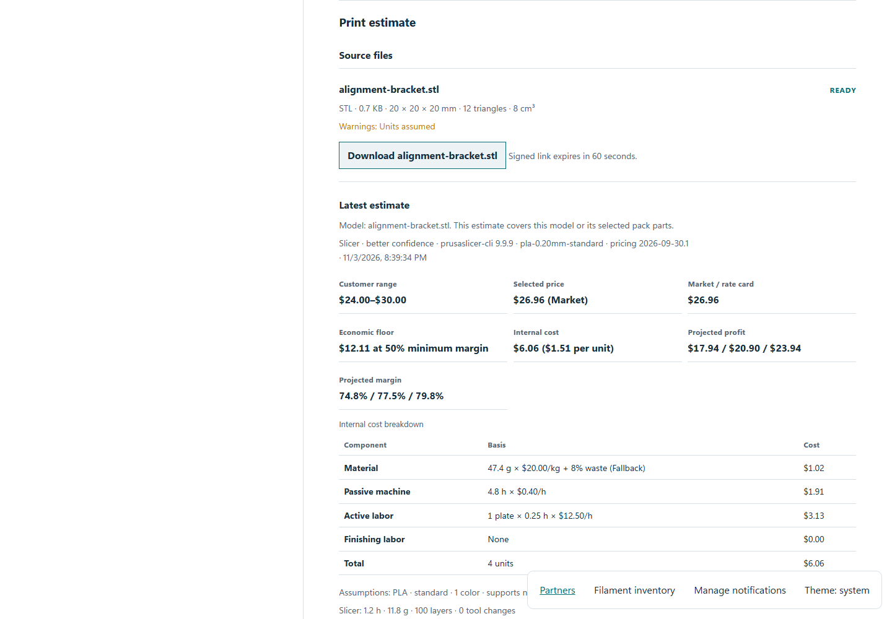

# Manage the work inbox

The work inbox holds private customer requests and inquiries. Sign in at [work.3dprint4.me](https://work.3dprint4.me) with an authorized GitHub identity. Keep shared-device access private and sign out when finished.

## Find the next request

Use **View**, **Kind**, **Service** and **Priority** to narrow the queue. Read the next-step summary, then select a work item. Check its customer details and current revision before making a change. An empty filtered list may mean nothing matches; clear filters before assuming a request is missing.

*Synthetic work queue. Filters and request actions remain usable on a phone.*

## Review the job sheet

Read the intake, private notes and activity. Save the intended operational change and confirm the updated record. If another operator changed the same item, reopen the current revision, compare it with your draft and apply the change again deliberately.

*Synthetic job detail with operational context and actions.*

## Keep comments and client email distinct

In **Conversation**, **Add private comment** saves an operator-only note. **Send email to client** targets the contact shown by the server. Check the recipient and text before sending. Provider acceptance is not proof of inbox delivery. Incoming replies remain in the shop's email inbox; they are not automatically imported into this conversation.

*Synthetic conversation. Delivery status stays visible for recovery.*

For a failed or uncertain delivery, inspect the existing message and available retry controls before creating another one. An unconfigured provider must not be treated as successful delivery.

## Models, estimates and production

Upload models through the private job sheet. Inspect source facts and warnings, choose material/quantity and create an immutable estimate revision. Review price basis and internal cost information in the private view. Do not send an internal-cost screenshot to a customer.

*Synthetic model workflow; downloads require authorized private access.*

*Synthetic estimate with production facts and internal pricing context.*

Use filament readiness to match stock and record any substitution proposal. A rough estimate is not a production commitment. Record actual production separately from the estimate. Where invoicing is configured, inspect the invoice state and external payment evidence; never infer payment from a return URL.

[Complete operator reference](../../../docs/OPERATOR-INBOX.md) · [Conversations and model revisions](../../../docs/WORK-COMMUNICATIONS.md) · [Invoicing](../../../docs/INVOICING.md)
