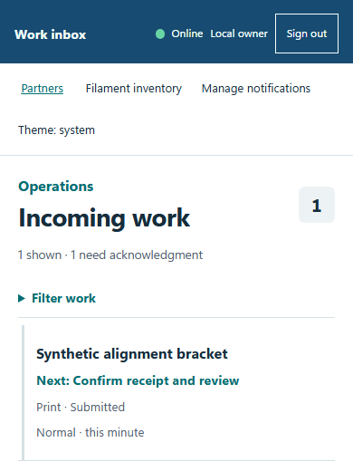

# From first idea to finished work

The **3dprint4.me handbook** explains how to request fabrication, manage private work, use the partner portal and test safely. Start with your role, then follow the illustrated steps. Each step includes desktop (16:9) and mobile (3:4) views. Select a screenshot for full resolution. Native BDD previews are bounded excerpts; their original captures remain available.

- **Customer:** [Request a project](guides/customer.md), estimate a print or customize a model.
- **Shop operator:** [Manage the work inbox](guides/work.md), conversations, models and production.
- **Program owner:** [Manage partners](guides/owner.md), documents and payment records.
- **Partner:** [Use your portal](guides/partner.md), review offers and submit work.
- **QA tester:** [Run the production-portal QA journey](guides/qa.md) with synthetic records.
- **Developer:** [Run locally](developers/index.md), explore the architecture and deploy changes.

*Illustration: the private work inbox, rendered with synthetic test fixtures. The handbook contains no customer work data.*

## Know which workspace you are in

The [storefront](https://3dprint4.me), [work inbox](https://work.3dprint4.me), [partner portal](https://partners.3dprint4.me) and [owner QA workspace](https://work.3dprint4.me/partners/qa) are separate entry points. This handbook is read-only; it never signs you into a portal or collects a passphrase.

!!! warning "Representative forms are awaiting review"
    All fifteen canonical contractor forms are **representative stubs, draft and unreviewed**. QA simulation does not establish attorney/CPA approval, authorize real outreach, execute a contract or move funds. Real activation remains off pending actual version-bound review.

[Get started](getting-started.md) · [Browse developer reference](reference/index.md) · [Browse all 60 BDD scenarios](bdd.md)
