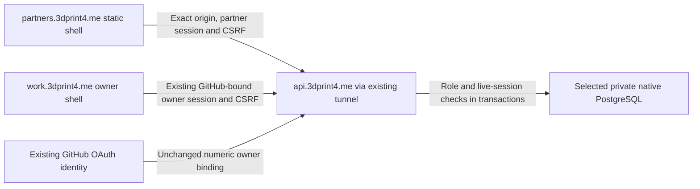

# Partner release evidence and remaining gates

## Verified isolated static preview, 2026-10-24

The dedicated `3dprint4me-partners` project now exists in the existing
`jerrettdavis-projects` workspace. The local link names that project and its matching
provider-issued project/team identifiers; the ignored link contains no API credential.
The effective CLI upload root is `partner/`, framework Other, output `public/`.
The existing storefront, operator, public status and operations projects were not
modified. No new project was connected to automatic Git deployments.

Current verified Preview:
<https://3dprint4me-partners-2dcdonotk-jerrettdavis-projects.vercel.app>

The public application bytes include weekly statements and supplied/returned materials
history, with matching worker/HTML release `partner-shell-v5`. Provider output is
Ready / Preview. Authenticated verification used the official CLI's protection
bypass handling, without printing or copying its managed credential. It proved:

- All 15 static files match their local source bytes and SHA-256 exactly, including
  the HTML, worker, manifest, icons and complete JavaScript graph.
- CSP, no-store, noindex/nofollow, no-referrer, nosniff and frame denial match the
  tracked hosting configuration on the actual served assets.
- Earnings/activity/draft/gig deep links return the generic shell; `/index.html` redirects to `/`.
  Package metadata, `.env`, server source and an API path return 404.
- Anonymous access receives a 302 Vercel authentication redirect. This is preview
  protection, not partner authentication or proof that the application API works.
- Preview/production toolbar flags read back false, and the toolbar script is absent
  from the exact-byte HTML. Deployment protection remains enabled.

Private operational evidence is retained outside Git in the release-preview-proof
and activity-preview-proof/materials-preview-proof folders of the session's private work directory: a redacted proof manifest, hashes,
status/header observations and CLI logs. No authorization/bypass header is copied
into this document, the repo, URLs or frontend configuration.

The first attempt failed after inheriting storefront function configuration and
being labeled Production. No functioning production deployment resulted. The helper
now explicitly chooses Preview and the partner config. The next preview exposed a
provider-injected toolbar; project-scoped toolbar settings were then disabled and
the current clean preview was deployed and reverified. Provider history is retained.

## Commands and provider contracts

[deploy-cloud.py](../deploy/platform/deploy-cloud.py) previews every command unless
`--apply` is supplied. The new partner target defaults to an explicit preview
environment; production requires `--environment production`. It validates the local
project name/identifier shape before any settings mutation, patches only toolbar
flags, stops on failure and reports `verified: false` after upload until separate
acceptance is completed. Focused command contracts check exact target, working
directory/configuration, settings endpoint/method/typed fields and failure behavior.

Primary references: [Vercel deployment CLI](https://vercel.com/docs/cli/deploy),
[authenticated curl](https://vercel.com/docs/cli/curl),
[project settings API](https://vercel.com/docs/rest-api/projects/update-an-existing-project).

## Still required before production acceptance

This is a static preview, not a completed staging or production rollout. Protected
preview hosting may redirect credential-free worker prefetches; it is not evidence
of offline behavior on the eventual production origin. A `vercel.app` preview is
also cross-site from the business API, whereas the intended partner/API subdomains
share the business site. Native local browser tests remain useful regression
proof, but do not replace real same-site cookie/CORS/TLS smoke tests.

1. Complete the packet requirement-by-requirement audit, remaining timer/operations
   work, full feature BDD and API/recovery evidence. Current test counts alone do not
   prove all named packet scenarios.
2. Prepare an isolated synthetic native staging environment and the correct origins;
   verify authenticated cookie/CORS/CSRF boundaries and mobile/offline behavior.
3. Discover and retain redacted current Cloudflare DNS/TTL/proxy data. Obtain the
   new domain's exact required target from Vercel; never guess a CNAME/IP or modify
   storefront/work/api/status records.
4. Preserve the verified `20261024T143246Z` complete encrypted checkpoint and isolated
   database restore evidence in [VERIFICATION.md](VERIFICATION.md). Repeat a current
   checkpoint before cutover, and complete replacement-host/private-object restore,
   reviewed exact release source, additive migration and safe cutover verification.
5. Deploy the partner domain and native API with launch flags off. Verify TLS,
   headers, scope, unauthenticated denial, actual authorized role boundaries and
   unchanged existing sites/services. Record rollback identities and provider IDs.
6. Real professional review and owner launch authorization are separate gates. Do not
   enable invitations/gigs or fabricate approval/payment evidence to test deployment.

No production native API deployment, production migration, custom domain assignment,
DNS mutation, real invitation, payment or professional review occurred in this
preview increment. The overall partner portal goal remains active.


## Earlier activity preview refresh

The current URL above supersedes the original protected static preview, whose source
was `8608e18`. All 14 current static files match local bytes/SHA-256 and all configured
hosting headers. Eight route checks cover activity/drafts/gig navigation, canonical
index redirect and private/server-path denials; anonymous HEAD returns authentication
302. No provider toolbar is injected. This verifies static hosting only: the native
partner API and actual production cookie/CORS/TLS paths remain undeployed/unproven.

The reviewed activity controls and all three packet activity scenarios pass native
browser evidence. The final 19-case native suite, 1,194 unit/contract tests, 304 browser
tests (one Windows skip), 241 UX checks and 133-image screenshot capture are
recorded in [VERIFICATION.md](VERIFICATION.md). Only the two new activity views and
updated preview board are new visual baselines. The exact remaining scenario audit
is [PARTNER-ACCEPTANCE-GAPS.md](PARTNER-ACCEPTANCE-GAPS.md).

## Earlier authentication preview refresh

The current protected URL supersedes the activity preview
`3dprint4me-partners-fr1qrhv6b-jerrettdavis-projects.vercel.app`. All 14 v3 static files
match local bytes/SHA-256; all hosting headers, eight route checks and anonymous
302 protection pass. Enrollment errors remain visible after form reset without
covering retry controls. Export expiry removes the private view; delayed export
failures do not interrupt a later page. This upload changes only the dedicated
static preview. The native API, same-site staging and production domain remain pending.


## Weekly statement release preparation

The local candidate adds opt-in weekly statement scheduling and private paged history.
It requires additive native migration `013_partner_weekly_statements.sql` after 012.
No deployed production schema or backend has been changed for this candidate. Both
migrations keep public database access denied; 013 grants only backend SELECT/INSERT
for immutable statement rows. Existing per-program settings remain unchanged until
an authenticated owner explicitly schedules statements. Neither migration enables
invitations, payments, email or new work.

Partner shell v4 is now uploaded at the protected remote URL above: all 15 static
files match source/SHA-256 and every configured hosting header. Nine route checks,
including Earnings, pass; anonymous access remains an authentication 302. Exact HTML
matching excludes a provider toolbar. Operator shell v23 remains a local build.
The earlier v3 preview was https://3dprint4me-partners-39l866vqm-jerrettdavis-projects.vercel.app. Native same-site staging, API rollout, DNS and actual launch gates
remain open. A read-only DNS query now reports NAME_ERROR for partners.3dprint4.me;
the credential-source clarification remains pending and no DNS record was changed.

## Materials release checkpoint

The protected v5 Preview above supersedes
`https://3dprint4me-partners-1hrcyiq8h-jerrettdavis-projects.vercel.app` (v4).
All 15 exact-source assets, nine route checks, configured hosting headers and
anonymous 302 protection passed again. This updates only the dedicated static
Preview. Owner v25 (35 exact static files) and the materials API candidate (210
exact runtime files; restricted offline imports) remain built locally. No production
migration, API/owner rollout, DNS or launch activation is implied by that evidence.

## Native rehearsal and disabled release implementation

`deploy/platform/release-partner.py` provides separate partner-aware rehearsal and
explicit disabled-rollout phases.
The inquiry release helper omits `contracts/partner` from its committed archive
and applies migration009 only; do not use it to release this portal. The original
controlled cutover is also not a release update: it performs the initial source
fence/native selection.

After committing and reviewing the complete release source, the rehearsal command is:

```sh
python deploy/platform/release-partner.py --release <full-reviewed-40-character-commit> --phase rehearse
```

The default phase is rehearsal. Explicit deploy requires `--backup-config`; a
missing, stale, incomplete or mismatched checkpoint stops before selected-schema
or service changes. No invocation of this new helper has occurred on the native
host yet. The current local implementation still needs final full verification,
fresh release review and a committed-source host rehearsal before any rollout.

The local builder includes the partner contracts and both Docker build inputs
from the specified commit, excludes uncommitted files, validates the SHA/phase/SSH
host, and sends the payload only through pinned SSH stdin. The host verifies the
archive digest and regular contained members, rejects incomplete/changed source
reuse, serializes its protocol with an owner-private lock, and records bounded
operation labels without child output, SQL, credentials or provider responses.

Rehearsal builds both API/jobs and slicer companion tags because the existing
Compose configuration selects them with the shared `PLATFORM_RELEASE`. It does
not recreate either running service. The native control connection and durable
selection remain authoritative even when bootstrap overrides a retired business
`DATABASE_URL`. Only a randomly named `platform_partner_rehearsal_*` database is
created, migrated, seeded with an unapproved synthetic program, and dropped.
All three partner switches are explicitly zero in disposable containers. Their
network blocks external egress; no external service credential is supplied.

The candidate runs real native schema/grant checks, activation/enrollment denials,
private route session denials and origin checks. Two isolated candidate HTTP
origins then rehearse overlap and drain while a probe requests the actual partner
status route. Private env files, live source selection, service identities and the
selected database are checked for unchanged state before reporting rehearsal success.
Cleanup failures fail the rehearsal rather than reporting a partial pass.

Local candidate-image evidence proves 48 actual requests with zero failures,
private native grants, disabled engagement, no invitations/approval/outbox/payable
rows, and removal of the disposable containers, networks and env file. It does
not prove an SSH-host rehearsal, same-site production TLS/authentication, an
actual cutover, professional clearance or provider recovery.


### Explicit rollout and owner acceptance

After the packet's source/branch/auth trust review and staging acceptance, use the
same exact reviewed commit and pinned SSH host. The owner-private backup controller
configuration must name that same host/root and the existing two encrypted stores:

```sh
python deploy/platform/release-partner.py --release FULL_REVIEWED_40_CHARACTER_SHA --phase deploy --host OWNER_AT_PINNED_HOST --backup-config /absolute/owner-private/backup-controller.json
```

Replace the placeholders before invoking the command. The CLI loads the reviewed
commit's backup controller/exporter, not modified local copies. It creates and
reads back the complete database/configuration, object and linking-receipt snapshots
in both stores and reports the existing signed backup heartbeat. Only verified
checkpoint identities cross SSH stdin. The host requires the exact selected native
database and a checkpoint no older than 30 minutes (at most 30 seconds ahead for
clock skew). It rechecks freshness after candidate builds/rehearsal, before migration.
A backup/readback failure aborts and reports failure using validated custody;
mismatched custody does not report against another host.

Only 012 and 013 run in one selected-database transaction with a five-second lock timeout.
All three partner flags remain zero. A database-only candidate guard must be
healthy and pass real feature-off/private-route/origin checks before it joins the
existing API network. Prior jobs drain before any replacement writer; disabled
writers remain disabled. The old API drains only after the guard is admitted.
Unrelated env bytes/values, native selection, existing owner/provider settings,
slicer and tunnel identities are preserved. Previously enabled jobs must use the
same candidate and produce fresh healthy statement-job evidence before success.
The script retains the prior source and immutable service/image identities.

The owner-private `partner-rollout-SHA12.private.json` records completed stages and
recovery identities. On failure the matching `.private.yml` is retained; a healthy
admitted guard is kept serving if the old API has drained. Inspect that journal,
service health and the override on the pinned host before repair. A leftover guard
blocks another rollout, including a different commit: a retry must not recreate
the only healthy origin. Do not delete partner data, restore a stale database,
return to fenced Neon, stop the guard blindly or restart the slicer/tunnel to
force a retry. Repair forward with a schema-compatible reviewed API, preserve
accepted obligations, and verify readiness/private denials before draining the guard.

The isolated Compose regression uses only synthetic credentials, an internal
network and synthetic checkpoint metadata. It proves actual guarded HTTP handover,
selected-only additive migration, unchanged intake, compatible statement worker
and unchanged slicer/tunnel identities; it does not perform real Restic backup or
prove production identity/TLS. CI builds the candidate and runs this regression.
Production execution, actual same-site authorized sessions, owner-shell rollout,
DNS/TLS and the remaining acceptance gates above are still open. Professional
clearance and launch activation remain separate from a flags-off technical release.

The release source root and archive proof stay owner-private. Source files below
that root use ordinary readable modes so Docker COPY can run them as node/worker.
The exact tracked `.env.worker.example` is omitted from release archives; no
environment file is a build requirement. CI builds both runtime images from Linux
`prepare_source` output before testing the guarded rollout. Run
`python tests/integration/partner_archive_images.py` to repeat that boundary check.

### Owner source and authentication acceptance

Review the exact release SHA on PR53 (`feat/partner-portal`) before the disabled
production phase. This trust diagram describes the implemented boundaries; actual
same-site HTTPS and authorized production sessions still require verification.



Partner and owner authentication are separate realms. API-host cookies are
host-only, Secure and HttpOnly; browser bundles contain no session secret or
provider credential. Owner commands require the existing numeric GitHub subject,
role and live binding; partner commands recheck account, credential version and
session. Static hosting or a preview-protection bypass grants no application role.
Legal text remains draft/unapproved unless actual recorded professional evidence
says otherwise. The technical release keeps all three partner flags off and does
not change OAuth identity configuration, send invitations or authorize payouts.

Owner acceptance must identify the exact reviewed SHA and these source/auth/draft
boundaries. DNS authorization is separate: provide the approved Cloudflare access
reference through private custody, capture existing records, and use only the new
domain's provider-verified target. No approval is inferred from staging success.
