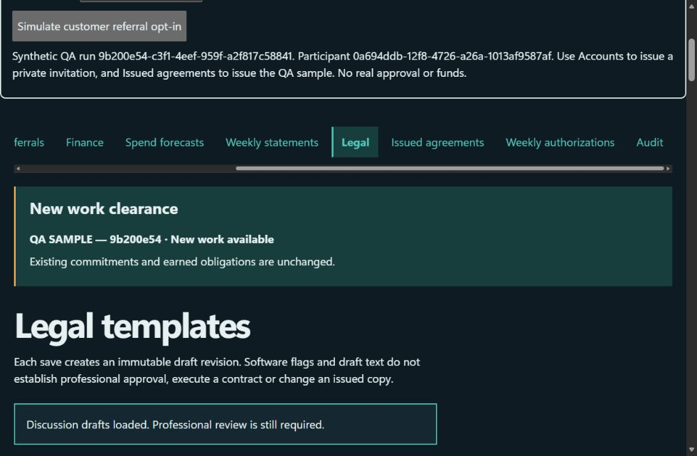
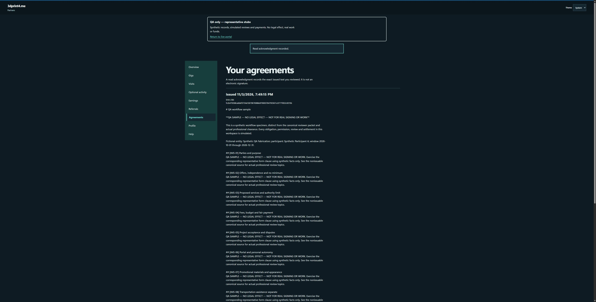
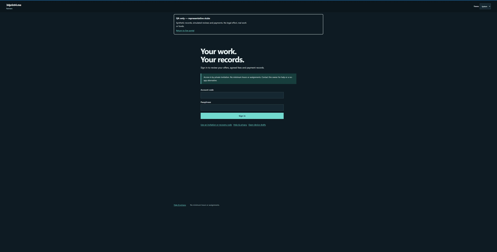

# Partner QA and representative forms

**Representative stubs remain unreviewed. QA does not authorize real work, consent, legal execution or payment.**

## Entry points

- Owner: [QA workspace](https://work.3dprint4.me/partners/qa), using the existing real GitHub owner login.
- Participant: [QA portal](https://partners.3dprint4.me/qa); invitation redemption is at `/qa/join`.
- Live owner and partner workspaces stay separate. Check the persistent **QA only — representative stubs** banner before every test action.

Hosted QA is deployed and smoke-tested as recorded below. Real program activation remains off pending actual version-bound attorney/CPA approval.

## Forms

[All fifteen representative forms](forms/README.md) include editable canonical sources, purpose, typed fields, fictional completed examples, unresolved professional decisions and corresponding operations. They seed additively and remain nonissuable. Owner edits survive repeat seeding. Existing private Markdown/DOCX review packages remain the professional review handoff; do not publish completed legal packages or personal information.

The separate QA workflow specimen exercises issuance and exact read acknowledgment. Its own hash and **QA SAMPLE — NO LEGAL EFFECT — NOT FOR REAL SIGNING OR WORK** notice distinguish it from canonical discussion drafts. Simulated reviewers and settlements are not real evidence. Read acknowledgment is not an electronic signature.

## Run the complete production-portal QA journey

1. Sign into the work inbox normally, open Partners, then **Open QA workspace**. Confirm the banner and return-to-live link. Unauthenticated or nonowner actors must be denied.
2. Choose **Create synthetic QA run**. Save its run/program/participant references privately. This creates a synthetic program, separate workflow sample and explicitly simulated review records in the isolated QA store. The real program flags and business records remain unchanged.
3. In QA Legal, seed the fifteen canonical forms. Open their clauses, compare a revision, export a private review package if needed, and confirm canonical discussion drafts cannot be issued. QA reviewer grants/names must start `SIMULATED`; actual professional decisions belong in the live review workflow after real review.
4. In QA Accounts, perform the identity-check acknowledgment and issue the participant a private single-use enrollment code. Open `/qa/join` separately and redeem it with a test passphrase. Never put codes in URLs, docs, screenshots or bug reports. Account recovery/revocation uses the usual guarded workflow in QA only.
5. Issue the separate QA workflow specimen with fictional typed bindings, then open QA Agreements as the participant. Inspect the exact text/hash and record its read acknowledgment. A later source version requires a new issue and acknowledgment; the previous frozen text must remain available.
6. Create/publish a QA campaign, offer it, and review/decline/counterpropose/accept as the participant. Verify exact accepted terms and one authorization reservation. The $200 default, $400 hard maximum, Central Monday boundaries and December 31, 2026 cutoff remain real software constraints in QA too.
7. Record ten distinct permitted synthetic business visits. Business-only visits create no contact record. For consent cases, use a fictional project purpose and exact consent text/version; use only `.invalid` email addresses and the fixed synthetic phone `+12025550100`. Test no-consent rejection, correction with renewed permission, withdrawal and deletion. Never contact a real business.
8. If the accepted offer has a sale bonus, copy its QA referral ID into **Simulate customer referral opt-in**. Use the resulting synthetic request ID and consent receipt time in Referrals. Simulate attribution, independent settlement/refund review and the original frozen bonus criteria. Settlement references must start `QA-SIMULATED-`. Verify one award under replay and no change to accepted bonus terms.
9. Optionally start/pause/resume/stop/delete an activity record. Never require a timer, location or attendance to submit work. Record supplied/returned materials separately without compensation deductions or gift repayment.
10. Submit the work, review objective criteria, request a correction if appropriate, approve and make it payable. A submission, approval, payable and settled payment are separate states. Test safety/cancellation/dispute requests without erasing earned obligations.
11. Record only simulated partial settlement, reversal and evidenced adjustments. Inspect earnings, funding forecasts, accounting exports and immutable weekly statements. QA CSV/JSON exports and downloaded filenames identify simulation; bytes/hashes remain verified. No real transfer or provider import occurs. Do not paste bank details or actual payment evidence.
12. Prepare a business-only offline draft, disconnect, close/reopen a QA page, and reconnect. Explicitly replay with the original command identity after a lost committed response; verify one server result. Open a live tab on the same origin and confirm QA drafts, cookies, CSRF, broadcasts and caches cannot cross realms.
13. Choose the QA program and **Retire selected QA run**. It disables that synthetic program and revokes its accounts/sessions; evidence and history remain. Create a fresh run for the next pass. Retirement is not deletion and does not erase any real or simulated obligation.

Never enter SSN/TIN, completed W-9s, banking details, real customers or real reviewer decisions. QA blocks real email/phone channels and unmarked settlement/reviewer inputs; fictional names and free-text remain the tester's responsibility. External delivery/payment adapters are absent and QA jobs process only their own statements/retention, not notifications.

## BDD coverage and evidence

[Gherkin features](features/) and the flow pages below map every collected native acceptance case, including parameterized variants. Each page has actor/prerequisites, synthetic inputs, actions, exact assertions, retry/cleanup behavior and linked screenshots. The maintained Python scenarios are executable automation; Gherkin is the readable contract, not a second independent step-runner.

Three evidence classes remain explicit: mocked UI fixtures for presentation; native real-browser/API/PostgreSQL fixtures for behavior; separately recorded hosted production-portal observations. A final-state screenshot substantiates only its pictured checkpoint, not all earlier steps. Nonvisual permission/concurrency checks rely on assertions rather than invented images. Reports distinguish passed, failed, blocked and not-run.

To reproduce from this worktree in PowerShell:

```powershell
# On Windows, let Node child processes use the same Python as the active shell.
$qaPythonDirectory = Split-Path (python -c 'import sys; print(sys.executable)')
$env:Path = $qaPythonDirectory + ';' + $env:Path
python scripts/build-partner-qa-docs.py
$env:PARTNER_QA_EVIDENCE_RUN = 'native-' + (Get-Date -Format 'yyyyMMdd-HHmmss')
npm run test:partner:browser -- --junitxml=.superpowers/partner-qa-results.xml
python scripts/finalize-partner-qa-evidence.py --junit .superpowers/partner-qa-results.xml --run $env:PARTNER_QA_EVIDENCE_RUN
npm run validate:partner:qa
Remove-Item Env:PARTNER_QA_EVIDENCE_RUN
```

Screenshots live in `screenshots/`, with source/run/environment/viewport/theme/checksum records in `evidence/`. Input fields, revealable access codes and secret-bearing controls are masked before capture. The validator rejects broken mappings/images, changed checksums, stale source fingerprints, unknown steps and secret markers. Run IDs must be unique. Session-start and session-end records bind the captured source commit/fingerprint, actual pytest cases and JUnit checksum. The finalizer rejects missing provenance, modified artifacts or source changes during the run, including edits to canonical form Markdown. Source commits may precede the documentation commit; source fingerprints must still match the actual runtime/test sources.

Final native run `portal-polish-20261103-final-03` passed **60 / 60 scenarios**, with **142 redacted screenshots**. The [run summary](evidence/run-summary.json) and [run provenance](evidence/runs/portal-polish-20261103-final-03.end.json) bind source `a72c529d88700d40e6d4dadb2f7e553c97050899`, the unchanged runtime fingerprint, actual cases and JUnit checksum. Documentation validation passed all 60 mappings and 142 image records. The full project check passed **1,277 unit tests, 408 E2E tests (one existing Windows skip), and 241 UX checks**. The 168-image preview board was regenerated and visually inspected. See the [current UI release and hosted evidence](../portal-polish/README.md).

## Scenario index

- [QA-001: auth initial enrollment without github has private host cookie](flows/QA-001.md)
- [QA-002: auth invitation replay from another browser is denied](flows/QA-002.md)
- [QA-003: auth revocation interrupts live profile mutation](flows/QA-003.md)
- [QA-004: auth other earnings and existing owner work api deny partner credentials](flows/QA-004.md)
- [QA-005: auth disabled environment blocks redemption without consuming invite](flows/QA-005.md)
- [QA-006: budget commit within cap](flows/QA-006.md)
- [QA-007: budget parallel acceptances do not oversubscribe](flows/QA-007.md)
- [QA-008: budget acceptance uses deterministic central monday[2026-10-26T04:59:00Z-2026-10-19]](flows/QA-008.md)
- [QA-009: budget acceptance uses deterministic central monday[2026-10-26T05:01:00Z-2026-10-26]](flows/QA-009.md)
- [QA-010: budget acceptance uses deterministic central monday[2026-11-02T05:59:00Z-2026-10-26]](flows/QA-010.md)
- [QA-011: budget acceptance uses deterministic central monday[2026-11-02T06:01:00Z-2026-11-02]](flows/QA-011.md)
- [QA-012: budget reduced cap preserves earned obligations](flows/QA-012.md)
- [QA-013: budget sunset blocks new acceptance preserves review and payment](flows/QA-013.md)
- [QA-014: business visit creates no personal contact or followup queue](flows/QA-014.md)
- [QA-015: explicit project permission records exact consent version before owner review](flows/QA-015.md)
- [QA-016: unconsented email is rejected without contact audit or notification side effects](flows/QA-016.md)
- [QA-017: withdrawn permission suppresses owner contact and cannot be requalified](flows/QA-017.md)
- [QA-018: qualified lead bonus survives different device duplicate evidence once](flows/QA-018.md)
- [QA-019: original twenty dollar sale bonus survives new ten dollar policy](flows/QA-019.md)
- [QA-020: forecasts replace fee and bonus reserves preserve week and show unfunded debt](flows/QA-020.md)
- [QA-021: forecast earned bonus is counted once and incomplete evidence fails safely](flows/QA-021.md)
- [QA-022: gig accept ten unique visits submit and owner review without attendance](flows/QA-022.md)
- [QA-023: gig decline has no obligation or penalty and future offer can be accepted](flows/QA-023.md)
- [QA-024: gig unsafe report reaches owner without location tracking or retaliation](flows/QA-024.md)
- [QA-025: gig offline visit and work submission retry after committed lost responses](flows/QA-025.md)
- [QA-026: separate personal gift is absent from partner statement and contractor exports](flows/QA-026.md)
- [QA-027: unconfigured invoice ninja preserves durable payable and manual csv without customer invoice](flows/QA-027.md)
- [QA-028: review package excludes unrelated private records and denies anonymous download](flows/QA-028.md)
- [QA-029: unreviewed issuance returns exact missing classification and language gates](flows/QA-029.md)
- [QA-030: version b requires independent reviews new issue and new ack without changing a](flows/QA-030.md)
- [QA-031: owner records materials with durable retry and partner private history](flows/QA-031.md)
- [QA-032: large material history is explicitly partial and keeps newest records](flows/QA-032.md)
- [QA-033: partner browser cookie csrf idor and logout](flows/QA-033.md)
- [QA-034: partner fixture removes its container after child crash](flows/QA-034.md)
- [QA-035: business visits and specific contact permission persist privately](flows/QA-035.md)
- [QA-036: browser replays 100 device drafts after lost committed response](flows/QA-036.md)
- [QA-037: expired visit session hides the private form](flows/QA-037.md)
- [QA-038: partner counterproposal persists without accepting or changing fee](flows/QA-038.md)
- [QA-039: customer referral request records permission without creating a bonus](flows/QA-039.md)
- [QA-040: owner console uses github binding and preserves obligations while paused](flows/QA-040.md)
- [QA-041: owner referral conversion requires settlement and awards once](flows/QA-041.md)
- [QA-042: owner lead review correction and withdrawal update live permission](flows/QA-042.md)
- [QA-043: owner finance preserves payment evidence and durable csv after lost response](flows/QA-043.md)
- [QA-044: owner legal editor preserves versions comments and conflicting draft](flows/QA-044.md)
- [QA-045: owner professional package decisions and returned feedback](flows/QA-045.md)
- [QA-046: owner scoped bindings typed issue ack and immutable history](flows/QA-046.md)
- [QA-047: prepared visit survives offline cold reopen and manual replay](flows/QA-047.md)
- [QA-048: late login cookie after other tab logout is revoked](flows/QA-048.md)
- [QA-049: optional activity partner can track and delete own elapsed record](flows/QA-049.md)
- [QA-050: optional activity work submission never requires a timer](flows/QA-050.md)
- [QA-051: optional activity gig and visit screens never request geolocation](flows/QA-051.md)
- [QA-052: http read results match published api schemas](flows/QA-052.md)
- [QA-053: only owner can publish forty dollar campaign and partner sees frozen offer](flows/QA-053.md)
- [QA-054: owner suspension ends routes but preserves payable for lawful settlement](flows/QA-054.md)
- [QA-055: program pause denies unaccepted work without erasing prior debt](flows/QA-055.md)
- [QA-056: existing private work inbox updates while storefront and status routes stay separate](flows/QA-056.md)
- [QA-057: shell port reservations are distinct and exclude other binds until released](flows/QA-057.md)
- [QA-058: workspace harness allocates distinct ports even when legacy probe reuses one](flows/QA-058.md)
- [QA-060: qa isolated lifecycle and canonical stub denial](flows/QA-060.md)
- [QA-059: owner schedules weekly statements and partners download only their immutable balances](flows/QA-059.md)

## Hosted verification

Verified November 3, 2026 on the existing production domains. Backend release `33271f1cf2fac1423f466e4f0b0057e3bccfc2e0`, immutable API image `sha256:0ec98dfdcb75c0c87cc6f78ed64658f9e493a362c748f25e485770a383b88a96`. Owner deployment `3dprint4me-operator-ebtewn3od`; participant deployment `3dprint4me-partners-m046ub5eq`. The later frontend routing source is commit `513a2b3`; subsequent evidence-tooling commits do not change deployed runtime bytes.

Actual GitHub owner sign-in opened the QA realm and created a synthetic run. All fifteen canonical forms seeded as drafts; the issuance picker offered only the separate published QA specimen. A synthetic participant redeemed a privately handed-off invitation, viewed the frozen fictional agreement and recorded read acknowledgment. Retiring that run preserved history and forced the participant back to sign-in. QA PostgreSQL and the QA-only maintenance worker were running in their separate Compose project. HTTPS anonymous session requests returned 401; allowed-origin and untrusted-origin CORS checks passed.

Live aggregate program/account/professional-review counts remained **0 / 0 / 0**. Real program, classification and accounting flags remained **0 / 0 / 0**; only `PARTNER_QA_ENABLED=1` was enabled. No actual professional approval, real work, payment or outreach was created. The hosted run is retired; choose **Create synthetic QA run** for a fresh test.

[Hosted observation record](hosted/observations.json) includes deployment identities and image checksums. This is a hosted smoke, not a claim that all adversarial native cases were rerun against production.







## Operational boundary

`deploy/platform/compose.partner-qa.yml` runs a separate private PostgreSQL cluster and QA-only maintenance service. The API uses fixed QA routes, a dedicated business credential and a restricted auth-only credential. The real owner/session/binding locks cover QA operations; no live business transaction is opened by QA commands. Secrets stay in host-private configuration. Canonical stubs and actual approvals remain separate from simulation.

See [deployment notes](../PARTNER-DEPLOYMENT.md) and the [approved design](../superpowers/specs/2026-11-03-partner-forms-live-qa-design.md). Before changing QA configuration, run preflight against explicit cluster/database identities. Preserve synthetic snapshots privately before upgrades. Recreate QA from the scenario commands when a synthetic fixture is no longer useful; never restore customer data into QA.

## November 4 workspace release verification

The complete native suite passed all 60 cases on source `b4e76ab922fb428907868f22b692b5627a75ce95`. Run `workspace-release-20261104-01` binds the exact source fingerprint, actual JUnit outcomes and 142 newly captured redacted desktop/mobile screenshots. All evidence mappings, screenshots, checksums and provenance validate. The full contact sheet was visually inspected. This replaces the earlier UI captures with current grouped navigation and task disclosures; earlier revisions remain in Git history.

Production owner and participant shells now serve committed runtime source `6023204ad1ef65def0338088ce3fffaf920f206f`; the later test commit changes no runtime bytes. Owner deployment is `3dprint4me-operator-1l7q45t59`; participant deployment is `3dprint4me-partners-8eqke2r52`. All 98 public static files match the committed archive. The guarded backend deployment passed its checkpoint, schema, privilege, overlap, worker and disabled-feature checks. Real owner navigation and phone keyboard/focus checks pass; live program/account counts remain zero and no real professional approvals were created.
