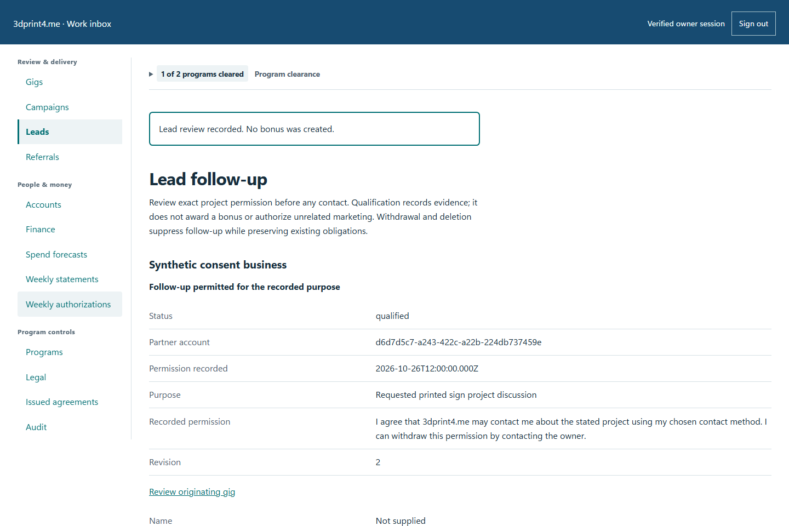
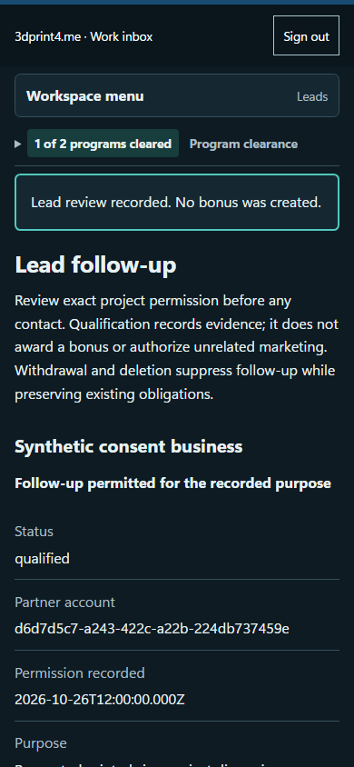

# QA-015: explicit project permission records exact consent version before owner review

Status: **passed**. Environment: native disposable browser/API/PostgreSQL fixture; hosted observations are separate.

Automation: `tests/integration/test_partner_consent_referral_browser.py::test_native_explicit_project_permission_records_exact_consent_version_before_owner_review`. [Maintained native source](../../../tests/integration/test_partner_consent_referral_browser.py). [Gherkin](../features/consent_referral.feature).

**Actor:** Owner and/or scoped partner as specified in each step

**Prerequisites:** Disposable PostgreSQL fixture and real browser HTTP boundaries; synthetic review evidence only. Production-portal QA uses the isolated QA realm.

**Inputs:** Fictional fixture businesses/participants and bounded amounts from the linked native test. No real work, consent or funds.

## Given / When

Nonvisual infrastructure/API case; use assertions and run result, not a fabricated UI image.

## Then: exact observable and persisted checks

- `lead['status'] == 'needs_review' and lead['followUpAllowed'] is False`
- `lead['purpose'] == 'Requested printed sign project discussion'`
- `lead['contact'] == {'email': 'consenting-project@example.test', 'preferredContact': 'email'}`
- `evidence['consent']['version'] == 'follow-up-permission-v1'`
- `evidence['consent']['consentText'] == lead['consentText']`
- `evidence['consent']['purpose'] == lead['purpose'] and evidence['consent']['sourceVisitId'] == lead['visitId']`
- `evidence['audit']['consentVersion'] == 'follow-up-permission-v1'`
- `qualification['followUpAllowed'] is True`
- `not [a for a in w['read']('referrals')['awards'] if a['referralId'] == ref['id']]`
- `w['fixture']['outboundAttempts']() == 0`

**Retry/failure behavior:** Use the same command identity for uncertain committed responses; other tests assert explicit conflict/replay behavior as named. Never automatically replay into another realm.

**Cleanup:** Context managers close browsers and remove disposable containers; hosted QA retires only the selected run and preserves history.

## Screenshot evidence

**final-1, 1440 px light; native run workspace-release-20261104-04.** Observed rendered state after the documented step; not evidence for unpictured earlier actions.

**final-1, 390 px dark; native run workspace-release-20261104-04.** Observed rendered state after the documented step; not evidence for unpictured earlier actions.

