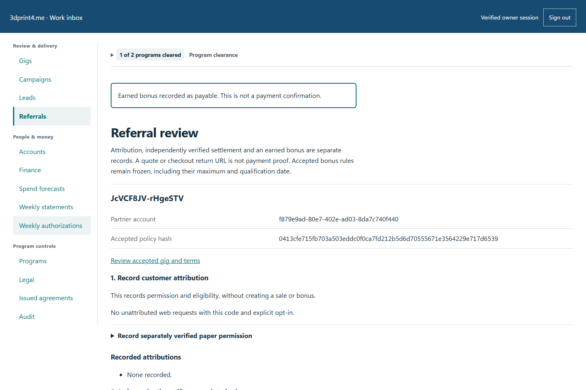
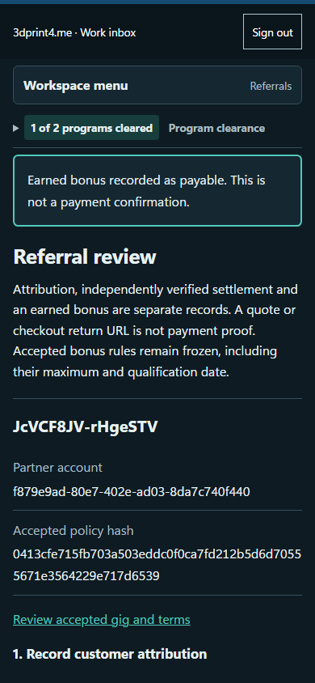

# QA-018: qualified lead bonus survives different device duplicate evidence once

Status: **passed**. Environment: native disposable browser/API/PostgreSQL fixture; hosted observations are separate.

Automation: `tests/integration/test_partner_consent_referral_browser.py::test_native_qualified_lead_bonus_survives_different_device_duplicate_evidence_once`. [Maintained native source](../../../tests/integration/test_partner_consent_referral_browser.py). [Gherkin](../features/consent_referral.feature).

**Actor:** Owner and/or scoped partner as specified in each step

**Prerequisites:** Disposable PostgreSQL fixture and real browser HTTP boundaries; synthetic review evidence only. Production-portal QA uses the isolated QA realm.

**Inputs:** Fictional fixture businesses/participants and bounded amounts from the linked native test. No real work, consent or funds.

## Given / When

- **action-01:** Open w['fixture']['ownerOrigin'] + '/partners#referrals'
- **action-02:** Select Qualification evidence qualification['id']
- **action-03:** Confirm The frozen qualification criteria and deadline are met.
- **action-04:** Confirm I reviewed self-referral, duplicate and collusion checks.
- **action-05:** Activate Award accepted bonus
- **action-06:** Open w['origin']
- **action-07:** Enter Account code w['accounts'][0]['id']
- **action-08:** Enter Passphrase 'Synthetic budget partner private passphrase'
- **action-09:** Activate Sign in

## Then: exact observable and persisted checks

- `replay['status'] == 200 and replay['body']['amountCents'] == 1000`
- `evidence == {'visits': 1, 'leads': 1, 'awards': 1, 'payables': 1}`
- `own(w, 'earnings')['totals']['paidCents'] == 0 and w['fixture']['outboundAttempts']() == 0`
- `result['status'] == 409 and result['body']['error'] == 'This business visit is already recorded.'`
- `result['status'] == 409 and result['body']['error'] == 'This follow-up contact is already recorded. Ask the owner to review the existing contact.'`

**Retry/failure behavior:** Use the same command identity for uncertain committed responses; other tests assert explicit conflict/replay behavior as named. Never automatically replay into another realm.

**Cleanup:** Context managers close browsers and remove disposable containers; hosted QA retires only the selected run and preserves history.

## Screenshot evidence

**final-1, 1440 px light; native run workspace-release-20261104-05.** Observed rendered state after the documented step; not evidence for unpictured earlier actions.

**final-1, 390 px dark; native run workspace-release-20261104-05.** Observed rendered state after the documented step; not evidence for unpictured earlier actions.

