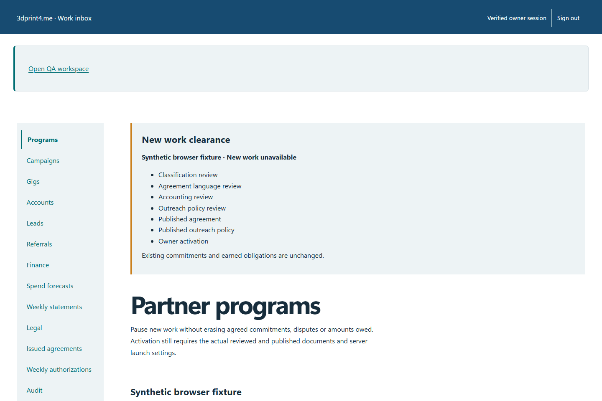

# QA-019: original twenty dollar sale bonus survives new ten dollar policy

Status: **passed**. Environment: native disposable browser/API/PostgreSQL fixture; hosted observations are separate.

Automation: `tests/integration/test_partner_consent_referral_browser.py::test_native_original_twenty_dollar_sale_bonus_survives_new_ten_dollar_policy`. [Maintained native source](../../../tests/integration/test_partner_consent_referral_browser.py). [Gherkin](../features/consent_referral.feature).

**Actor:** Owner and/or scoped partner as specified in each step

**Prerequisites:** Disposable PostgreSQL fixture and real browser HTTP boundaries; synthetic review evidence only. Production-portal QA uses the isolated QA realm.

**Inputs:** Fictional fixture businesses/participants and bounded amounts from the linked native test. No real work, consent or funds.

## Given / When

- **action-01:** Open w['origin'] + '/referrals'
- **action-02:** Reload the current page and revalidate its session

## Then: exact observable and persisted checks

- `'$20.00 per award' in old_card.inner_text() and '$10.00 per award' in new_card.inner_text()`
- `code == 201`
- `code == 200`
- `receipt['code'] == old_ref['code']`
- `not [r for r in data['awards'] if r['referralId'] in [old_ref['id'], new_ref['id']]]`
- `not [r for r in data['attributions'] if r['requestId'] == request_id]`
- `award['amountCents'] == 2000`
- `retained['policyHash'] == old_ref['policyHash'] and retained['bonusRules'][0]['amountCents'] == 2000`
- `next((r for r in data['items'] if r['id'] == new_ref['id']))['bonusRules'][0]['amountCents'] == 1000`
- `len(earned) == 1 and earned[0]['referralId'] == old_ref['id'] and (earned[0]['amountCents'] == 2000)`
- `own(w, 'earnings')['totals']['earnedBonusCents'] == 2000 and own(w, 'earnings')['totals']['paidCents'] == 0`
- `w['fixture']['outboundAttempts']() == 0`

**Retry/failure behavior:** Use the same command identity for uncertain committed responses; other tests assert explicit conflict/replay behavior as named. Never automatically replay into another realm.

**Cleanup:** Context managers close browsers and remove disposable containers; hosted QA retires only the selected run and preserves history.

## Screenshot evidence

**final-1, 1440 px light; native run portal-polish-20261103-final-03.** Observed rendered state after the documented step; not evidence for unpictured earlier actions.

**final-1, 390 px dark; native run portal-polish-20261103-final-03.** Observed rendered state after the documented step; not evidence for unpictured earlier actions.

