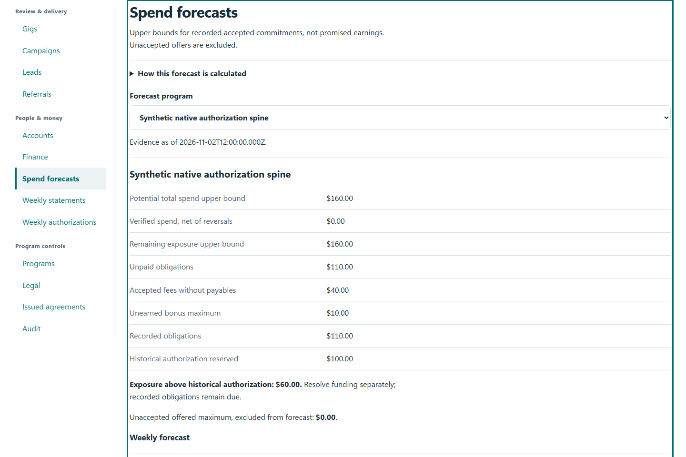
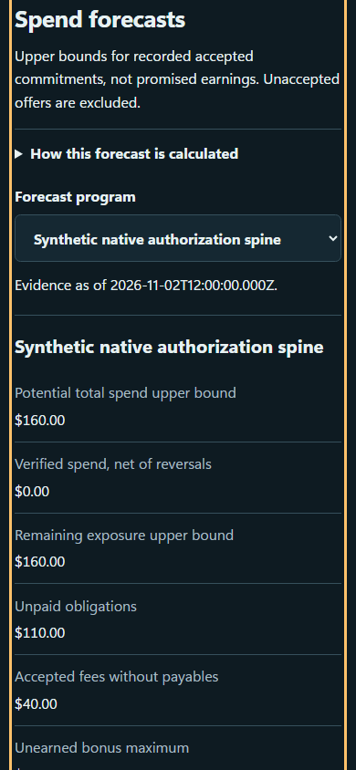

# QA-020: forecasts replace fee and bonus reserves preserve week and show unfunded debt

Status: **not-run**. Environment: native disposable browser/API/PostgreSQL fixture; hosted observations are separate.

Automation: `tests/integration/test_partner_forecast_browser.py::test_native_forecasts_replace_fee_and_bonus_reserves_preserve_week_and_show_unfunded_debt`. [Maintained native source](../../../tests/integration/test_partner_forecast_browser.py). [Gherkin](../features/forecast.feature).

**Actor:** Owner and/or scoped partner as specified in each step

**Prerequisites:** Disposable PostgreSQL fixture and real browser HTTP boundaries; synthetic review evidence only. Production-portal QA uses the isolated QA realm.

**Inputs:** Fictional fixture businesses/participants and bounded amounts from the linked native test. No real work, consent or funds.

## Given / When

- **action-01:** Open w['origin']
- **action-02:** Enter Account code w['accounts'][0]['id']
- **action-03:** Enter Passphrase 'Synthetic budget partner private passphrase'
- **action-04:** Activate Sign in
- **action-05:** Open w['fixture']['ownerOrigin'] + '/partners#forecasts/' + w['programId']

## Then: exact observable and persisted checks

- `result['status'] == 200`
- `row['pendingFeeCents'] == 5000 and row['contingentBonusCents'] == 1000 and (row['potentialTotalCents'] == 6000)`
- `row['pendingFeeCents'] == 0 and row['paidCents'] == 2000 and (row['remainingExposureCents'] == 4000) and (row['potentialTotalCents'] == 6000)`
- `row['potentialTotalCents'] == 12000 and row['unfundedExposureCents'] == 6000`
- `row['weeks'][0]['capCents'] == 1000 and row['weeks'][0]['potentialTotalCents'] == 12000`
- `row['paidCents'] == 0 and row['potentialTotalCents'] == 16000`
- `weeks['2026-10-26']['potentialTotalCents'] == 12000 and weeks['2026-11-02']['potentialTotalCents'] == 4000`
- `'Exposure above historical authorization: $60.00' in owner.locator('main').inner_text()`
- `owner.evaluate('document.documentElement.scrollWidth<=innerWidth')`
- `denied.status == 401 and w['programId'] not in denied.text()`
- `forecast(w)['status'] == 200`

**Retry/failure behavior:** Use the same command identity for uncertain committed responses; other tests assert explicit conflict/replay behavior as named. Never automatically replay into another realm.

**Cleanup:** Context managers close browsers and remove disposable containers; hosted QA retires only the selected run and preserves history.

## Screenshot evidence

**final-1, 1440 px light; native run native-20261103.** Observed rendered state after the documented step; not evidence for unpictured earlier actions.

**final-1, 390 px dark; native run native-20261103.** Observed rendered state after the documented step; not evidence for unpictured earlier actions.

