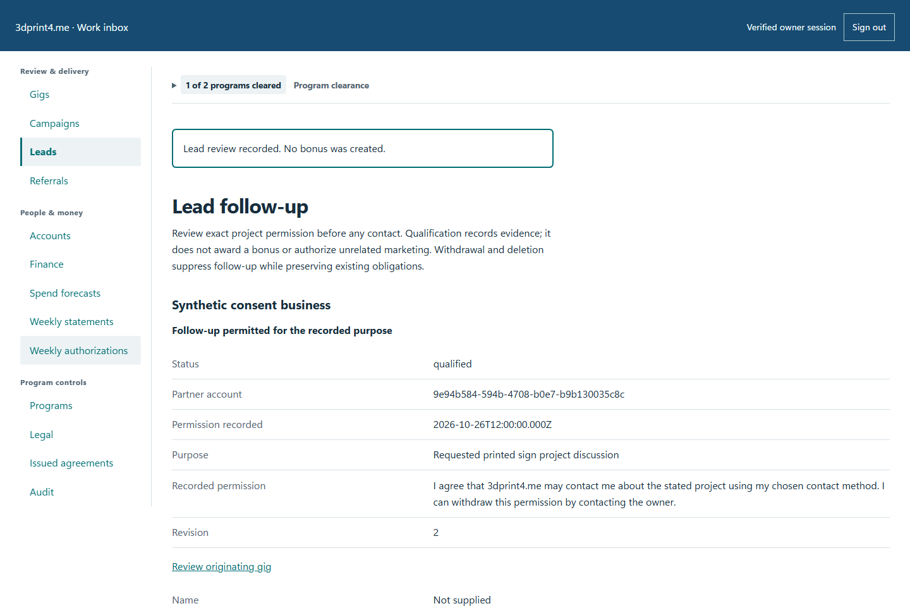
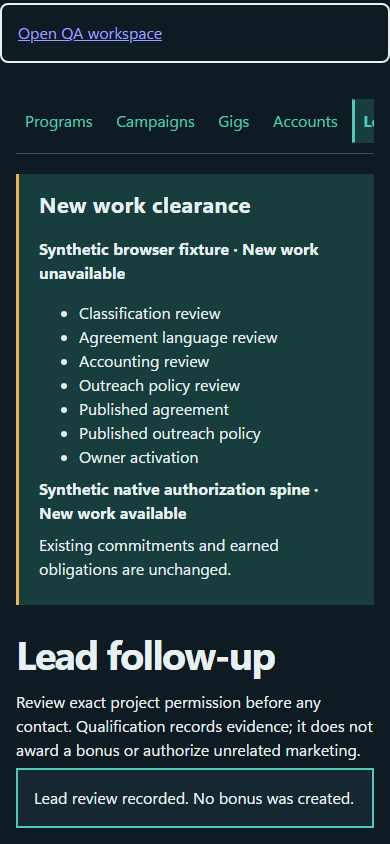

# QA-021: forecast earned bonus is counted once and incomplete evidence fails safely

Status: **not-run**. Environment: native disposable browser/API/PostgreSQL fixture; hosted observations are separate.

Automation: `tests/integration/test_partner_forecast_browser.py::test_native_forecast_earned_bonus_is_counted_once_and_incomplete_evidence_fails_safely`. [Maintained native source](../../../tests/integration/test_partner_forecast_browser.py). [Gherkin](../features/forecast.feature).

**Actor:** Owner and/or scoped partner as specified in each step

**Prerequisites:** Disposable PostgreSQL fixture and real browser HTTP boundaries; synthetic review evidence only. Production-portal QA uses the isolated QA realm.

**Inputs:** Fictional fixture businesses/participants and bounded amounts from the linked native test. No real work, consent or funds.

## Given / When

Nonvisual infrastructure/API case; use assertions and run result, not a fabricated UI image.

## Then: exact observable and persisted checks

- `row['pendingFeeCents'] == 5000 and row['contingentBonusCents'] == 0 and (row['outstandingCents'] == 1000) and (row['potentialTotalCents'] == 6000)`
- `result['status'] == 503 and result['body']['error'] == 'The partner service is temporarily unavailable. Please try again later.'`
- `'reservation' not in json.dumps(result['body']).lower()`

**Retry/failure behavior:** Use the same command identity for uncertain committed responses; other tests assert explicit conflict/replay behavior as named. Never automatically replay into another realm.

**Cleanup:** Context managers close browsers and remove disposable containers; hosted QA retires only the selected run and preserves history.

## Screenshot evidence

**final-1, 1440 px light; native run native-20261103.** Observed rendered state after the documented step; not evidence for unpictured earlier actions.

**final-1, 390 px dark; native run native-20261103.** Observed rendered state after the documented step; not evidence for unpictured earlier actions.

