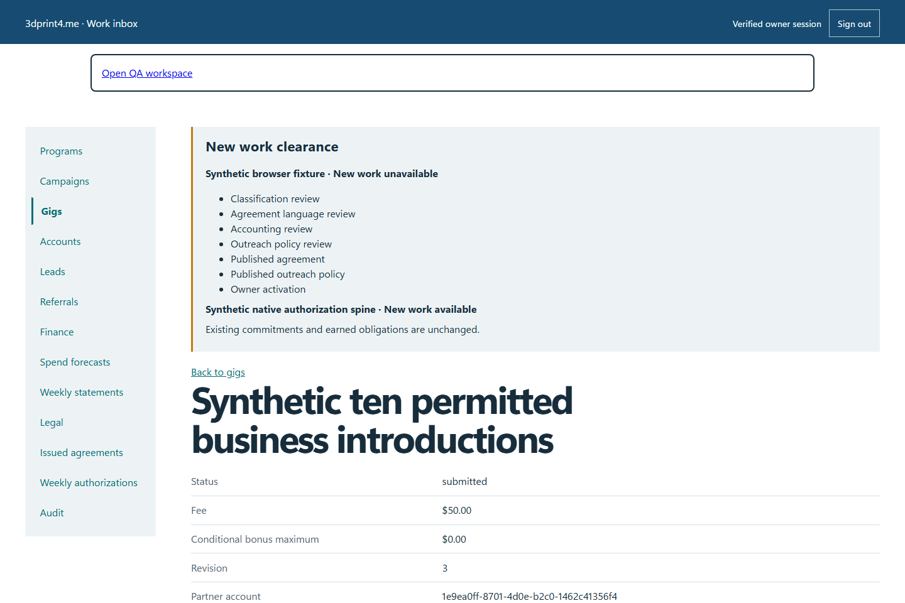
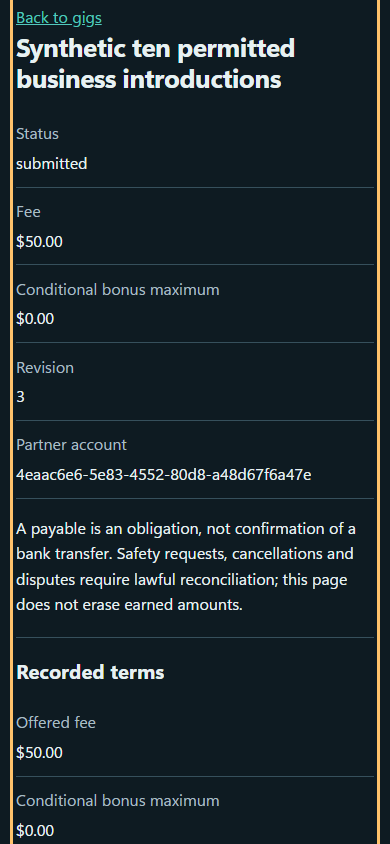

# QA-022: gig accept ten unique visits submit and owner review without attendance

Status: **not-run**. Environment: native disposable browser/API/PostgreSQL fixture; hosted observations are separate.

Automation: `tests/integration/test_partner_gig_browser.py::test_native_gig_accept_ten_unique_visits_submit_and_owner_review_without_attendance`. [Maintained native source](../../../tests/integration/test_partner_gig_browser.py). [Gherkin](../features/gig.feature).

**Actor:** Owner and/or scoped partner as specified in each step

**Prerequisites:** Disposable PostgreSQL fixture and real browser HTTP boundaries; synthetic review evidence only. Production-portal QA uses the isolated QA realm.

**Inputs:** Fictional fixture businesses/participants and bounded amounts from the linked native test. No real work, consent or funds.

## Given / When

- **action-01:** Open w['origin'] + '/gigs/' + gig['id']
- **action-02:** Open w['origin'] + '/visits/new?gig=' + gig['id']
- **action-03:** Enter Business name 'Synthetic permitted business ' + str(number)
- **action-04:** Enter Visit time instant
- **action-05:** Select Outcome 'accepted_material'
- **action-06:** Select Permission to leave materials 'permission_received'
- **action-07:** Enter Samples left '1'
- **action-08:** Activate Submit visit

## Then: exact observable and persisted checks

- `'$50.00 offered fee' in text and 'ten unique allowed business visits' in text`
- `all((word not in text.lower() for word in ['clock-in', 'uniform', 'required hours']))`
- `reservations(w) == {'count': 0, 'total': 0}`
- `reservations(w) == {'count': 1, 'total': 5000}`
- `len(visits) == 10 and len({r['business_name'] for r in visits}) == 10`
- `own(w, 'leads')['items'] == [] and own(w, 'activity')['items'] == []`
- `item['status'] == 'submitted' and item['terms'] == terms`
- `owner.get_by_role('combobox', name='Review action', exact=True).input_value() == 'approve'`
- `'Ten permitted unique business visits completed' in owner.locator('main').inner_text()`
- `earnings['totals']['submittedCents'] == 5000 and earnings['totals']['paidCents'] == 0`
- `earnings['items'] == [] and reservations(w) == {'count': 1, 'total': 5000}`

**Retry/failure behavior:** Use the same command identity for uncertain committed responses; other tests assert explicit conflict/replay behavior as named. Never automatically replay into another realm.

**Cleanup:** Context managers close browsers and remove disposable containers; hosted QA retires only the selected run and preserves history.

## Screenshot evidence

**final-1, 1440 px light; native run native-20261103-final-04.** Observed rendered state after the documented step; not evidence for unpictured earlier actions.

**final-1, 390 px dark; native run native-20261103-final-04.** Observed rendered state after the documented step; not evidence for unpictured earlier actions.

