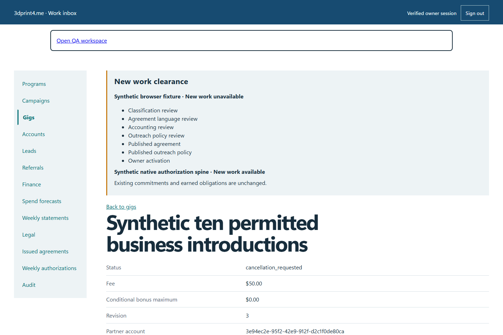
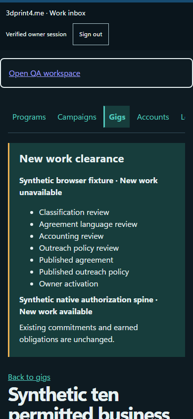

# QA-024: gig unsafe report reaches owner without location tracking or retaliation

Status: **passed**. Environment: native disposable browser/API/PostgreSQL fixture; hosted observations are separate.

Automation: `tests/integration/test_partner_gig_browser.py::test_native_gig_unsafe_report_reaches_owner_without_location_tracking_or_retaliation`. [Maintained native source](../../../tests/integration/test_partner_gig_browser.py). [Gherkin](../features/gig.feature).

**Actor:** Owner and/or scoped partner as specified in each step

**Prerequisites:** Disposable PostgreSQL fixture and real browser HTTP boundaries; synthetic review evidence only. Production-portal QA uses the isolated QA realm.

**Inputs:** Fictional fixture businesses/participants and bounded amounts from the linked native test. No real work, consent or funds.

## Given / When

Nonvisual infrastructure/API case; use assertions and run result, not a fabricated UI image.

## Then: exact observable and persisted checks

- `page.evaluate('window.__gpsRequests') == 0`
- `set(command['input']) == {'gigId', 'expectedRevision', 'reason'}`
- `data['item']['status'] == 'cancellation_requested'`
- `any((e['event_type'] == 'gig.report_unsafe' and e['reason'] == reason for e in data['events']))`
- `reason in owner_gig(w, gig).locator('main').inner_text()`
- `reservations(w) == {'count': 1, 'total': 5000}`
- `reservations(w) == {'count': 2, 'total': 10000}`
- `own(w, 'profile')['program']['newWorkAvailable'] is True`
- `own(w, 'earnings')['totals']['paidCents'] == 0`

**Retry/failure behavior:** Use the same command identity for uncertain committed responses; other tests assert explicit conflict/replay behavior as named. Never automatically replay into another realm.

**Cleanup:** Context managers close browsers and remove disposable containers; hosted QA retires only the selected run and preserves history.

## Screenshot evidence

**final-1, 1440 px light; native run native-20261103-final-05.** Observed rendered state after the documented step; not evidence for unpictured earlier actions.

**final-1, 390 px dark; native run native-20261103-final-05.** Observed rendered state after the documented step; not evidence for unpictured earlier actions.

