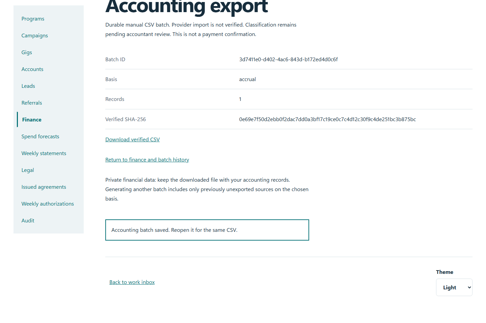
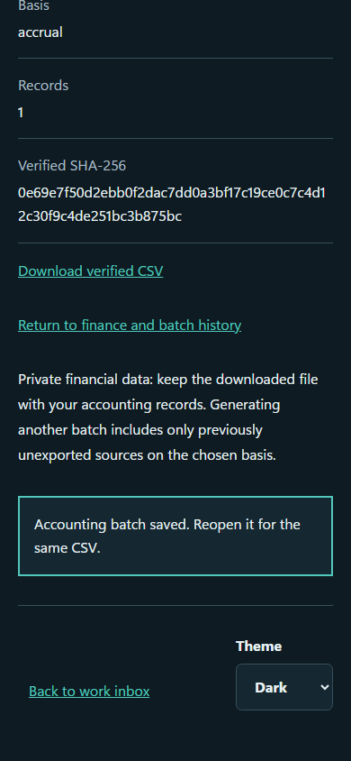

# QA-026: separate personal gift is absent from partner statement and contractor exports

Status: **passed**. Environment: native disposable browser/API/PostgreSQL fixture; hosted observations are separate.

Automation: `tests/integration/test_partner_ledger_browser.py::test_native_separate_personal_gift_is_absent_from_partner_statement_and_contractor_exports`. [Maintained native source](../../../tests/integration/test_partner_ledger_browser.py). [Gherkin](../features/ledger.feature).

**Actor:** Owner and/or scoped partner as specified in each step

**Prerequisites:** Disposable PostgreSQL fixture and real browser HTTP boundaries; synthetic review evidence only. Production-portal QA uses the isolated QA realm.

**Inputs:** Fictional fixture businesses/participants and bounded amounts from the linked native test. No real work, consent or funds.

## Given / When

- **action-01:** Open w['origin'] + '/earnings'
- **action-02:** Activate Download statement for 2026-11-02

## Then: exact observable and persisted checks

- `proof == {'amount': 20000, 'backendAccess': False}`
- `w['fixture']['runStatementJob']()['generated'] == 2`
- `len(rows) == 1 and rows[0]['record_id'] == payable['id']`
- `rows[0]['amount_due_cents'] == '5000' and rows[0]['paid_cents'] == '5000' and (rows[0]['outstanding_cents'] == '0')`
- `'BIKE-GIFT' not in statement`
- `database(w, "SELECT json_build_object('amount',sum(amount_cents),'count',count(*)) FROM synthetic_owner_books.personal_gifts") == {'amount': 20000, 'count': 1}`
- `w['fixture']['outboundAttempts']() == 0`
- `batch['recordCount'] == 1 and sum((int(r['amount_cents']) for r in rows)) == 5000`
- `all((r['partner_internal_id'] == partner and r['tax_reporting_class'] == 'review_required' for r in rows))`
- `'20000' not in batch['csv'] and 'BIKE-GIFT' not in batch['csv']`

**Retry/failure behavior:** Use the same command identity for uncertain committed responses; other tests assert explicit conflict/replay behavior as named. Never automatically replay into another realm.

**Cleanup:** Context managers close browsers and remove disposable containers; hosted QA retires only the selected run and preserves history.

## Screenshot evidence

**final-1, 1440 px light; native run portal-polish-20261103-final-03.** Observed rendered state after the documented step; not evidence for unpictured earlier actions.

**final-1, 390 px dark; native run portal-polish-20261103-final-03.** Observed rendered state after the documented step; not evidence for unpictured earlier actions.

