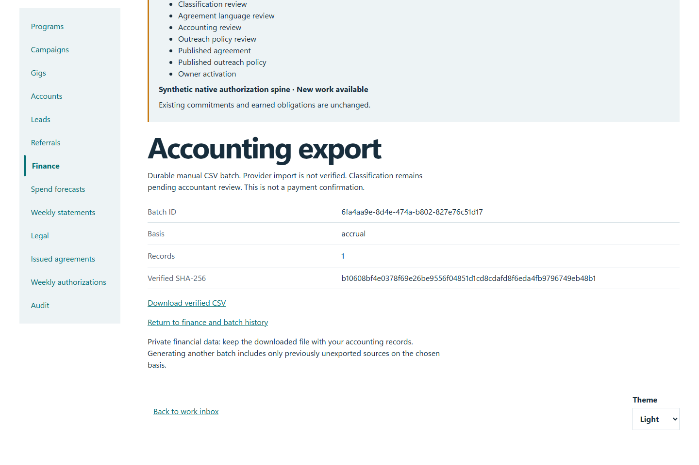
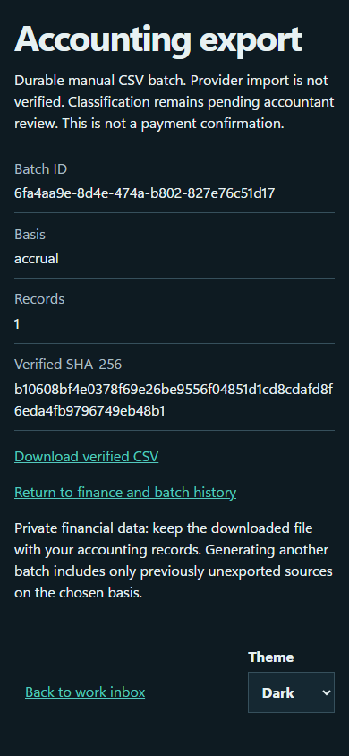

# QA-027: unconfigured invoice ninja preserves durable payable and manual csv without customer invoice

Status: **passed**. Environment: native disposable browser/API/PostgreSQL fixture; hosted observations are separate.

Automation: `tests/integration/test_partner_ledger_browser.py::test_native_unconfigured_invoice_ninja_preserves_durable_payable_and_manual_csv_without_customer_invoice`. [Maintained native source](../../../tests/integration/test_partner_ledger_browser.py). [Gherkin](../features/ledger.feature).

**Actor:** Owner and/or scoped partner as specified in each step

**Prerequisites:** Disposable PostgreSQL fixture and real browser HTTP boundaries; synthetic review evidence only. Production-portal QA uses the isolated QA realm.

**Inputs:** Fictional fixture businesses/participants and bounded amounts from the linked native test. No real work, consent or funds.

## Given / When

- **action-01:** Open w['origin'] + '/earnings'
- **action-02:** Reload the current page and revalidate its session
- **action-03:** Activate Download verified CSV

## Then: exact observable and persisted checks

- `w['fixture']['invoiceNinjaConfigured'] is False`
- `earnings['totals']['outstandingCents'] == 5000 and earnings['totals']['paidCents'] == 0`
- `next((p for p in earnings['items'] if p['id'] == payable['id']))['amountDueCents'] == 5000`
- `len(rows) == 1 and rows[0]['amount_cents'] == '5000' and (rows[0]['payment_status'] == 'not_a_payment')`
- `{key: reopened[key] for key in batch} == batch`
- `pending.value.path().read_bytes() == batch['csv'].encode('utf-8')`
- `next((p for p in w['read']('ledger')['items'] if p['id'] == payable['id'])) == payable`
- `database(w, "SELECT json_build_object('invoices',(SELECT count(*) FROM invoice_operations))") == before == {'invoices': 0}`
- `w['fixture']['outboundAttempts']() == 0`

**Retry/failure behavior:** Use the same command identity for uncertain committed responses; other tests assert explicit conflict/replay behavior as named. Never automatically replay into another realm.

**Cleanup:** Context managers close browsers and remove disposable containers; hosted QA retires only the selected run and preserves history.

## Screenshot evidence

**final-1, 1440 px light; native run native-20261103-final-05.** Observed rendered state after the documented step; not evidence for unpictured earlier actions.

**final-1, 390 px dark; native run native-20261103-final-05.** Observed rendered state after the documented step; not evidence for unpictured earlier actions.

