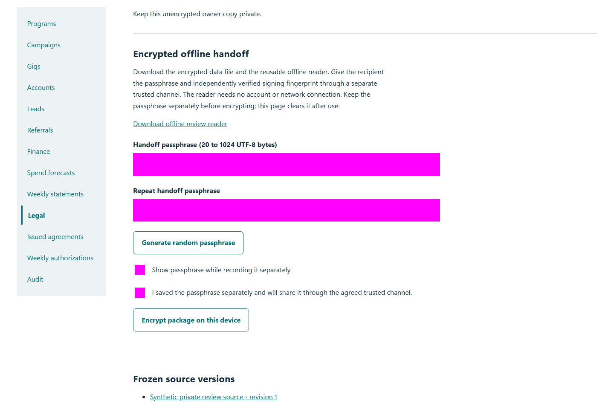
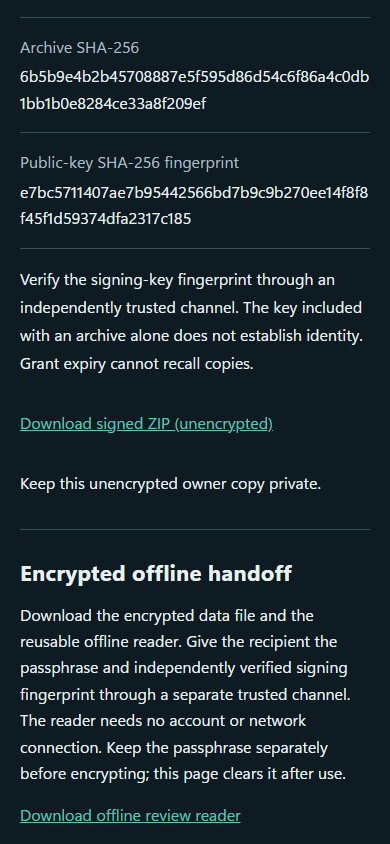

# QA-028: review package excludes unrelated private records and denies anonymous download

Status: **passed**. Environment: native disposable browser/API/PostgreSQL fixture; hosted observations are separate.

Automation: `tests/integration/test_partner_legal_acceptance_browser.py::test_native_review_package_excludes_unrelated_private_records_and_denies_anonymous_download`. [Maintained native source](../../../tests/integration/test_partner_legal_acceptance_browser.py). [Gherkin](../features/legal_acceptance.feature).

**Actor:** Owner and/or scoped partner as specified in each step

**Prerequisites:** Disposable PostgreSQL fixture and real browser HTTP boundaries; synthetic review evidence only. Production-portal QA uses the isolated QA realm.

**Inputs:** Fictional fixture businesses/participants and bounded amounts from the linked native test. No real work, consent or funds.

## Given / When

- **action-01:** Open w['fixture']['ownerOrigin'] + '/partners#legal/package/' + package['id']
- **action-02:** Activate Download signed ZIP (unencrypted)

## Then: exact observable and persisted checks

- `'private-customer@example.test' in json.dumps(private)`
- `hashlib.sha256(archive).hexdigest() == package['sha256']`
- `status == 401 and 'data' not in json.loads(body)`
- `archive not in body and package['sha256'].encode() not in body`
- `w['fixture']['outboundAttempts']() == 0`
- `manifest['redactionConfirmed'] is True and manifest['versions'] == [version['versionId']]`
- `any((n.endswith('.md') for n in z.namelist())) and any((n.endswith('.docx') for n in z.namelist()))`
- `'changes-from-prior-round.json' in z.namelist() and 'review-checklist.csv' in z.namelist()`
- `b'IMS-04' in z.read(next((n for n in z.namelist() if n.endswith('.md') and n.startswith('native-'))))`
- `hashlib.sha256(z.read(item['name'])).hexdigest() == item['sha256']`
- `b'private-customer@example.test' not in content`
- `b'Synthetic confidential project marker.' not in content`
- `all((account['displayName'].encode() not in content for account in w['accounts']))`

**Retry/failure behavior:** Use the same command identity for uncertain committed responses; other tests assert explicit conflict/replay behavior as named. Never automatically replay into another realm.

**Cleanup:** Context managers close browsers and remove disposable containers; hosted QA retires only the selected run and preserves history.

## Screenshot evidence

**final-1, 1440 px light; native run portal-polish-20261103-final-03.** Observed rendered state after the documented step; not evidence for unpictured earlier actions.

**final-1, 390 px dark; native run portal-polish-20261103-final-03.** Observed rendered state after the documented step; not evidence for unpictured earlier actions.

