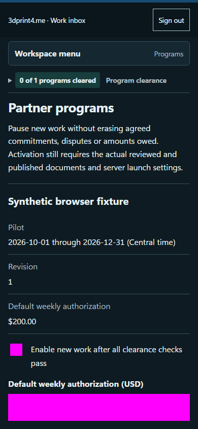

# QA-029: unreviewed issuance returns exact missing classification and language gates

Status: **passed**. Environment: native disposable browser/API/PostgreSQL fixture; hosted observations are separate.

Automation: `tests/integration/test_partner_legal_acceptance_browser.py::test_native_unreviewed_issuance_returns_exact_missing_classification_and_language_gates`. [Maintained native source](../../../tests/integration/test_partner_legal_acceptance_browser.py). [Gherkin](../features/legal_acceptance.feature).

**Actor:** Owner and/or scoped partner as specified in each step

**Prerequisites:** Disposable PostgreSQL fixture and real browser HTTP boundaries; synthetic review evidence only. Production-portal QA uses the isolated QA realm.

**Inputs:** Fictional fixture businesses/participants and bounded amounts from the linked native test. No real work, consent or funds.

## Given / When

Nonvisual infrastructure/API case; use assertions and run result, not a fabricated UI image.

## Then: exact observable and persisted checks

- `result['status'] == 409`
- `set(result['body']['missingGates']) == {'classification', 'agreement_language'}`
- `w['read']('agreements')['items'] == before`
- `w['read']('legal-version', version['versionId'])['reviews'] == []`

**Retry/failure behavior:** Use the same command identity for uncertain committed responses; other tests assert explicit conflict/replay behavior as named. Never automatically replay into another realm.

**Cleanup:** Context managers close browsers and remove disposable containers; hosted QA retires only the selected run and preserves history.

## Screenshot evidence

**final-1, 1440 px light; native run workspace-release-20261104-04.** Observed rendered state after the documented step; not evidence for unpictured earlier actions.

**final-1, 390 px dark; native run workspace-release-20261104-04.** Observed rendered state after the documented step; not evidence for unpictured earlier actions.

