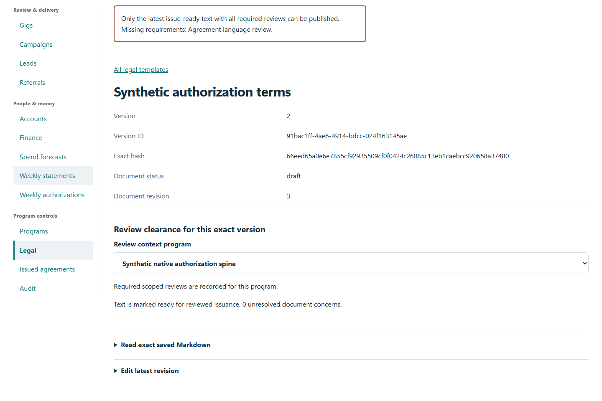
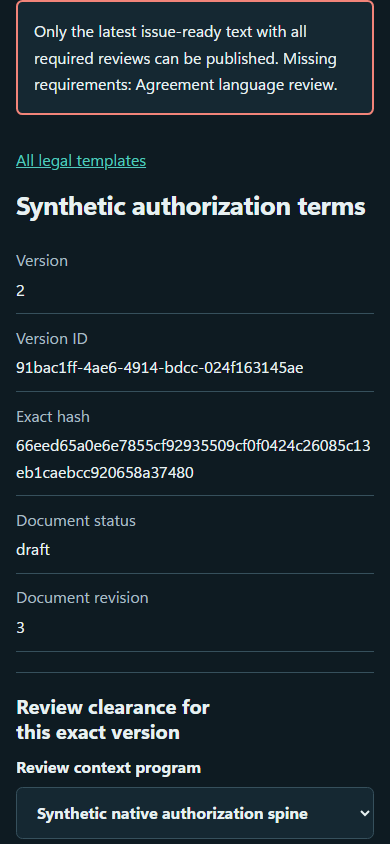

# QA-030: version b requires independent reviews new issue and new ack without changing a

Status: **passed**. Environment: native disposable browser/API/PostgreSQL fixture; hosted observations are separate.

Automation: `tests/integration/test_partner_legal_acceptance_browser.py::test_native_version_b_requires_independent_reviews_new_issue_and_new_ack_without_changing_a`. [Maintained native source](../../../tests/integration/test_partner_legal_acceptance_browser.py). [Gherkin](../features/legal_acceptance.feature).

**Actor:** Owner and/or scoped partner as specified in each step

**Prerequisites:** Disposable PostgreSQL fixture and real browser HTTP boundaries; synthetic review evidence only. Production-portal QA uses the isolated QA realm.

**Inputs:** Fictional fixture businesses/participants and bounded amounts from the linked native test. No real work, consent or funds.

## Given / When

- **action-01:** Open w['fixture']['ownerOrigin'] + '/partners#legal/version/' + b['versionId']
- **action-02:** Select Review context program w['programId']
- **action-03:** Activate Publish reviewed revision
- **action-04:** Open w['origin'] + '/agreements'
- **action-05:** Confirm I have read this exact issued version.
- **action-06:** Activate Record read acknowledgment

## Then: exact observable and persisted checks

- `original['acknowledgedAt']`
- `b['hash'] != source['content_sha256']`
- `denied['status'] == 409 and set(denied['body']['missingGates']) == {'published_agreement', 'published_policy'}`
- `denied['status'] == 409 and set(denied['body']['missingGates']) == set(SCOPES)`
- `w['read']('legal-version', b['versionId'])['reviews'] == []`
- `w['read']('agreement', a['id']) == original`
- `owner.evaluate('document.documentElement.scrollWidth <= innerWidth')`
- `w['read']('agreement', a['id']) == original`
- `issued['id'] != a['id']`
- `fresh['acknowledgedAt'] is None and fresh['sourceHash'] == b['hash']`
- `final['acknowledgedAt'] and final['snapshotHash'] == fresh['snapshotHash']`
- `w['read']('agreement', a['id']) == original`
- `len([i for i in w['read']('agreements')['items'] if i['partnerId'] == w['accounts'][0]['id']]) == 2`
- `w['fixture']['outboundAttempts']() == 0`

**Retry/failure behavior:** Use the same command identity for uncertain committed responses; other tests assert explicit conflict/replay behavior as named. Never automatically replay into another realm.

**Cleanup:** Context managers close browsers and remove disposable containers; hosted QA retires only the selected run and preserves history.

## Screenshot evidence

**final-1, 1440 px light; native run workspace-release-20261104-04.** Observed rendered state after the documented step; not evidence for unpictured earlier actions.

**final-1, 390 px dark; native run workspace-release-20261104-04.** Observed rendered state after the documented step; not evidence for unpictured earlier actions.

