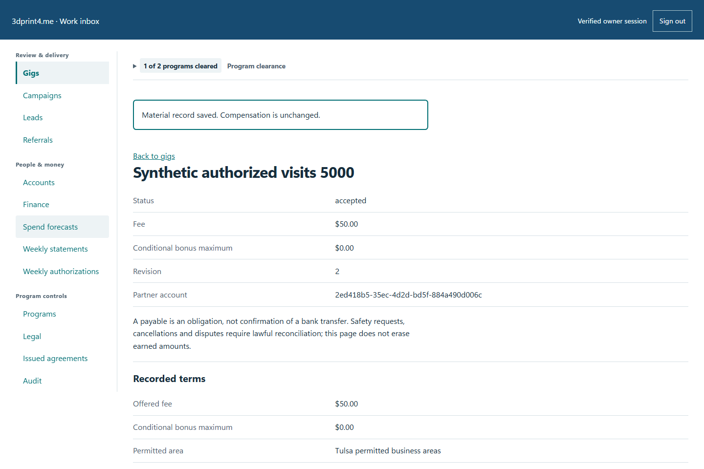
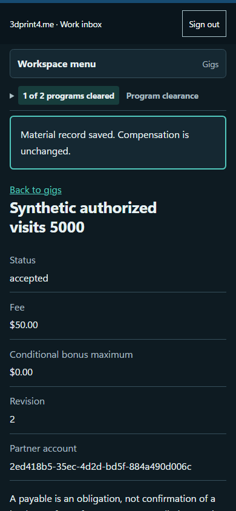

# QA-031: owner records materials with durable retry and partner private history

Status: **passed**. Environment: native disposable browser/API/PostgreSQL fixture; hosted observations are separate.

Automation: `tests/integration/test_partner_materials_browser.py::test_native_owner_records_materials_with_durable_retry_and_partner_private_history`. [Maintained native source](../../../tests/integration/test_partner_materials_browser.py). [Gherkin](../features/materials.feature).

**Actor:** Owner and/or scoped partner as specified in each step

**Prerequisites:** Disposable PostgreSQL fixture and real browser HTTP boundaries; synthetic review evidence only. Production-portal QA uses the isolated QA realm.

**Inputs:** Fictional fixture businesses/participants and bounded amounts from the linked native test. No real work, consent or funds.

## Given / When

- **action-01:** Open w['fixture']['ownerOrigin'] + '/partners#gig/' + gig['id']
- **action-02:** Enter Material label 1 'Sample signs '
- **action-03:** Enter Material count 1 '5'
- **action-04:** Activate Record materials
- **action-05:** Select Material event 'returned'
- **action-06:** Enter Material count 1 '3'
- **action-07:** Open w['origin'] + '/gigs/' + gig['id']

## Then: exact observable and persisted checks

- `len(w['read']('gig', gig['id'])['materials']) == 1`
- `attempts[0] == attempts[1]`
- `'Sample signs ' in page.locator('[data-material-history]').inner_text()`
- `page.locator('main script').count() == 0 and page.locator('[data-material-record]').count() == 0`
- `denied['status'] == 403`
- `page.evaluate("async ({api,id})=>(await fetch(api+'/api/partner/v1/gig?'+new URLSearchParams({id}),{credentials:'include'})).status", {'api': w['fixture']['apiOrigin'], 'id': gig['id']}) == 200`
- `denied == 404`
- `denied['status'] == 409 and w['read']('gig', gig['id']) == before`
- `before['item']['feeCents'] == 5000 and w['budgets']()[0]['committed_cents'] == 5000`
- `payable['amountDueCents'] == 5000`
- `len(w['read']('gig', gig['id'])['materials']) == 2`
- `database(w, "SELECT json_build_object('events',count(*)) FROM partner_material_events WHERE gig_id='" + gig['id'] + "'") == {'events': 2}`
- `w['fixture']['outboundAttempts']() == 0`
- `response.status == 200`

**Retry/failure behavior:** Use the same command identity for uncertain committed responses; other tests assert explicit conflict/replay behavior as named. Never automatically replay into another realm.

**Cleanup:** Context managers close browsers and remove disposable containers; hosted QA retires only the selected run and preserves history.

## Screenshot evidence

**final-1, 1440 px light; native run workspace-release-20261104-04.** Observed rendered state after the documented step; not evidence for unpictured earlier actions.

**final-1, 390 px dark; native run workspace-release-20261104-04.** Observed rendered state after the documented step; not evidence for unpictured earlier actions.

