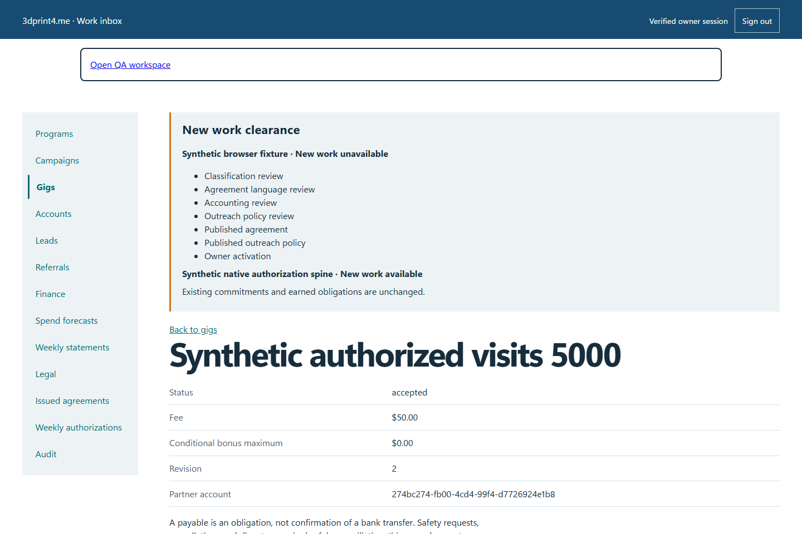
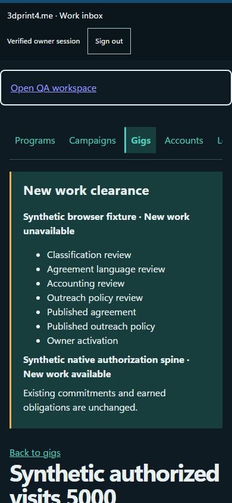

# QA-032: large material history is explicitly partial and keeps newest records

Status: **passed**. Environment: native disposable browser/API/PostgreSQL fixture; hosted observations are separate.

Automation: `tests/integration/test_partner_materials_browser.py::test_native_large_material_history_is_explicitly_partial_and_keeps_newest_records`. [Maintained native source](../../../tests/integration/test_partner_materials_browser.py). [Gherkin](../features/materials.feature).

**Actor:** Owner and/or scoped partner as specified in each step

**Prerequisites:** Disposable PostgreSQL fixture and real browser HTTP boundaries; synthetic review evidence only. Production-portal QA uses the isolated QA realm.

**Inputs:** Fictional fixture businesses/participants and bounded amounts from the linked native test. No real work, consent or funds.

## Given / When

- **action-01:** Open w['origin'] + '/gigs/' + gig['id']
- **action-02:** Open w['fixture']['ownerOrigin'] + '/partners#gig/' + gig['id']

## Then: exact observable and persisted checks

- `added == {'count': 201}`
- `data['materialsHasMore'] is True and len(data['materials']) == 200`
- `data['materials'][0]['items'][0]['label'] == 'Synthetic batch 201' and data['materials'][-1]['items'][0]['label'] == 'Synthetic batch 2'`
- `page.get_by_text('Synthetic batch 201: 1', exact=True).count() == 1 and page.get_by_text('Synthetic batch 1: 1', exact=True).count() == 0`
- `w['budgets']()[0]['committed_cents'] == 5000 and data['item']['feeCents'] == 5000`

**Retry/failure behavior:** Use the same command identity for uncertain committed responses; other tests assert explicit conflict/replay behavior as named. Never automatically replay into another realm.

**Cleanup:** Context managers close browsers and remove disposable containers; hosted QA retires only the selected run and preserves history.

## Screenshot evidence

**final-1, 1440 px light; native run native-20261103-final-05.** Observed rendered state after the documented step; not evidence for unpictured earlier actions.

**final-1, 390 px dark; native run native-20261103-final-05.** Observed rendered state after the documented step; not evidence for unpictured earlier actions.

