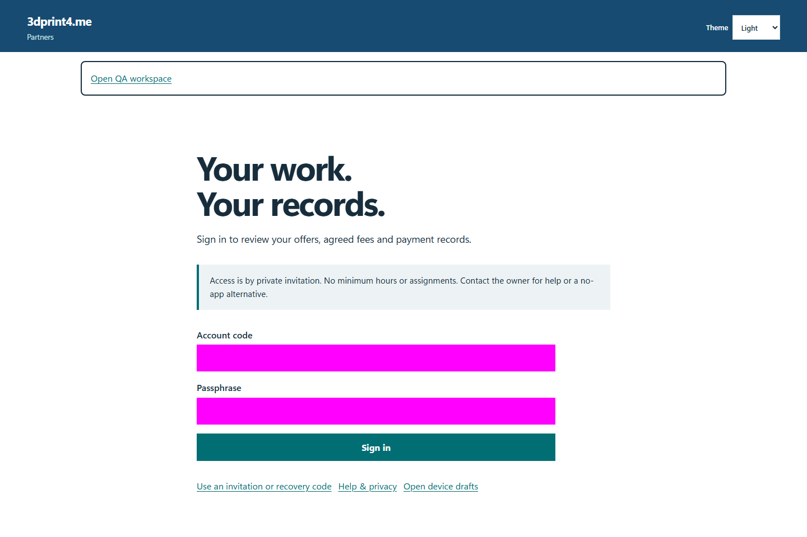
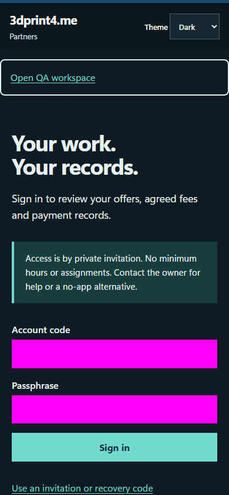

# QA-033: partner browser cookie csrf idor and logout

Status: **not-run**. Environment: native disposable browser/API/PostgreSQL fixture; hosted observations are separate.

Automation: `tests/integration/test_partner_native_browser.py::test_native_partner_browser_cookie_csrf_idor_and_logout`. [Maintained native source](../../../tests/integration/test_partner_native_browser.py). [Gherkin](../features/native.feature).

**Actor:** Owner and/or scoped partner as specified in each step

**Prerequisites:** Disposable PostgreSQL fixture and real browser HTTP boundaries; synthetic review evidence only. Production-portal QA uses the isolated QA realm.

**Inputs:** Fictional fixture businesses/participants and bounded amounts from the linked native test. No real work, consent or funds.

## Given / When

- **action-01:** Open origin
- **action-02:** Enter Account code fixture['partnerId']
- **action-03:** Enter Passphrase fixture['password']
- **action-04:** Activate Sign in
- **action-05:** Reload the current page and revalidate its session
- **action-06:** Activate Profile
- **action-07:** Enter Display name 'Synthetic browser saved'
- **action-08:** Activate Save profile
- **action-09:** Enter Account code fixture['otherPartnerId']
- **action-10:** Activate Sign out

## Then: exact observable and persisted checks

- `cookie['httpOnly'] and cookie['secure'] and (cookie['sameSite'] == 'Strict') and (cookie['path'] == '/')`
- `'__Host-3dp-partner' not in page.evaluate('document.cookie')`
- `result['status'] == 404 and result['cache'] == 'no-store'`
- `'Synthetic Partner 2' not in json.dumps(result['body'])`
- `page.get_by_label('Display name', exact=True).input_value() == 'Synthetic browser saved'`
- `not any((c['name'] == '__Host-3dp-partner' for c in site.context.cookies()))`
- `not site.page_errors`
- `second_cookie['value'] != cookie['value']`
- `denied == 404`
- `second.get_by_label('Display name', exact=True).input_value() == 'Synthetic Partner 2'`
- `not errors`

**Retry/failure behavior:** Use the same command identity for uncertain committed responses; other tests assert explicit conflict/replay behavior as named. Never automatically replay into another realm.

**Cleanup:** Context managers close browsers and remove disposable containers; hosted QA retires only the selected run and preserves history.

## Screenshot evidence

**final-1, 1440 px light; native run native-20261103-final-04.** Observed rendered state after the documented step; not evidence for unpictured earlier actions.

**final-1, 390 px dark; native run native-20261103-final-04.** Observed rendered state after the documented step; not evidence for unpictured earlier actions.

