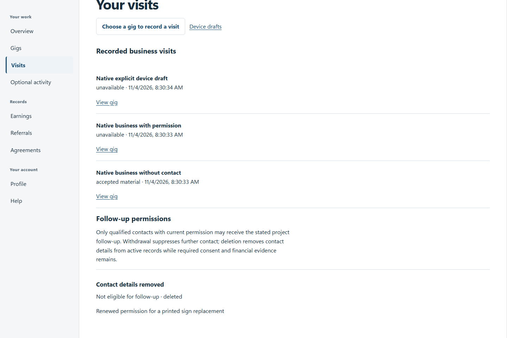
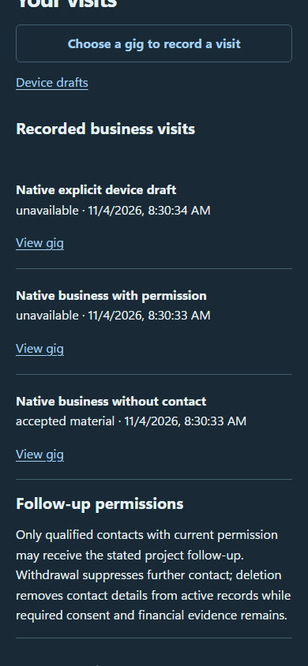

# QA-035: business visits and specific contact permission persist privately

Status: **passed**. Environment: native disposable browser/API/PostgreSQL fixture; hosted observations are separate.

Automation: `tests/integration/test_partner_native_browser.py::test_native_business_visits_and_specific_contact_permission_persist_privately`. [Maintained native source](../../../tests/integration/test_partner_native_browser.py). [Gherkin](../features/native.feature).

**Actor:** Owner and/or scoped partner as specified in each step

**Prerequisites:** Disposable PostgreSQL fixture and real browser HTTP boundaries; synthetic review evidence only. Production-portal QA uses the isolated QA realm.

**Inputs:** Fictional fixture businesses/participants and bounded amounts from the linked native test. No real work, consent or funds.

## Given / When

- **action-01:** Open origin
- **action-02:** Enter Account code fixture['partnerId']
- **action-03:** Enter Passphrase fixture['password']
- **action-04:** Activate Sign in
- **action-05:** Open origin + '/visits/new?gig=' + fixture['acceptedGigId']
- **action-06:** Enter Business name 'Native business without contact'
- **action-07:** Select Outcome 'accepted_material'
- **action-08:** Select Permission to leave materials 'permission_received'
- **action-09:** Enter Samples left '2'
- **action-10:** Activate Submit visit
- **action-11:** Reload the current page and revalidate its session
- **action-12:** Enter Business name 'Native business with permission'
- **action-13:** Confirm This person explicitly agreed to project follow-up.
- **action-14:** Enter Project follow-up purpose 'Consented printed sign discussion'
- **action-15:** Enter Contact email 'native-consent@example.test'
- **action-16:** Activate page.get_by_text('Correct contact details', exact=True)
- **action-17:** Enter Contact email 'native-corrected@example.test'
- **action-18:** Enter Project follow-up purpose 'Renewed permission for a printed sign replacement'
- **action-19:** Confirm This person renewed permission for these contact details and purpose.
- **action-20:** Activate Save corrected contact
- **action-21:** Activate Withdraw follow-up permission
- **action-22:** Confirm I understand this removes the contact details from active records.
- **action-23:** Activate Delete contact details
- **action-24:** Enter Business name 'Native explicit device draft'
- **action-25:** Confirm I understand this business-only draft stays on this device and is deleted when I sign out.
- **action-26:** Activate Save business draft on this device
- **action-27:** Activate Device drafts
- **action-28:** Activate Send pending business drafts
- **action-29:** Activate Recorded visits

## Then: exact observable and persisted checks

- `'No personal follow-up contacts recorded.' in page.locator('main').inner_text()`
- `len(result['items']) == 1`
- `lead['purpose'] == 'Consented printed sign discussion'`
- `lead['status'] == 'needs_review' and lead['followUpAllowed'] is False`
- `'withdraw this permission' in lead['consentText']`
- `'native-consent@example.test' not in page.evaluate('JSON.stringify({...localStorage,...sessionStorage})')`
- `'native-consent@example.test' not in page.locator('main').inner_text()`
- `suppressed['status'] == 'withdrawn' and suppressed['followUpAllowed'] is False`
- `'native-corrected@example.test' not in page.locator('main').inner_text()`
- `blocked == {'status': 422, 'count': 2}`
- `not site.page_errors`

**Retry/failure behavior:** Use the same command identity for uncertain committed responses; other tests assert explicit conflict/replay behavior as named. Never automatically replay into another realm.

**Cleanup:** Context managers close browsers and remove disposable containers; hosted QA retires only the selected run and preserves history.

## Screenshot evidence

**final-1, 1440 px light; native run workspace-release-20261104-01.** Observed rendered state after the documented step; not evidence for unpictured earlier actions.

**final-1, 390 px dark; native run workspace-release-20261104-01.** Observed rendered state after the documented step; not evidence for unpictured earlier actions.

