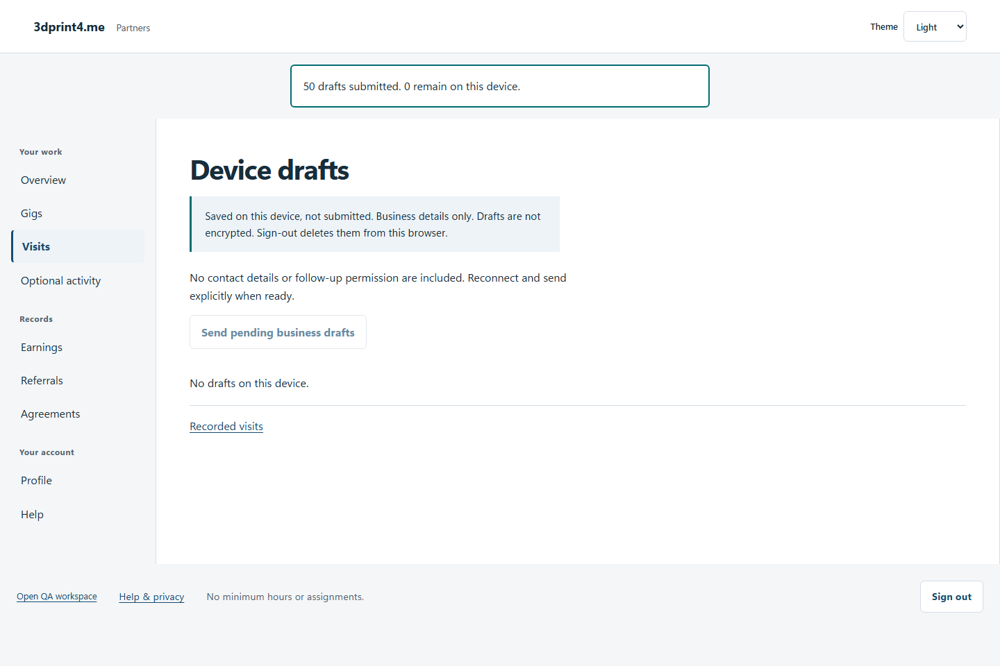
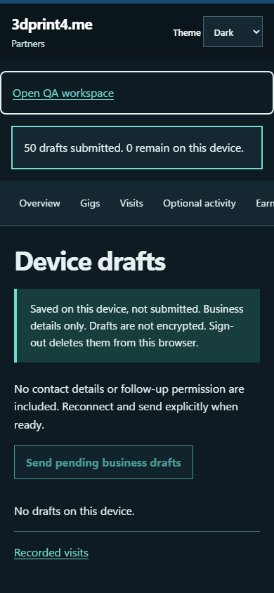

# QA-036: browser replays 100 device drafts after lost committed response

Status: **passed**. Environment: native disposable browser/API/PostgreSQL fixture; hosted observations are separate.

Automation: `tests/integration/test_partner_native_browser.py::test_native_browser_replays_100_device_drafts_after_lost_committed_response`. [Maintained native source](../../../tests/integration/test_partner_native_browser.py). [Gherkin](../features/native.feature).

**Actor:** Owner and/or scoped partner as specified in each step

**Prerequisites:** Disposable PostgreSQL fixture and real browser HTTP boundaries; synthetic review evidence only. Production-portal QA uses the isolated QA realm.

**Inputs:** Fictional fixture businesses/participants and bounded amounts from the linked native test. No real work, consent or funds.

## Given / When

- **action-01:** Open origin
- **action-02:** Enter Account code fixture['partnerId']
- **action-03:** Enter Passphrase fixture['password']
- **action-04:** Activate Sign in
- **action-05:** Open origin + '/visits/new?gig=' + fixture['acceptedGigId']
- **action-06:** Enter Business name 'Native replay 0'
- **action-07:** Confirm I understand this business-only draft stays on this device and is deleted when I sign out.
- **action-08:** Activate Save business draft on this device
- **action-09:** Activate Device drafts
- **action-10:** Activate Send pending business drafts
- **action-11:** Reload the current page and revalidate its session

## Then: exact observable and persisted checks

- `page.get_by_role('button', name='Remove device draft', exact=True).count() == 100`
- `len(requests) == 101 and requests[50] == requests[51]`
- `records == {'visits': 100, 'leads': 0}`
- `not site.page_errors`
- `response.status == 200`

**Retry/failure behavior:** Use the same command identity for uncertain committed responses; other tests assert explicit conflict/replay behavior as named. Never automatically replay into another realm.

**Cleanup:** Context managers close browsers and remove disposable containers; hosted QA retires only the selected run and preserves history.

## Screenshot evidence

**final-1, 1440 px light; native run workspace-release-20261104-04.** Observed rendered state after the documented step; not evidence for unpictured earlier actions.

**final-1, 390 px dark; native run workspace-release-20261104-04.** Observed rendered state after the documented step; not evidence for unpictured earlier actions.

