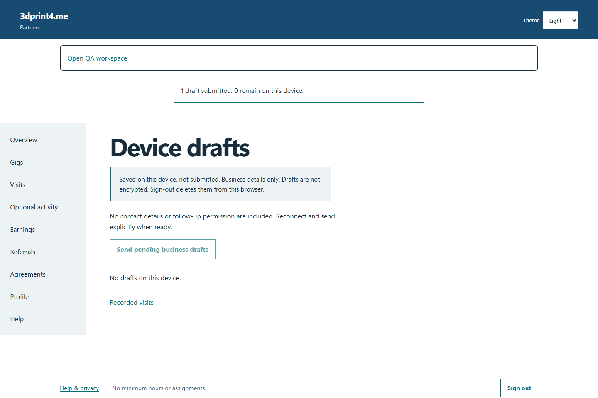
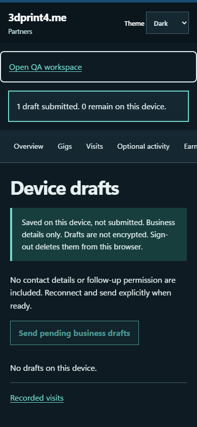

# QA-037: expired visit session hides the private form

Status: **passed**. Environment: native disposable browser/API/PostgreSQL fixture; hosted observations are separate.

Automation: `tests/integration/test_partner_native_browser.py::test_native_expired_visit_session_hides_the_private_form`. [Maintained native source](../../../tests/integration/test_partner_native_browser.py). [Gherkin](../features/native.feature).

**Actor:** Owner and/or scoped partner as specified in each step

**Prerequisites:** Disposable PostgreSQL fixture and real browser HTTP boundaries; synthetic review evidence only. Production-portal QA uses the isolated QA realm.

**Inputs:** Fictional fixture businesses/participants and bounded amounts from the linked native test. No real work, consent or funds.

## Given / When

- **action-01:** Open origin
- **action-02:** Enter Account code fixture['partnerId']
- **action-03:** Enter Passphrase fixture['password']
- **action-04:** Activate Sign in
- **action-05:** Open origin + '/visits/new?gig=' + fixture['acceptedGigId']
- **action-06:** Enter Business name 'Native expired-session visit'
- **action-07:** Confirm This person explicitly agreed to project follow-up.
- **action-08:** Enter Project follow-up purpose 'Consented project request'
- **action-09:** Enter Contact email 'expired-private@example.test'
- **action-10:** Activate Submit visit
- **action-11:** Enter Business name 'Native draft retained after expiry'
- **action-12:** Confirm I understand this business-only draft stays on this device and is deleted when I sign out.
- **action-13:** Activate Save business draft on this device
- **action-14:** Activate Device drafts
- **action-15:** Activate Send pending business drafts
- **action-16:** Open origin + '/drafts'

## Then: exact observable and persisted checks

- `page.get_by_role('navigation').is_hidden()`
- `page.locator('[name=contactEmail]').count() == 0`
- `'Native draft retained after expiry' not in page.locator('main').inner_text()`
- `'Native draft retained after expiry' in page.evaluate('JSON.stringify({...localStorage})')`
- `'expired-private@example.test' not in page.evaluate('JSON.stringify({...localStorage,...sessionStorage})')`
- `not site.page_errors`

**Retry/failure behavior:** Use the same command identity for uncertain committed responses; other tests assert explicit conflict/replay behavior as named. Never automatically replay into another realm.

**Cleanup:** Context managers close browsers and remove disposable containers; hosted QA retires only the selected run and preserves history.

## Screenshot evidence

**final-1, 1440 px light; native run native-20261103-final-05.** Observed rendered state after the documented step; not evidence for unpictured earlier actions.

**final-1, 390 px dark; native run native-20261103-final-05.** Observed rendered state after the documented step; not evidence for unpictured earlier actions.

