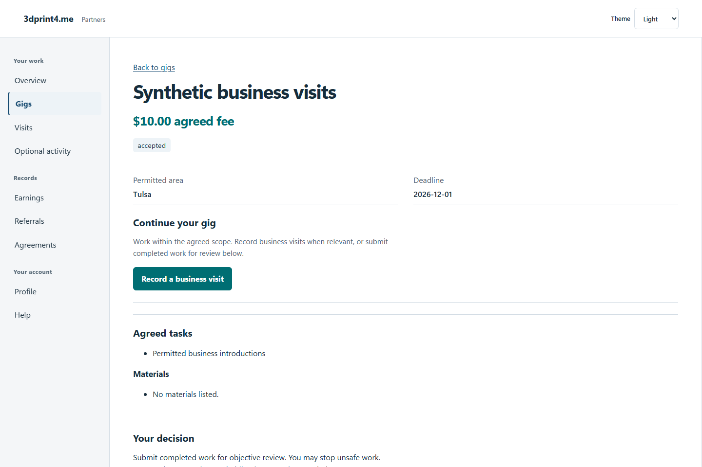
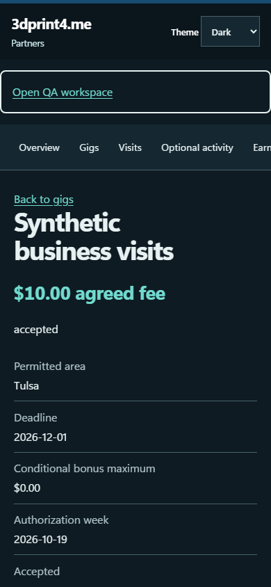

# QA-038: partner counterproposal persists without accepting or changing fee

Status: **not-run**. Environment: native disposable browser/API/PostgreSQL fixture; hosted observations are separate.

Automation: `tests/integration/test_partner_native_browser.py::test_native_partner_counterproposal_persists_without_accepting_or_changing_fee`. [Maintained native source](../../../tests/integration/test_partner_native_browser.py). [Gherkin](../features/native.feature).

**Actor:** Owner and/or scoped partner as specified in each step

**Prerequisites:** Disposable PostgreSQL fixture and real browser HTTP boundaries; synthetic review evidence only. Production-portal QA uses the isolated QA realm.

**Inputs:** Fictional fixture businesses/participants and bounded amounts from the linked native test. No real work, consent or funds.

## Given / When

- **action-01:** Open origin
- **action-02:** Enter Account code fixture['partnerId']
- **action-03:** Enter Passphrase fixture['password']
- **action-04:** Activate Sign in
- **action-05:** Open origin + '/gigs/' + fixture['gigId']
- **action-06:** Enter Proposed fee (USD) '12.34'
- **action-07:** Enter Message to the owner 'Synthetic fee discussion '
- **action-08:** Activate Send counterproposal
- **action-09:** Reload the current page and revalidate its session
- **action-10:** Open origin + '/gigs/' + fixture['acceptedGigId']

## Then: exact observable and persisted checks

- `'$10.00 offered fee' in page.locator('main').inner_text()`
- `page.locator('main script').count() == 0`
- `data['item']['status'] == 'offered' and data['item']['acceptedAt'] is None`
- `data['item']['feeCents'] == 1000 and data['item']['revision'] == 2`
- `len(data['negotiations']) == 1 and data['negotiations'][0]['proposed_fee_cents'] == 1234`
- `denied == 404`
- `page.get_by_role('button', name='Send counterproposal', exact=True).count() == 0`
- `not site.page_errors`

**Retry/failure behavior:** Use the same command identity for uncertain committed responses; other tests assert explicit conflict/replay behavior as named. Never automatically replay into another realm.

**Cleanup:** Context managers close browsers and remove disposable containers; hosted QA retires only the selected run and preserves history.

## Screenshot evidence

**final-1, 1440 px light; native run native-20261103-final-04.** Observed rendered state after the documented step; not evidence for unpictured earlier actions.

**final-1, 390 px dark; native run native-20261103-final-04.** Observed rendered state after the documented step; not evidence for unpictured earlier actions.

