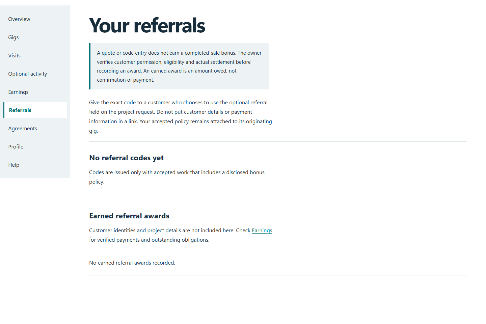

# QA-039: customer referral request records permission without creating a bonus

Status: **not-run**. Environment: native disposable browser/API/PostgreSQL fixture; hosted observations are separate.

Automation: `tests/integration/test_partner_native_browser.py::test_native_customer_referral_request_records_permission_without_creating_a_bonus`. [Maintained native source](../../../tests/integration/test_partner_native_browser.py). [Gherkin](../features/native.feature).

**Actor:** Owner and/or scoped partner as specified in each step

**Prerequisites:** Disposable PostgreSQL fixture and real browser HTTP boundaries; synthetic review evidence only. Production-portal QA uses the isolated QA realm.

**Inputs:** Fictional fixture businesses/participants and bounded amounts from the linked native test. No real work, consent or funds.

## Given / When

- **action-01:** Open origin
- **action-02:** Enter Account code fixture['partnerId']
- **action-03:** Enter Passphrase fixture['password']
- **action-04:** Activate Sign in
- **action-05:** Activate Referrals
- **action-06:** Activate Sign out
- **action-07:** Enter Account code fixture['otherPartnerId']

## Then: exact observable and persisted checks

- `status == 201`
- `status == 200`
- `request_id.startswith('3DP-') and all((c.isalnum() or c == '-' for c in request_id))`
- `saved['payload']['referral'] == referral and saved['status'] == 'submitted'`
- `saved['awards'] == 0 and saved['attributions'] == 0`
- `saved['payload']['submittedAt']`
- `status == 400`
- `'No earned referral awards recorded.' in page.locator('main').inner_text()`
- `'customer@example.test' not in page.locator('main').inner_text()`
- `fixture['referralCode'] not in page.locator('main').inner_text()`
- `not site.page_errors`

**Retry/failure behavior:** Use the same command identity for uncertain committed responses; other tests assert explicit conflict/replay behavior as named. Never automatically replay into another realm.

**Cleanup:** Context managers close browsers and remove disposable containers; hosted QA retires only the selected run and preserves history.

## Screenshot evidence

**final-1, 1440 px light; native run native-20261103-final-04.** Observed rendered state after the documented step; not evidence for unpictured earlier actions.

**final-1, 390 px dark; native run native-20261103-final-04.** Observed rendered state after the documented step; not evidence for unpictured earlier actions.

