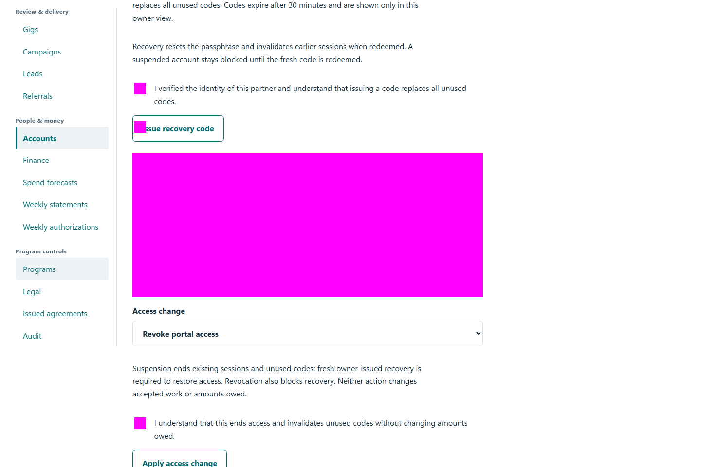
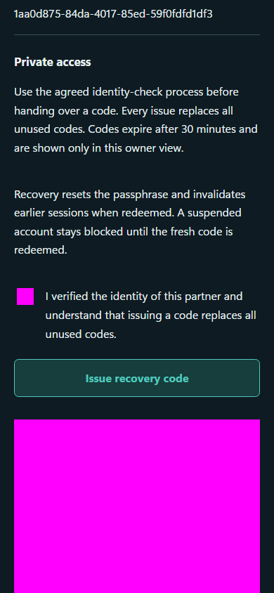

# QA-040: owner console uses github binding and preserves obligations while paused

Status: **passed**. Environment: native disposable browser/API/PostgreSQL fixture; hosted observations are separate.

Automation: `tests/integration/test_partner_native_browser.py::test_native_owner_console_uses_github_binding_and_preserves_obligations_while_paused`. [Maintained native source](../../../tests/integration/test_partner_native_browser.py). [Gherkin](../features/native.feature).

**Actor:** Owner and/or scoped partner as specified in each step

**Prerequisites:** Disposable PostgreSQL fixture and real browser HTTP boundaries; synthetic review evidence only. Production-portal QA uses the isolated QA realm.

**Inputs:** Fictional fixture businesses/participants and bounded amounts from the linked native test. No real work, consent or funds.

## Given / When

- **action-01:** Open owner + '/partners#programs'
- **action-02:** Activate page.locator('#partner-clearance summary')
- **action-03:** Enter Default weekly authorization (USD) '175.25'
- **action-04:** Activate Save program controls
- **action-05:** Reload the current page and revalidate its session
- **action-06:** Open owner + '/partners'
- **action-07:** Open origin
- **action-08:** Enter Account code fixture['partnerId']
- **action-09:** Enter Passphrase fixture['password']
- **action-10:** Activate Sign in
- **action-11:** Open origin + '/gigs/' + fixture['acceptedGigId']
- **action-12:** Enter Reason or submission details 'Synthetic completed permitted introductions.'
- **action-13:** Activate Submit work for review
- **action-14:** Open owner + '/partners#gig/' + fixture['acceptedGigId']
- **action-15:** Select Review action 'approve'
- **action-16:** Enter Review reason 'Objective deliverables verified.'
- **action-17:** Activate Record gig review
- **action-18:** Select Review action 'make_payable'
- **action-19:** Open origin + '/earnings'
- **action-20:** Open origin + '/profile'
- **action-21:** Open owner + '/partners#partners'
- **action-22:** Activate access.locator('..').locator('summary')
- **action-23:** Select Access change 'suspended'
- **action-24:** Confirm I understand that this ends access and invalidates unused codes without changing amounts owed.
- **action-25:** Activate Apply access change
- **action-26:** Activate Save profile
- **action-27:** Confirm I verified the identity of this partner and understand that issuing a code replaces all unused codes.
- **action-28:** Activate Issue recovery code
- **action-29:** Open origin + '/join'
- **action-30:** Enter Invitation or recovery code token
- **action-31:** Enter Choose a passphrase 'Synthetic restored partner passphrase'
- **action-32:** Activate Set passphrase and continue

## Then: exact observable and persisted checks

- `'New work unavailable' in page.locator('#partner-clearance').inner_text()`
- `page.get_by_label('Default weekly authorization (USD)', exact=True).input_value() == '175.25'`
- `not site.page_errors`
- `denied.locator('main form').count() == 0`
- `any((row['amountDueCents'] == 1000 and row['outstandingCents'] == 1000 for row in result['items']))`
- `'$10.00' in partner_page.locator('main').inner_text()`
- `'Verified paid' in partner_page.locator('main').inner_text()`
- `partner_page.get_by_label('Display name', exact=True).count() == 0`
- `code.get_attribute('type') == 'password' and token not in page.url`
- `'$10.00' in partner_page.locator('main').inner_text()`
- `any((row['amountDueCents'] == 1000 and row['outstandingCents'] == 1000 for row in result['items']))`

**Retry/failure behavior:** Use the same command identity for uncertain committed responses; other tests assert explicit conflict/replay behavior as named. Never automatically replay into another realm.

**Cleanup:** Context managers close browsers and remove disposable containers; hosted QA retires only the selected run and preserves history.

## Screenshot evidence

**final-1, 1440 px light; native run workspace-release-20261104-04.** Observed rendered state after the documented step; not evidence for unpictured earlier actions.

**final-1, 390 px dark; native run workspace-release-20261104-04.** Observed rendered state after the documented step; not evidence for unpictured earlier actions.

