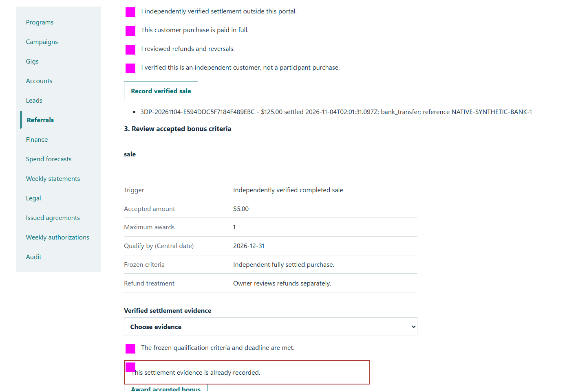
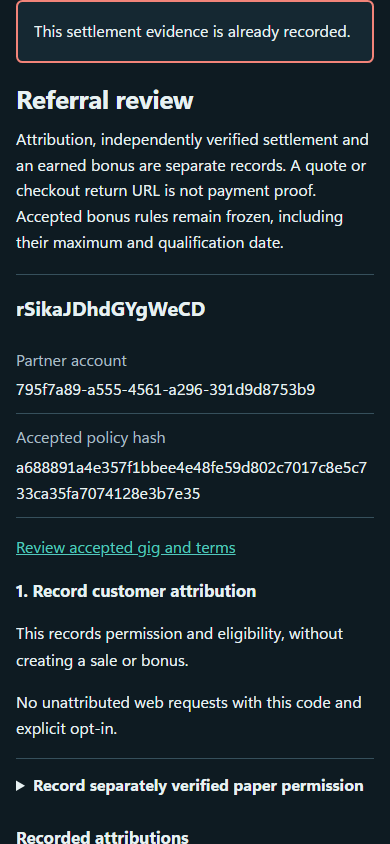

# QA-041: owner referral conversion requires settlement and awards once

Status: **not-run**. Environment: native disposable browser/API/PostgreSQL fixture; hosted observations are separate.

Automation: `tests/integration/test_partner_native_browser.py::test_native_owner_referral_conversion_requires_settlement_and_awards_once`. [Maintained native source](../../../tests/integration/test_partner_native_browser.py). [Gherkin](../features/native.feature).

**Actor:** Owner and/or scoped partner as specified in each step

**Prerequisites:** Disposable PostgreSQL fixture and real browser HTTP boundaries; synthetic review evidence only. Production-portal QA uses the isolated QA realm.

**Inputs:** Fictional fixture businesses/participants and bounded amounts from the linked native test. No real work, consent or funds.

## Given / When

- **action-01:** Open owner + '/partners#referrals'
- **action-02:** Select Consenting web request request_id
- **action-03:** Enter Permission evidence reference 'Native private web request permission checked'
- **action-04:** Confirm Customer opt-in for this referral code is verified.
- **action-05:** Confirm I verified this is an independent customer, not a participant purchase.
- **action-06:** Activate Record attribution
- **action-07:** Select Attributed request attribution_id
- **action-08:** Enter Settled amount (USD) '125.00'
- **action-09:** Enter Settlement reference reference
- **action-10:** Select Settlement method 'bank_transfer'
- **action-11:** Enter Settled at (ISO 8601 with timezone) datetime.now(timezone.utc).isoformat()
- **action-12:** Confirm form.get_by_label(label, exact=True)
- **action-13:** Activate Record verified sale
- **action-14:** Select Verified settlement evidence sale_id
- **action-15:** Confirm The frozen qualification criteria and deadline are met.
- **action-16:** Confirm I reviewed self-referral, duplicate and collusion checks.
- **action-17:** Activate Award accepted bonus
- **action-18:** Open origin
- **action-19:** Enter Account code fixture['partnerId']
- **action-20:** Enter Passphrase fixture['password']
- **action-21:** Activate Sign in
- **action-22:** Open origin + '/referrals'

## Then: exact observable and persisted checks

- `status == 201`
- `status == 200`
- `'New work unavailable' in page.locator('#partner-clearance').inner_text()`
- `form.get_by_label('Server permission receipt (UTC)', exact=True).input_value()`
- `len(data['attributions']) == 1 and len(data['awards']) == 0 and (len(data['sales']) == 0)`
- `len(read()['sales']) == 0 and len(read()['awards']) == 0`
- `data['awards'] == []`
- `len(data['awards']) == 1 and data['awards'][0]['amountCents'] == 500`
- `json.loads(counts.stdout) == {'awards': 1, 'payables': 1, 'sale_evidence': 1, 'committed': 2500}`
- `not site.page_errors`
- `'$5.00' in other.locator('main').inner_text()`
- `'native-sale@example.test' not in other.locator('main').inner_text()`
- `'NATIVE-SYNTHETIC-BANK-1' not in other.locator('main').inner_text()`
- `all((key not in own for key in ['attributions', 'sales', 'qualifications', 'requests']))`

**Retry/failure behavior:** Use the same command identity for uncertain committed responses; other tests assert explicit conflict/replay behavior as named. Never automatically replay into another realm.

**Cleanup:** Context managers close browsers and remove disposable containers; hosted QA retires only the selected run and preserves history.

## Screenshot evidence

**final-1, 1440 px light; native run native-20261103-final-04.** Observed rendered state after the documented step; not evidence for unpictured earlier actions.

**final-1, 390 px dark; native run native-20261103-final-04.** Observed rendered state after the documented step; not evidence for unpictured earlier actions.

