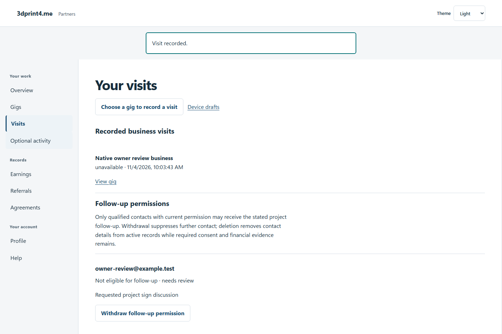
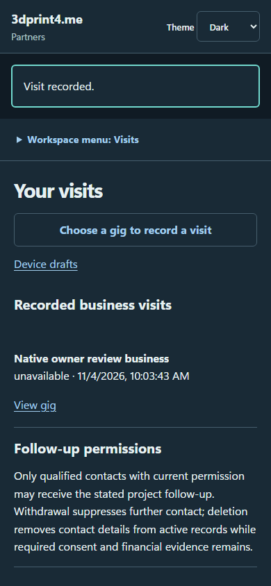

# QA-042: owner lead review correction and withdrawal update live permission

Status: **passed**. Environment: native disposable browser/API/PostgreSQL fixture; hosted observations are separate.

Automation: `tests/integration/test_partner_native_browser.py::test_native_owner_lead_review_correction_and_withdrawal_update_live_permission`. [Maintained native source](../../../tests/integration/test_partner_native_browser.py). [Gherkin](../features/native.feature).

**Actor:** Owner and/or scoped partner as specified in each step

**Prerequisites:** Disposable PostgreSQL fixture and real browser HTTP boundaries; synthetic review evidence only. Production-portal QA uses the isolated QA realm.

**Inputs:** Fictional fixture businesses/participants and bounded amounts from the linked native test. No real work, consent or funds.

## Given / When

- **action-01:** Open origin
- **action-02:** Enter Account code fixture['partnerId']
- **action-03:** Enter Passphrase fixture['password']
- **action-04:** Activate Sign in
- **action-05:** Open origin + '/visits/new?gig=' + fixture['acceptedGigId']
- **action-06:** Enter Business name 'Native owner review business'
- **action-07:** Confirm This person explicitly agreed to project follow-up.
- **action-08:** Enter Project follow-up purpose 'Requested project sign discussion'
- **action-09:** Enter Contact email 'owner-review@example.test'
- **action-10:** Activate Submit visit
- **action-11:** Open fixture['ownerOrigin'] + '/partners#leads'
- **action-12:** Enter Review reason 'Specific project interest and permission checked.'
- **action-13:** Activate Record lead review
- **action-14:** Activate owner.get_by_text('Correct contact or purpose', exact=True)
- **action-15:** Enter Email 'owner-renewed@example.test'
- **action-16:** Enter Project purpose 'Renewed permission for the replacement sign project'
- **action-17:** Confirm Renewed purpose-specific permission was explicitly given for these corrected details.
- **action-18:** Activate Save corrected contact
- **action-19:** Confirm I confirmed the requested suppression or deletion. Existing obligations remain unchanged.
- **action-20:** Activate Apply permission action

## Then: exact observable and persisted checks

- `not site.page_errors`
- `'Follow-up permitted for the recorded purpose' in owner.locator('main').inner_text()`
- `'Follow-up unavailable' in owner.locator('main').inner_text()`
- `'owner-review@example.test' not in owner.locator('main').inner_text()`
- `'owner-renewed@example.test' not in owner.locator('main').inner_text()`
- `live['status'] == 'withdrawn' and live['followUpAllowed'] is False and (live['revision'] == 4)`
- `live['withdrawnAt']`
- `owner.get_by_role('button', name='Record lead review', exact=True).count() == 0`
- `live['contact'] == {} and live['deletedAt'] and (live['followUpAllowed'] is False)`
- `len(data['qualifications']) == 1 and data['qualifications'][0]['followUpAllowed'] is False`
- `data['awards'] == []`

**Retry/failure behavior:** Use the same command identity for uncertain committed responses; other tests assert explicit conflict/replay behavior as named. Never automatically replay into another realm.

**Cleanup:** Context managers close browsers and remove disposable containers; hosted QA retires only the selected run and preserves history.

## Screenshot evidence

**final-1, 1440 px light; native run workspace-release-20261104-05.** Observed rendered state after the documented step; not evidence for unpictured earlier actions.

**final-1, 390 px dark; native run workspace-release-20261104-05.** Observed rendered state after the documented step; not evidence for unpictured earlier actions.

