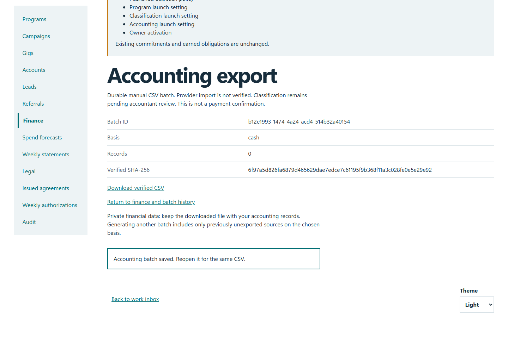
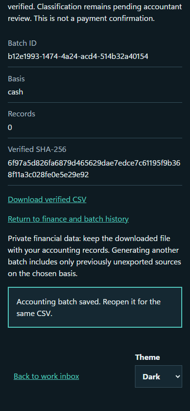

# QA-043: owner finance preserves payment evidence and durable csv after lost response

Status: **passed**. Environment: native disposable browser/API/PostgreSQL fixture; hosted observations are separate.

Automation: `tests/integration/test_partner_native_browser.py::test_native_owner_finance_preserves_payment_evidence_and_durable_csv_after_lost_response`. [Maintained native source](../../../tests/integration/test_partner_native_browser.py). [Gherkin](../features/native.feature).

**Actor:** Owner and/or scoped partner as specified in each step

**Prerequisites:** Disposable PostgreSQL fixture and real browser HTTP boundaries; synthetic review evidence only. Production-portal QA uses the isolated QA realm.

**Inputs:** Fictional fixture businesses/participants and bounded amounts from the linked native test. No real work, consent or funds.

## Given / When

- **action-01:** Open origin
- **action-02:** Enter Account code fixture['partnerId']
- **action-03:** Enter Passphrase fixture['password']
- **action-04:** Activate Sign in
- **action-05:** Open origin + '/gigs/' + fixture['acceptedGigId']
- **action-06:** Select Action 'submit'
- **action-07:** Enter Reason or submission details 'Synthetic completed work for finance verification.'
- **action-08:** Activate Save decision
- **action-09:** Open owner + '/partners#gig/' + fixture['acceptedGigId']
- **action-10:** Select Review action action
- **action-11:** Enter Review reason 'Synthetic objective work reviewed.'
- **action-12:** Activate Record gig review
- **action-13:** Open owner + '/partners#finance'
- **action-14:** Enter Settled payment (USD) amount
- **action-15:** Enter Payment reference reference
- **action-16:** Enter Settled at (ISO 8601 with timezone) datetime.now(timezone.utc).isoformat()
- **action-17:** Confirm I independently verified that this payment actually settled.
- **action-18:** Activate Record verified payment
- **action-19:** Activate form.locator('..').get_by_text('Record a confirmed returned transfer', exact=True)
- **action-20:** Enter Nonsettlement reference 'NATIVE-RETURN-2'
- **action-21:** Enter Reversed at (ISO 8601 with timezone) datetime.now(timezone.utc).isoformat()
- **action-22:** Enter Reversal reason 'Synthetic bank confirmation of returned transfer.'
- **action-23:** Confirm I verified nonsettlement or return of this original payment.
- **action-24:** Activate Record payment reversal
- **action-25:** Activate page.get_by_text('Record an evidenced obligation adjustment', exact=True)
- **action-26:** Enter Adjustment (USD, positive or negative) '2.00'
- **action-27:** Enter Adjustment reason 'Additional externally documented obligation.'
- **action-28:** Enter Resolution reference 'NATIVE-RESOLUTION-1'
- **action-29:** Confirm form.get_by_label(label, exact=True)
- **action-30:** Activate Record obligation adjustment
- **action-31:** Open origin + '/gigs/' + referral_gig
- **action-32:** Select Action 'report_unsafe'
- **action-33:** Enter Reason or submission details 'Synthetic unsafe access; partial work needs resolution.'
- **action-34:** Reload the current page and revalidate its session
- **action-35:** Activate page.get_by_text('Reconcile accepted work', exact=True)
- **action-36:** Enter Agreed obligation (USD) '5.00'
- **action-37:** Enter Resolution reason 'Synthetic acknowledged safety resolution.'
- **action-38:** Enter Resolution reference 'NATIVE-SAFETY-RESOLUTION'
- **action-39:** Activate Record resolved obligation
- **action-40:** Select Accounting basis 'cash'
- **action-41:** Activate Create incremental CSV batch
- **action-42:** Activate Download verified CSV
- **action-43:** Activate Return to finance and batch history
- **action-44:** Select Accounting basis basis
- **action-45:** Open origin + '/earnings'

## Then: exact observable and persisted checks

- `not site.page_errors`
- `read('ledger')['totals']['outstandingCents'] == 1000`
- `read('ledger')['totals']['paidCents'] == 400`
- `attempts[0] == attempts[1]`
- `data['totals']['paidCents'] == 1000 and data['totals']['outstandingCents'] == 0`
- `read('ledger')['totals']['outstandingCents'] == 600`
- `read('ledger')['totals']['outstandingCents'] == 800`
- `data['totals']['paidCents'] == 1200 and len(data['paymentEvents']) == 4`
- `read('ledger')['totals']['outstandingCents'] == 500`
- `len(read('exports')['items']) == 1`
- `export_attempts[0] == export_attempts[1]`
- `len(rows) == 4 and sum((int(row['amount_cents']) for row in rows)) == 1200`
- `any((row['record_kind'] == 'reversed' and row['amount_cents'] == '-600' for row in rows))`
- `all((row['tax_reporting_class'] == 'review_required' for row in rows))`
- `event.value.path().read_text() == cash and page.url == first_url`
- `totals['paidCents'] == 1200 and totals['outstandingCents'] == 500`
- `json.loads(state.stdout) == {'payments': 4, 'batches': 3, 'adjustments': 2, 'committed': 2500, 'fees': 2000}`
- `len(rows) == expected_count and sum((int(row['amount_cents']) for row in rows)) == total`
- `response.status == 200`
- `response.status == 200`

**Retry/failure behavior:** Use the same command identity for uncertain committed responses; other tests assert explicit conflict/replay behavior as named. Never automatically replay into another realm.

**Cleanup:** Context managers close browsers and remove disposable containers; hosted QA retires only the selected run and preserves history.

## Screenshot evidence

**final-1, 1440 px light; native run native-20261103-final-05.** Observed rendered state after the documented step; not evidence for unpictured earlier actions.

**final-1, 390 px dark; native run native-20261103-final-05.** Observed rendered state after the documented step; not evidence for unpictured earlier actions.

