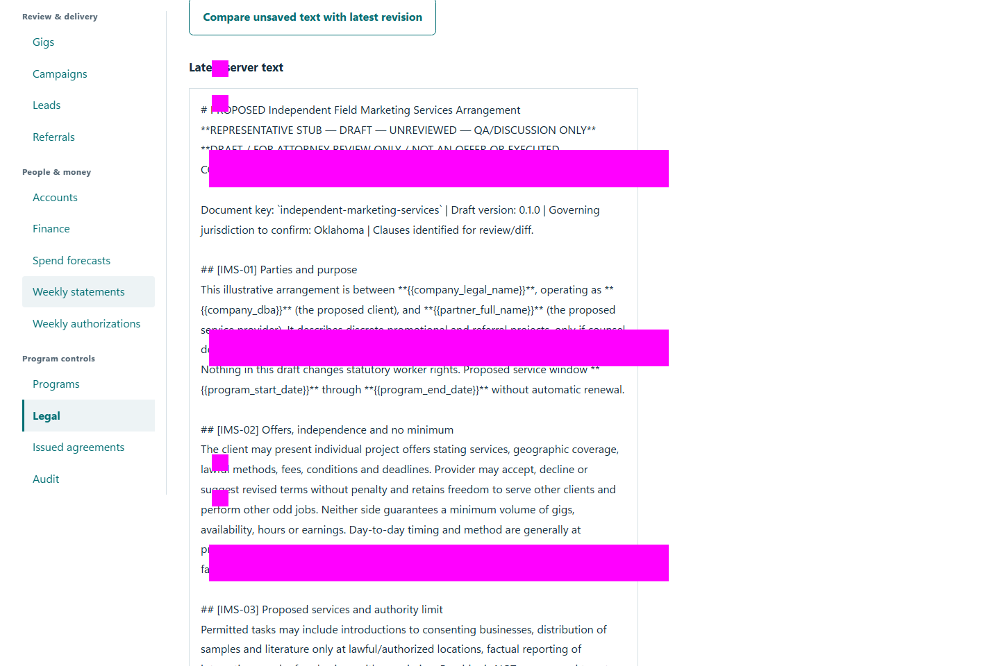
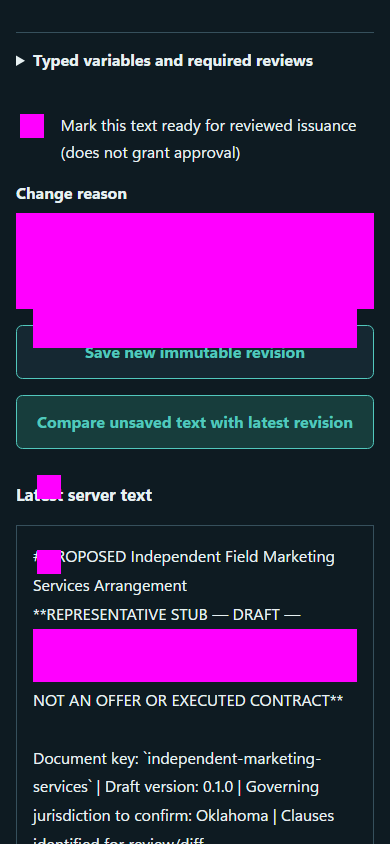

# QA-044: owner legal editor preserves versions comments and conflicting draft

Status: **passed**. Environment: native disposable browser/API/PostgreSQL fixture; hosted observations are separate.

Automation: `tests/integration/test_partner_native_browser.py::test_native_owner_legal_editor_preserves_versions_comments_and_conflicting_draft`. [Maintained native source](../../../tests/integration/test_partner_native_browser.py). [Gherkin](../features/native.feature).

**Actor:** Owner and/or scoped partner as specified in each step

**Prerequisites:** Disposable PostgreSQL fixture and real browser HTTP boundaries; synthetic review evidence only. Production-portal QA uses the isolated QA realm.

**Inputs:** Fictional fixture businesses/participants and bounded amounts from the linked native test. No real work, consent or funds.

## Given / When

- **action-01:** Open owner + '/partners#legal'
- **action-02:** Activate Load bundled discussion drafts
- **action-03:** Activate page.locator('[data-template="independent-marketing-services"] a')
- **action-04:** Select Clause anchor 'preamble'
- **action-05:** Enter Reviewer or source attribution 'Synthetic counsel discussion'
- **action-06:** Enter Clause concern 'Synthetic clarification needed before professional review.'
- **action-07:** Activate Add clause concern
- **action-08:** Activate page.locator('summary').filter(has_text='Edit latest revision')
- **action-09:** Enter Markdown source updated
- **action-10:** Enter Change reason 'Add the requested synthetic clarification.'
- **action-11:** Activate Save new immutable revision
- **action-12:** Enter Resolution 'Synthetic clarification recorded in this new revision.'
- **action-13:** Activate Record comment resolution
- **action-14:** Activate Mark revision in review
- **action-15:** Select Compare with revision old_id
- **action-16:** Activate Compare saved revisions
- **action-17:** Enter Markdown source unsaved
- **action-18:** Enter Change reason 'Synthetic stale editor attempt.'
- **action-19:** Activate Compare unsaved text with latest revision

## Then: exact observable and persisted checks

- `current_id != old_id`
- `earlier['markdown'] == old['markdown'] and earlier['content_sha256'] == old['content_sha256']`
- `page.locator('[data-resolve-comment]').count() == 1`
- `len(details['history']) == 2 and details['version']['document_status'] == 'in_review'`
- `details['clearance']['approved'] is False and details['reviews'] == []`
- `page.get_by_role('button', name='Publish reviewed revision', exact=True).is_disabled()`
- `denied['status'] == 409`
- `form.get_by_role('textbox', name='Markdown source', exact=True).input_value() == unsaved`
- `'Unsaved owner proposal retained' in page.locator('[data-unsaved-comparison]').inner_text()`
- `len(read('legal-version', saved['body']['versionId'])['history']) == 3`
- `read('legal-version', old_id)['version']['content_sha256'] == old['content_sha256']`
- `'Unsaved owner proposal' not in page.evaluate('JSON.stringify({...localStorage,...sessionStorage})')`
- `not site.page_errors`
- `saved['status'] == 200`

**Retry/failure behavior:** Use the same command identity for uncertain committed responses; other tests assert explicit conflict/replay behavior as named. Never automatically replay into another realm.

**Cleanup:** Context managers close browsers and remove disposable containers; hosted QA retires only the selected run and preserves history.

## Screenshot evidence

**final-1, 1440 px light; native run workspace-release-20261104-01.** Observed rendered state after the documented step; not evidence for unpictured earlier actions.

**final-1, 390 px dark; native run workspace-release-20261104-01.** Observed rendered state after the documented step; not evidence for unpictured earlier actions.

