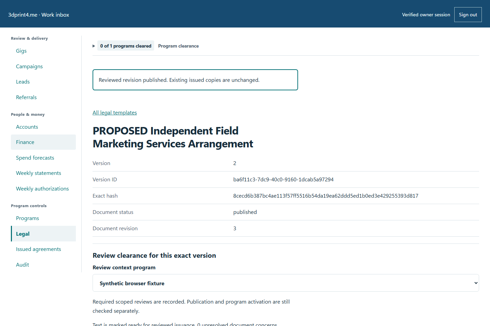
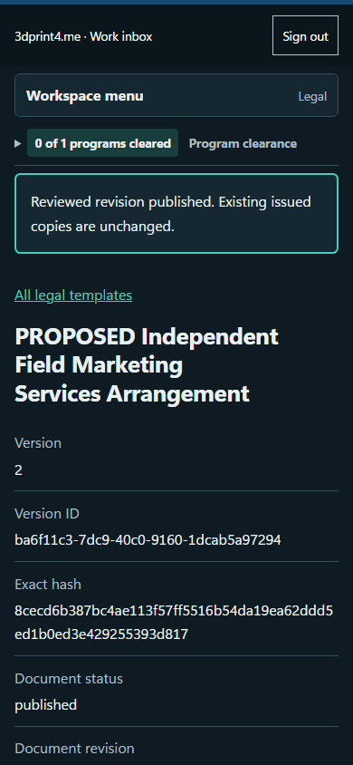

# QA-045: owner professional package decisions and returned feedback

Status: **passed**. Environment: native disposable browser/API/PostgreSQL fixture; hosted observations are separate.

Automation: `tests/integration/test_partner_native_browser.py::test_native_owner_professional_package_decisions_and_returned_feedback`. [Maintained native source](../../../tests/integration/test_partner_native_browser.py). [Gherkin](../features/native.feature).

**Actor:** Owner and/or scoped partner as specified in each step

**Prerequisites:** Disposable PostgreSQL fixture and real browser HTTP boundaries; synthetic review evidence only. Production-portal QA uses the isolated QA realm.

**Inputs:** Fictional fixture businesses/participants and bounded amounts from the linked native test. No real work, consent or funds.

## Given / When

- **action-01:** Open owner + '/partners#legal'
- **action-02:** Activate Load bundled discussion drafts
- **action-03:** Activate page.locator('[data-template="independent-marketing-services"] a')
- **action-04:** Activate page.locator('summary').filter(has_text='Edit latest revision')
- **action-05:** Enter Markdown source '# Synthetic services terms\n## [IMS-04] Scope\nSynthetic voluntary introductions in a disposable browser test.\n'
- **action-06:** Confirm Mark this text ready for reviewed issuance (does not grant approval)
- **action-07:** Enter Change reason 'Synthetic professional review journey only.'
- **action-08:** Activate Save new immutable revision
- **action-09:** Activate page.get_by_text('Create professional review package', exact=True)
- **action-10:** Confirm form.locator('[name=versionIds]')
- **action-11:** Activate Add named reviewer
- **action-12:** Enter Reviewer name name
- **action-13:** Select Professional role role
- **action-14:** Confirm row.get_by_label(scope, exact=True)
- **action-15:** Enter Grant expires at (ISO 8601 with timezone) expires
- **action-16:** Enter Private factual brief and review questions 'Synthetic facts. No actual professional decision or engagement.'
- **action-17:** Confirm I checked redaction, private facts and permission to share this package.
- **action-18:** Activate Create private signed package
- **action-19:** Activate Download signed ZIP (unencrypted)
- **action-20:** Enter Handoff passphrase (20 to 1024 UTF-8 bytes) secret
- **action-21:** Enter Repeat handoff passphrase secret
- **action-22:** Confirm I saved the passphrase separately and will share it through the agreed trusted channel.
- **action-23:** Activate Encrypt package on this device
- **action-24:** Activate Download encrypted review file
- **action-25:** Open (ROOT / 'operator' / 'review-reader.html').as_uri()
- **action-26:** Enter Review passphrase password
- **action-27:** Enter Independently trusted signing fingerprint fingerprint
- **action-28:** Activate Unlock and verify locally
- **action-29:** Activate offline.locator('#result a[download$=".md"]').first
- **action-30:** Enter Return passphrase (20 to 1024 UTF-8 bytes) return_secret
- **action-31:** Enter Repeat return passphrase return_secret
- **action-32:** Confirm form.get_by_role('checkbox')
- **action-33:** Activate Encrypt returned DOCX locally
- **action-34:** Activate Download encrypted DOCX return
- **action-35:** Enter Return passphrase (20 to 1024 UTF-8 bytes) 'Changed private return passphrase 2026!'
- **action-36:** Activate Lock and clear private view
- **action-37:** Select Returned source version version_id
- **action-38:** Select Returning named reviewer '0'
- **action-39:** Enter Return passphrase (encrypted returns only) return_secret
- **action-40:** Confirm I confirmed the returning reviewer identity through the agreed private channel.
- **action-41:** Activate Import untrusted feedback
- **action-42:** Activate Return to the source review package
- **action-43:** Select Reviewed source version version_id
- **action-44:** Select Named reviewer and scope str(grant)
- **action-45:** Select Professional decision choice
- **action-46:** Enter Evidence reference reference
- **action-47:** Enter Reviewed at (ISO 8601 with timezone) datetime.now(timezone.utc).isoformat()
- **action-48:** Confirm I verified the reviewer identity and this decision through the agreed private channel.
- **action-49:** Activate Record professional decision
- **action-50:** Open owner + '/partners#legal/version/' + version_id
- **action-51:** Activate Publish reviewed revision

## Then: exact observable and persisted checks

- `len(read('legal-version', version_id)['packages']) == 1`
- `attempts[0] == attempts[1]`
- `hashlib.sha256(archive).hexdigest() == package['sha256']`
- `manifest['documents'][0]['sourceHash'] == source['content_sha256']`
- `read('legal-version', version_id)['reviews'] == []`
- `secret.encode() not in encrypted_archive and source['markdown'].encode() not in encrypted_archive`
- `encrypted_form.get_by_label('Handoff passphrase (20 to 1024 UTF-8 bytes)', exact=True).input_value() == ''`
- `page.locator('main script').count() == 0`
- `base64.b64decode(attachment['data']) == returned`
- `read('legal-version', version_id)['version']['content_sha256'] == source['content_sha256']`
- `read('legal-version', version_id)['reviews'] == []`
- `read('legal-version', version_id)['clearanceByProgram'][manifest['programId']]['approved'] is False`
- `detail['clearanceByProgram'][manifest['programId']]['approved'] is True and len(detail['reviews']) == 4`
- `detail['version']['document_status'] == 'draft'`
- `read('legal-version', version_id)['version']['document_status'] == 'published'`
- `read('programs')['items'][0]['clearance']['allowed'] is False`
- `read('legal-version', original['latest_version_id'])['version']['content_sha256'] == original['content_sha256']`
- `json.loads(state.stdout) == {'packages': 1, 'attachments': 1, 'reviews': 4}`
- `not site.page_errors`
- `manifest == package['manifest']`
- `offline.locator('#result a').count() == 0`
- `offline.locator('#result a').count() == 0`
- `offline.locator('#result a').count() == len(manifest['files'])`
- `md_event.value.path().read_bytes() in [zbytes for zbytes in [source['markdown'].encode()] if zbytes]`
- `return_secret.encode() not in returned_envelope and returned not in returned_envelope`
- `offline.get_by_role('link', name='Download encrypted DOCX return', exact=True).is_hidden()`
- `not [url for url in outbound if url.startswith(('http:', 'https:'))]`
- `offline.locator('#result a').count() == 0 and offline.locator('#return-feedback').is_hidden()`
- `offline.locator('[name=passphrase]').first.input_value() == ''`
- `response.status == 200`

**Retry/failure behavior:** Use the same command identity for uncertain committed responses; other tests assert explicit conflict/replay behavior as named. Never automatically replay into another realm.

**Cleanup:** Context managers close browsers and remove disposable containers; hosted QA retires only the selected run and preserves history.

## Screenshot evidence

**final-1, 1440 px light; native run workspace-release-20261104-05.** Observed rendered state after the documented step; not evidence for unpictured earlier actions.

**final-1, 390 px dark; native run workspace-release-20261104-05.** Observed rendered state after the documented step; not evidence for unpictured earlier actions.

