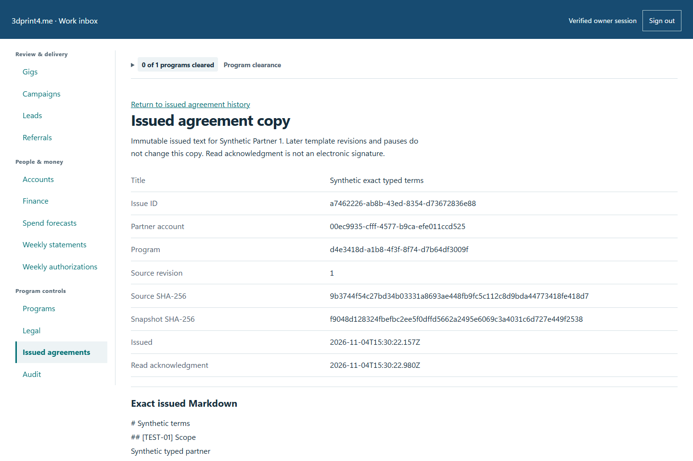
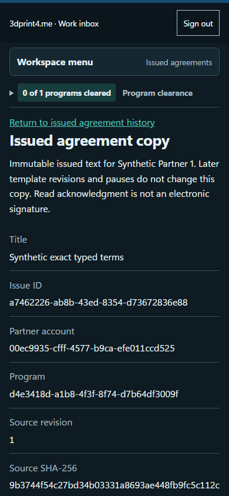

# QA-046: owner scoped bindings typed issue ack and immutable history

Status: **not-run**. Environment: native disposable browser/API/PostgreSQL fixture; hosted observations are separate.

Automation: `tests/integration/test_partner_native_browser.py::test_native_owner_scoped_bindings_typed_issue_ack_and_immutable_history`. [Maintained native source](../../../tests/integration/test_partner_native_browser.py). [Gherkin](../features/native.feature).

**Actor:** Owner and/or scoped partner as specified in each step

**Prerequisites:** Disposable PostgreSQL fixture and real browser HTTP boundaries; synthetic review evidence only. Production-portal QA uses the isolated QA realm.

**Inputs:** Fictional fixture businesses/participants and bounded amounts from the linked native test. No real work, consent or funds.

## Given / When

- **action-01:** Open owner + '/partners#programs'
- **action-02:** Reload the current page and revalidate its session
- **action-03:** Activate page.get_by_text('Bind reviewed agreement and outreach policy', exact=True)
- **action-04:** Select form.get_by_role('combobox', name=label, exact=True) version['versionId']
- **action-05:** Activate Save reviewed version bindings
- **action-06:** Confirm Enable new work after all clearance checks pass
- **action-07:** Activate Save program controls
- **action-08:** Activate Issued agreements
- **action-09:** Select Program program_id
- **action-10:** Select Active partner fixture['partnerId']
- **action-11:** Select Exact reviewed source version['versionId']
- **action-12:** Enter partner name (private-person-name) 'Synthetic typed partner'
- **action-13:** Enter fee usd (USD) '12.34'
- **action-14:** Enter service date (date) '2026-10-25'
- **action-15:** Enter count (integer) '3'
- **action-16:** Enter email (email) 'synthetic@example.test'
- **action-17:** Enter notes (multiline) 'Private objective scope.\n*Literal* note.'
- **action-18:** Confirm I reviewed the typed values and will issue this exact saved version to this partner.
- **action-19:** Activate Issue frozen agreement copy
- **action-20:** Open origin
- **action-21:** Enter Account code fixture['partnerId']
- **action-22:** Enter Passphrase fixture['password']
- **action-23:** Activate Sign in
- **action-24:** Open origin + '/gigs/' + fixture['gigId']
- **action-25:** Select Action 'accept'
- **action-26:** Activate Save decision
- **action-27:** Open origin + '/agreements'
- **action-28:** Confirm I have read this exact issued version.
- **action-29:** Activate Record read acknowledgment

## Then: exact observable and persisted checks

- `read('programs')['items'][0]['enabled'] is False`
- `read('programs')['items'][0]['clearance']['allowed'] is True`
- `form.locator('[name="binding:unused_person"]').count() == 0`
- `len(read('agreements')['items']) == 1`
- `attempts[0] == attempts[1]`
- `issued['bindings'] == {'partner_name': 'Synthetic typed partner', 'fee_usd': 1234, 'service_date': '2026-10-25', 'count': 3, 'email': 'synthetic@example.test', 'notes': 'Private objective scope.\n*Literal* note.'}`
- `'12.34' in issued['snapshotMarkdown'] and '{{' not in issued['snapshotMarkdown']`
- `acknowledged['acknowledgedAt'] and acknowledged['snapshotHash'] == issued['snapshotHash']`
- `read('programs')['items'][0]['clearance']['allowed'] is False`
- `final['snapshotMarkdown'] == issued['snapshotMarkdown'] and final['snapshotHash'] == issued['snapshotHash'] and (final['sourceMarkdown'] == issued['sourceMarkdown'])`
- `len(read('agreements')['items']) == 1 and 'Synthetic typed partner' not in page.evaluate('JSON.stringify({...localStorage,...sessionStorage})')`
- `state.stdout.strip() == issue_id and (not site.page_errors)`
- `response['status'] == 200`
- `'12.34' in partner.locator('main').inner_text()`
- `response.status == 200`

**Retry/failure behavior:** Use the same command identity for uncertain committed responses; other tests assert explicit conflict/replay behavior as named. Never automatically replay into another realm.

**Cleanup:** Context managers close browsers and remove disposable containers; hosted QA retires only the selected run and preserves history.

## Screenshot evidence

**final-1, 1440 px light; native run native-20261103.** Observed rendered state after the documented step; not evidence for unpictured earlier actions.

**final-1, 390 px dark; native run native-20261103.** Observed rendered state after the documented step; not evidence for unpictured earlier actions.

