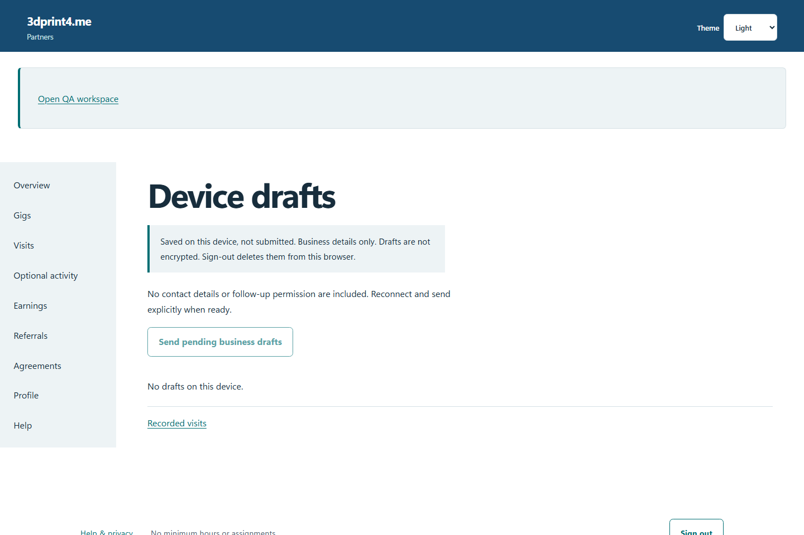
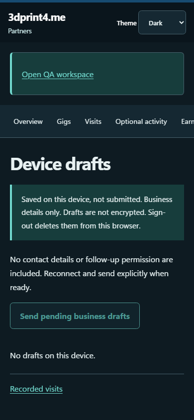

# QA-047: prepared visit survives offline cold reopen and manual replay

Status: **passed**. Environment: native disposable browser/API/PostgreSQL fixture; hosted observations are separate.

Automation: `tests/integration/test_partner_native_browser.py::test_native_prepared_visit_survives_offline_cold_reopen_and_manual_replay`. [Maintained native source](../../../tests/integration/test_partner_native_browser.py). [Gherkin](../features/native.feature).

**Actor:** Owner and/or scoped partner as specified in each step

**Prerequisites:** Disposable PostgreSQL fixture and real browser HTTP boundaries; synthetic review evidence only. Production-portal QA uses the isolated QA realm.

**Inputs:** Fictional fixture businesses/participants and bounded amounts from the linked native test. No real work, consent or funds.

## Given / When

- **action-01:** Open origin
- **action-02:** Enter Account code fixture['partnerId']
- **action-03:** Enter Passphrase fixture['password']
- **action-04:** Activate Sign in
- **action-05:** Open origin + '/visits/new?gig=' + fixture['acceptedGigId']
- **action-06:** Activate Prepare this gig for offline business drafts
- **action-07:** Open origin + '/drafts'
- **action-08:** Enter Account code for device drafts fixture['partnerId']
- **action-09:** Activate Open device drafts
- **action-10:** Activate Record another business visit
- **action-11:** Enter Business name 'Native cold offline business'
- **action-12:** Confirm page.locator('#device-permission')
- **action-13:** Activate Save business draft on this device
- **action-14:** Reload the current page and revalidate its session
- **action-15:** Activate Send pending business drafts

## Then: exact observable and persisted checks

- `page.get_by_role('button', name='Send pending business drafts', exact=True).is_disabled()`
- `page.get_by_role('button', name='Remove device draft', exact=True).count() == 0`
- `len(rows) == 1 and rows[0]['business_name'] == 'Native cold offline business'`
- `page.evaluate("async()=>{const c=await caches.open('partner-shell-v3');return(await c.keys()).every(r=>!r.url.includes('/api/'));}")`

**Retry/failure behavior:** Use the same command identity for uncertain committed responses; other tests assert explicit conflict/replay behavior as named. Never automatically replay into another realm.

**Cleanup:** Context managers close browsers and remove disposable containers; hosted QA retires only the selected run and preserves history.

## Screenshot evidence

**final-1, 1440 px light; native run portal-polish-20261103-final-03.** Observed rendered state after the documented step; not evidence for unpictured earlier actions.

**final-1, 390 px dark; native run portal-polish-20261103-final-03.** Observed rendered state after the documented step; not evidence for unpictured earlier actions.

