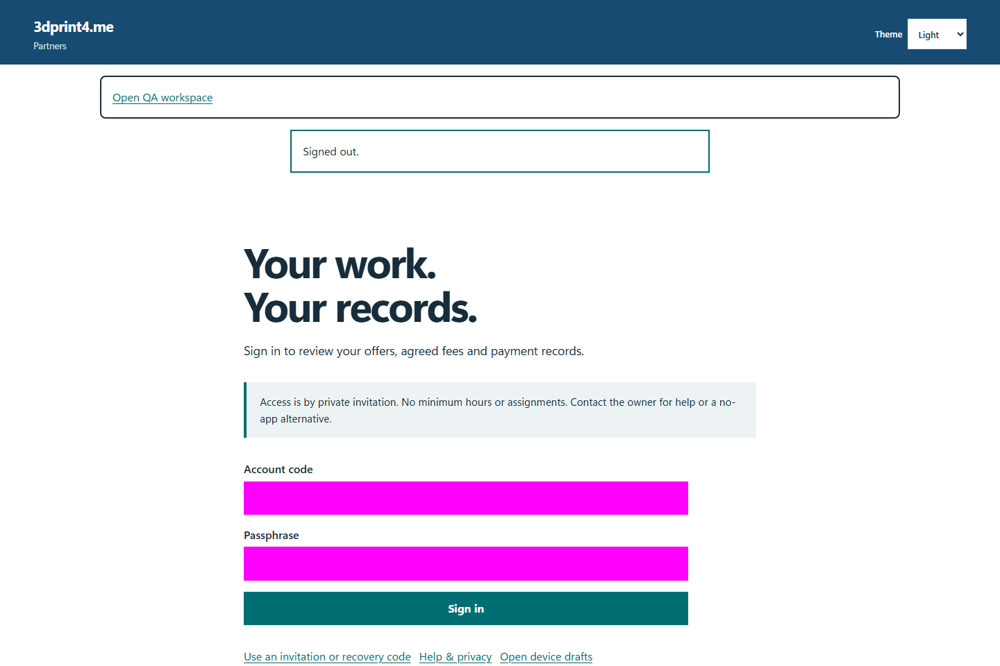
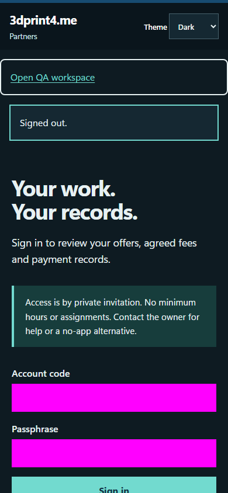
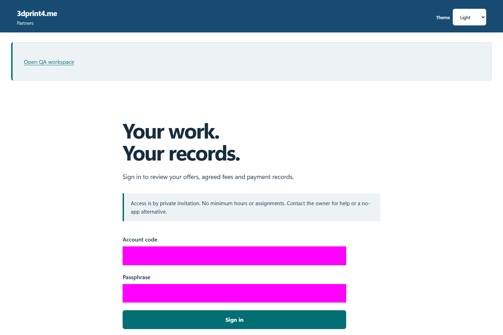
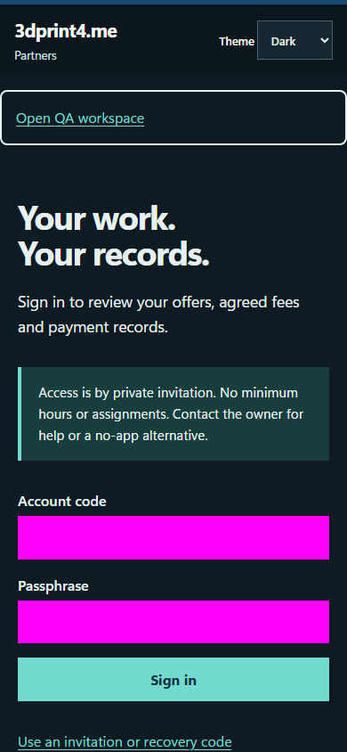

# QA-048: late login cookie after other tab logout is revoked

Status: **not-run**. Environment: native disposable browser/API/PostgreSQL fixture; hosted observations are separate.

Automation: `tests/integration/test_partner_native_browser.py::test_native_late_login_cookie_after_other_tab_logout_is_revoked`. [Maintained native source](../../../tests/integration/test_partner_native_browser.py). [Gherkin](../features/native.feature).

**Actor:** Owner and/or scoped partner as specified in each step

**Prerequisites:** Disposable PostgreSQL fixture and real browser HTTP boundaries; synthetic review evidence only. Production-portal QA uses the isolated QA realm.

**Inputs:** Fictional fixture businesses/participants and bounded amounts from the linked native test. No real work, consent or funds.

## Given / When

- **action-01:** Open origin
- **action-02:** Enter Account code fixture['partnerId']
- **action-03:** Enter Passphrase fixture['password']
- **action-04:** Activate Sign in
- **action-05:** Activate Sign out
- **action-06:** Reload the current page and revalidate its session

## Then: exact observable and persisted checks

- `held`
- `cleanup.value.status == 200`
- `second.get_by_role('heading', name='Hello, Synthetic Partner 1.').count() == 0`
- `code == 200 and 'set-cookie' in {k.lower() for k in headers}`

**Retry/failure behavior:** Use the same command identity for uncertain committed responses; other tests assert explicit conflict/replay behavior as named. Never automatically replay into another realm.

**Cleanup:** Context managers close browsers and remove disposable containers; hosted QA retires only the selected run and preserves history.

## Screenshot evidence

**final-1, 1440 px light; native run native-20261103.** Observed rendered state after the documented step; not evidence for unpictured earlier actions.

**final-1, 390 px dark; native run native-20261103.** Observed rendered state after the documented step; not evidence for unpictured earlier actions.

**final-2, 1440 px light; native run native-20261103.** Observed rendered state after the documented step; not evidence for unpictured earlier actions.

**final-2, 390 px dark; native run native-20261103.** Observed rendered state after the documented step; not evidence for unpictured earlier actions.

