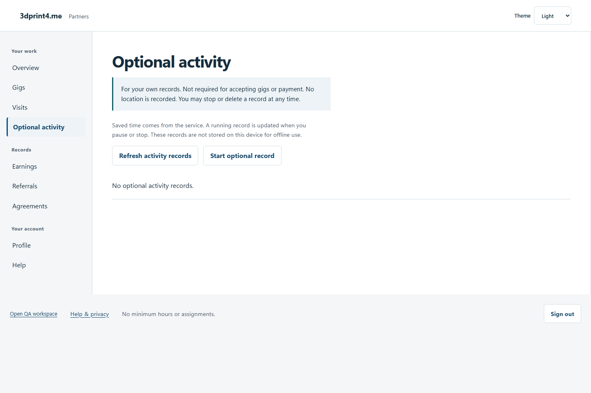
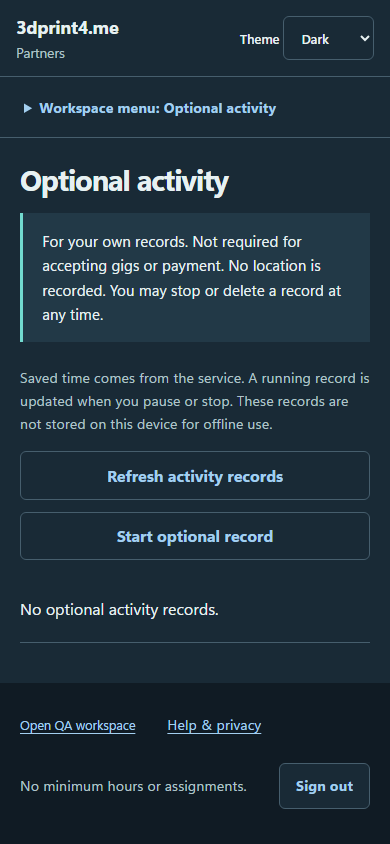

# QA-049: optional activity partner can track and delete own elapsed record

Status: **passed**. Environment: native disposable browser/API/PostgreSQL fixture; hosted observations are separate.

Automation: `tests/integration/test_partner_native_browser.py::test_native_optional_activity_partner_can_track_and_delete_own_elapsed_record`. [Maintained native source](../../../tests/integration/test_partner_native_browser.py). [Gherkin](../features/native.feature).

**Actor:** Owner and/or scoped partner as specified in each step

**Prerequisites:** Disposable PostgreSQL fixture and real browser HTTP boundaries; synthetic review evidence only. Production-portal QA uses the isolated QA realm.

**Inputs:** Fictional fixture businesses/participants and bounded amounts from the linked native test. No real work, consent or funds.

## Given / When

- **action-01:** Open origin + '/activity'
- **action-02:** Activate Start optional record
- **action-03:** Activate Pause
- **action-04:** Reload the current page and revalidate its session
- **action-05:** Activate Resume
- **action-06:** Activate Stop
- **action-07:** Open fixture['ownerOrigin'] + '/partners'
- **action-08:** Activate Delete record

## Then: exact observable and persisted checks

- `'Not required for accepting gigs or payment' in page.locator('main').inner_text()`
- `commands[0] == commands[1]`
- `len(rows) == 1 and rows[0]['optional'] is True`
- `paused['elapsedSeconds'] >= 7 and paused['runningSince'] is None`
- `str(paused['elapsedSeconds']) + ' saved seconds' in page.locator('main').inner_text()`
- `stopped['endedAt'] and stopped['runningSince'] is None and (stopped['elapsedSeconds'] >= paused['elapsedSeconds'])`
- `read() == []`
- `not page.evaluate("Object.keys(localStorage).some(k=>k.includes('activity'))") and (not site.page_errors)`
- `denied == {'status': 404, 'items': []}`
- `status in [400, 403, 404]`
- `response.status == 200`

**Retry/failure behavior:** Use the same command identity for uncertain committed responses; other tests assert explicit conflict/replay behavior as named. Never automatically replay into another realm.

**Cleanup:** Context managers close browsers and remove disposable containers; hosted QA retires only the selected run and preserves history.

## Screenshot evidence

**final-1, 1440 px light; native run workspace-release-20261104-01.** Observed rendered state after the documented step; not evidence for unpictured earlier actions.

**final-1, 390 px dark; native run workspace-release-20261104-01.** Observed rendered state after the documented step; not evidence for unpictured earlier actions.

