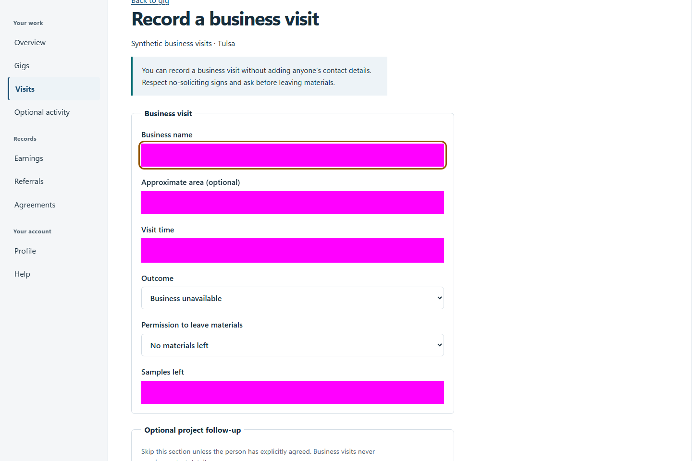
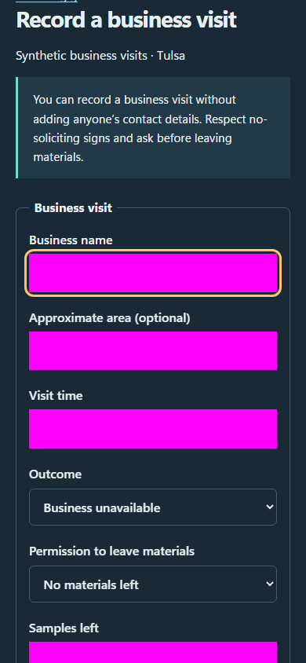

# QA-051: optional activity gig and visit screens never request geolocation

Status: **passed**. Environment: native disposable browser/API/PostgreSQL fixture; hosted observations are separate.

Automation: `tests/integration/test_partner_native_browser.py::test_native_optional_activity_gig_and_visit_screens_never_request_geolocation`. [Maintained native source](../../../tests/integration/test_partner_native_browser.py). [Gherkin](../features/native.feature).

**Actor:** Owner and/or scoped partner as specified in each step

**Prerequisites:** Disposable PostgreSQL fixture and real browser HTTP boundaries; synthetic review evidence only. Production-portal QA uses the isolated QA realm.

**Inputs:** Fictional fixture businesses/participants and bounded amounts from the linked native test. No real work, consent or funds.

## Given / When

- **action-01:** Activate page.locator('nav summary')
- **action-02:** Activate Gigs
- **action-03:** Activate page.locator('a[href="/gigs/' + fixture['acceptedGigId'] + '"]')
- **action-04:** Activate Record a business visit
- **action-05:** Enter Business name 'Synthetic map-free visit'

## Then: exact observable and persisted checks

- `page.evaluate('window.__geoCalls') == [] and (not site.page_errors)`

**Retry/failure behavior:** Use the same command identity for uncertain committed responses; other tests assert explicit conflict/replay behavior as named. Never automatically replay into another realm.

**Cleanup:** Context managers close browsers and remove disposable containers; hosted QA retires only the selected run and preserves history.

## Screenshot evidence

**final-1, 1440 px light; native run workspace-release-20261104-05.** Observed rendered state after the documented step; not evidence for unpictured earlier actions.

**final-1, 390 px dark; native run workspace-release-20261104-05.** Observed rendered state after the documented step; not evidence for unpictured earlier actions.

