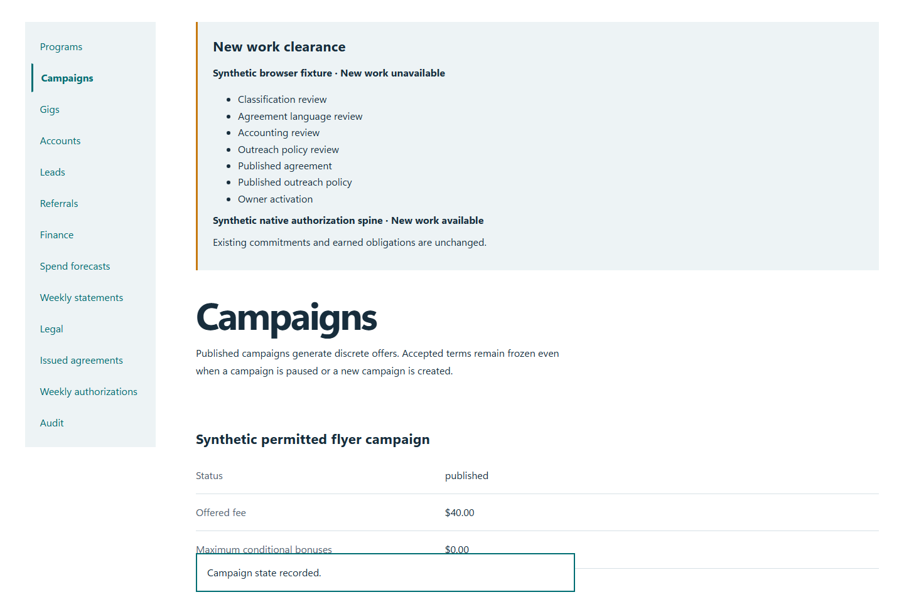
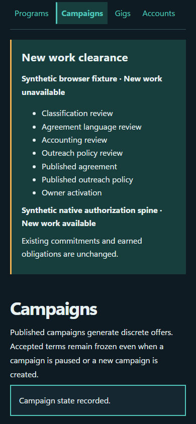

# QA-053: only owner can publish forty dollar campaign and partner sees frozen offer

Status: **passed**. Environment: native disposable browser/API/PostgreSQL fixture; hosted observations are separate.

Automation: `tests/integration/test_partner_owner_control_browser.py::test_native_only_owner_can_publish_forty_dollar_campaign_and_partner_sees_frozen_offer`. [Maintained native source](../../../tests/integration/test_partner_owner_control_browser.py). [Gherkin](../features/owner_control.feature).

**Actor:** Owner and/or scoped partner as specified in each step

**Prerequisites:** Disposable PostgreSQL fixture and real browser HTTP boundaries; synthetic review evidence only. Production-portal QA uses the isolated QA realm.

**Inputs:** Fictional fixture businesses/participants and bounded amounts from the linked native test. No real work, consent or funds.

## Given / When

- **action-01:** Open w['fixture']['ownerOrigin'] + '/partners#campaigns'
- **action-02:** Select Program w['programId']
- **action-03:** Enter Offer title 'Synthetic permitted flyer campaign'
- **action-04:** Enter Offered fee (USD) '40.00'
- **action-05:** Enter Permitted area 'Tulsa permitted business areas'
- **action-06:** Enter Completion deadline '2026-12-01'
- **action-07:** Enter Objective tasks (one per line) 'Respect no-soliciting signs\nAsk permission before leaving owner-provided flyers'
- **action-08:** Enter Supplied materials (one per line, optional) 'Owner-provided flyers'
- **action-09:** Activate Create campaign draft
- **action-10:** Activate Publish campaign
- **action-11:** Open w['origin'] + '/gigs/' + gig['id']

## Then: exact observable and persisted checks

- `created.value.status == 200`
- `'$40.00 offered fee' in page.locator('main').inner_text()`
- `denied['status'] == 403`
- `current['status'] == 'published' and current['revision'] == 2`
- `w['read']('gig', gig['id'])['item'] == before`
- `financial_counts(w) == {'reservations': 0, 'committed': 0, 'payables': 0}`
- `w['fixture']['outboundAttempts']() == 0`

**Retry/failure behavior:** Use the same command identity for uncertain committed responses; other tests assert explicit conflict/replay behavior as named. Never automatically replay into another realm.

**Cleanup:** Context managers close browsers and remove disposable containers; hosted QA retires only the selected run and preserves history.

## Screenshot evidence

**final-1, 1440 px light; native run portal-polish-20261103-final-03.** Observed rendered state after the documented step; not evidence for unpictured earlier actions.

**final-1, 390 px dark; native run portal-polish-20261103-final-03.** Observed rendered state after the documented step; not evidence for unpictured earlier actions.

