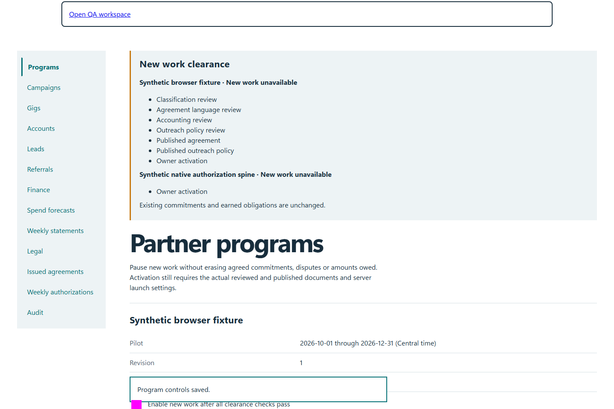
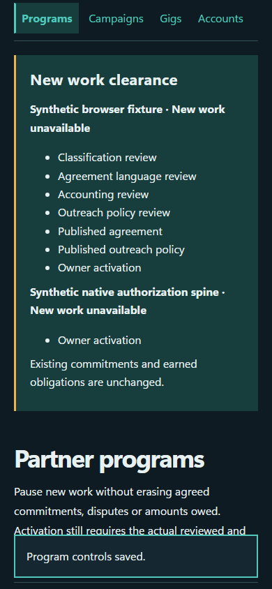

# QA-055: program pause denies unaccepted work without erasing prior debt

Status: **not-run**. Environment: native disposable browser/API/PostgreSQL fixture; hosted observations are separate.

Automation: `tests/integration/test_partner_owner_control_browser.py::test_native_program_pause_denies_unaccepted_work_without_erasing_prior_debt`. [Maintained native source](../../../tests/integration/test_partner_owner_control_browser.py). [Gherkin](../features/owner_control.feature).

**Actor:** Owner and/or scoped partner as specified in each step

**Prerequisites:** Disposable PostgreSQL fixture and real browser HTTP boundaries; synthetic review evidence only. Production-portal QA uses the isolated QA realm.

**Inputs:** Fictional fixture businesses/participants and bounded amounts from the linked native test. No real work, consent or funds.

## Given / When

- **action-01:** Open w['fixture']['ownerOrigin'] + '/partners#programs'
- **action-02:** Activate Save program controls
- **action-03:** Open w['origin'] + '/gigs/' + new['id']
- **action-04:** Activate Save decision
- **action-05:** Open w['origin'] + '/earnings'

## Then: exact observable and persisted checks

- `denied.value.status == 409 and 'unavailable' in denied.value.json()['error'].lower()`
- `financial_counts(w) == before == {'reservations': 1, 'committed': 4000, 'payables': 1}`
- `w['read']('gig', new['id'])['item']['status'] == 'offered'`
- `next((p for p in w['read']('ledger')['items'] if p['id'] == payable['id'])) == payable`
- `'$40.00' in page.locator('main').inner_text()`

**Retry/failure behavior:** Use the same command identity for uncertain committed responses; other tests assert explicit conflict/replay behavior as named. Never automatically replay into another realm.

**Cleanup:** Context managers close browsers and remove disposable containers; hosted QA retires only the selected run and preserves history.

## Screenshot evidence

**final-1, 1440 px light; native run native-20261103.** Observed rendered state after the documented step; not evidence for unpictured earlier actions.

**final-1, 390 px dark; native run native-20261103.** Observed rendered state after the documented step; not evidence for unpictured earlier actions.

