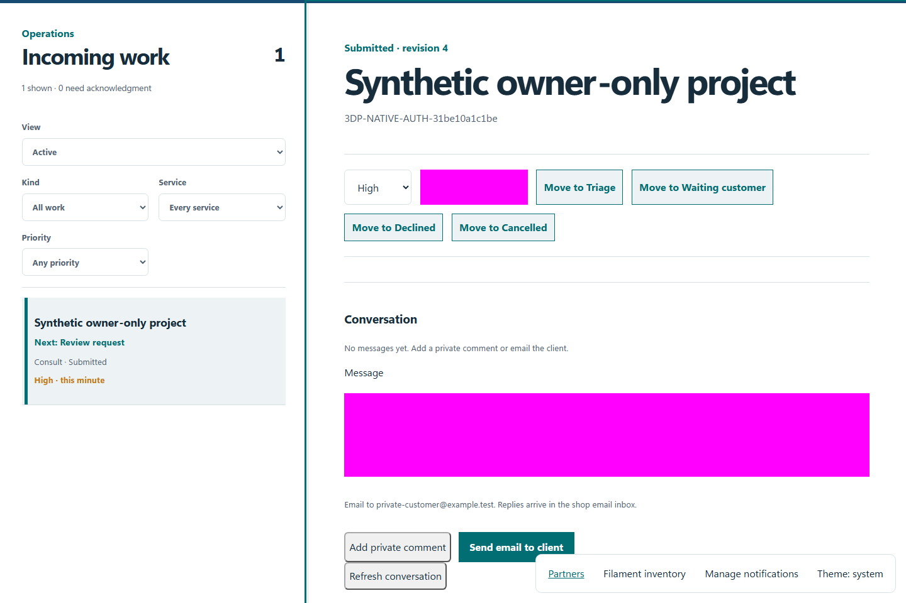
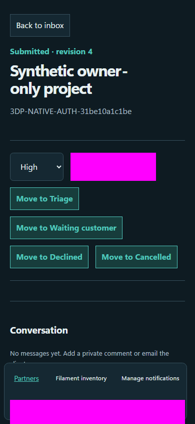

# QA-056: existing private work inbox updates while storefront and status routes stay separate

Status: **passed**. Environment: native disposable browser/API/PostgreSQL fixture; hosted observations are separate.

Automation: `tests/integration/test_partner_owner_control_browser.py::test_native_existing_private_work_inbox_updates_while_storefront_and_status_routes_stay_separate`. [Maintained native source](../../../tests/integration/test_partner_owner_control_browser.py). [Gherkin](../features/owner_control.feature).

**Actor:** Owner and/or scoped partner as specified in each step

**Prerequisites:** Disposable PostgreSQL fixture and real browser HTTP boundaries; synthetic review evidence only. Production-portal QA uses the isolated QA realm.

**Inputs:** Fictional fixture businesses/participants and bounded amounts from the linked native test. No real work, consent or funds.

## Given / When

- **action-01:** Open w['fixture']['ownerOrigin']
- **action-02:** Activate row
- **action-03:** Activate Acknowledge
- **action-04:** Select Priority 'high'
- **action-05:** Enter owner.locator('#private-note') 'Synthetic private owner compatibility note.'
- **action-06:** Activate Add private note
- **action-07:** Reload the current page and revalidate its session

## Then: exact observable and persisted checks

- `all((request(url)[0] == 200 for url in public_before))`
- `'Synthetic confidential project marker.' in owner.locator('#detail-content').inner_text()`
- `detail['item']['revision'] == 4 and detail['item']['priority'] == 'high'`
- `detail['request']['contact']['email'] == 'private-customer@example.test'`
- `denied.status == 401 and 'private-customer@example.test' not in denied.text()`
- `{url: request(url)[2] for url in public_before} == public_before`
- `all((b'private-customer@example.test' not in body for body in public_before.values()))`
- `w['fixture']['outboundAttempts']() == 0`

**Retry/failure behavior:** Use the same command identity for uncertain committed responses; other tests assert explicit conflict/replay behavior as named. Never automatically replay into another realm.

**Cleanup:** Context managers close browsers and remove disposable containers; hosted QA retires only the selected run and preserves history.

## Screenshot evidence

**final-1, 1440 px light; native run portal-polish-20261103-final-03.** Observed rendered state after the documented step; not evidence for unpictured earlier actions.

**final-1, 390 px dark; native run portal-polish-20261103-final-03.** Observed rendered state after the documented step; not evidence for unpictured earlier actions.

