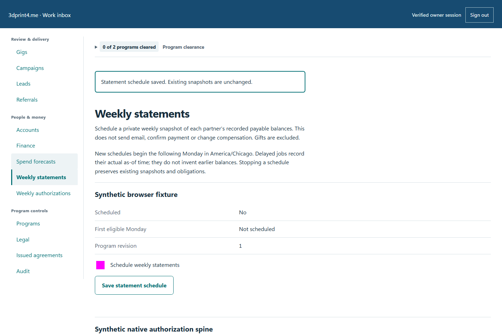
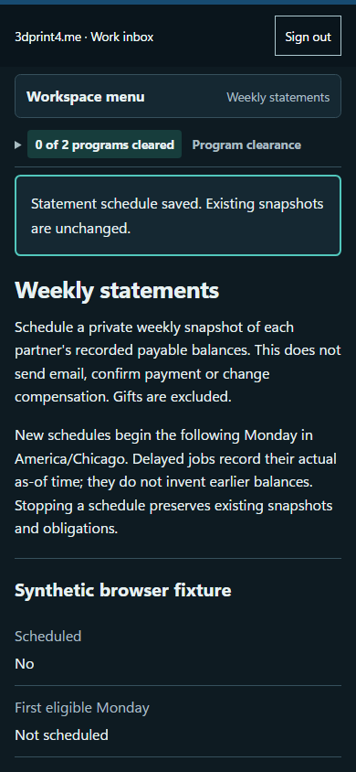

# QA-059: owner schedules weekly statements and partners download only their immutable balances

Status: **passed**. Environment: native disposable browser/API/PostgreSQL fixture; hosted observations are separate.

Automation: `tests/integration/test_partner_statement_browser.py::test_native_owner_schedules_weekly_statements_and_partners_download_only_their_immutable_balances`. [Maintained native source](../../../tests/integration/test_partner_statement_browser.py). [Gherkin](../features/statement.feature).

**Actor:** Owner and/or scoped partner as specified in each step

**Prerequisites:** Disposable PostgreSQL fixture and real browser HTTP boundaries; synthetic review evidence only. Production-portal QA uses the isolated QA realm.

**Inputs:** Fictional fixture businesses/participants and bounded amounts from the linked native test. No real work, consent or funds.

## Given / When

- **action-01:** Open w['fixture']['ownerOrigin'] + '/partners#statements'
- **action-02:** Confirm Schedule weekly statements
- **action-03:** Activate Save statement schedule
- **action-04:** Open w['origin'] + '/earnings'
- **action-05:** Activate Download statement for 2026-11-02
- **action-06:** Activate Workspace menu
- **action-07:** Activate Finance
- **action-08:** Activate Weekly statements

## Then: exact observable and persisted checks

- `w['fixture']['runStatementJob']()['generated'] == 0`
- `w['fixture']['runStatementJob']()['generated'] == 2`
- `len(records) == 2`
- `b',5000,2000,3000,' in original`
- `b'SYNTHETIC-WEEKLY' not in original`
- `hashlib.sha256(original).hexdigest() == own['sha256']`
- `denied['status'] == 404 and 'csv' not in denied['body']`
- `denied_cursor == 404`
- `paged['status'] == 200 and len(paged['body']['items']) == 1`
- `paged['body']['schedules']`
- `w['fixture']['runStatementJob']()['generated'] == 0`
- `later.read_bytes() == original`
- `response.value.status == 200`
- `response.value.json()['enabled'] is False`
- `w['fixture']['runStatementJob']()['generated'] == 0`
- `len(w['read']('statements')['items']) == 2`
- `w['fixture']['outboundAttempts']() == 0`

**Retry/failure behavior:** Use the same command identity for uncertain committed responses; other tests assert explicit conflict/replay behavior as named. Never automatically replay into another realm.

**Cleanup:** Context managers close browsers and remove disposable containers; hosted QA retires only the selected run and preserves history.

## Screenshot evidence

**final-1, 1440 px light; native run workspace-release-20261104-05.** Observed rendered state after the documented step; not evidence for unpictured earlier actions.

**final-1, 390 px dark; native run workspace-release-20261104-05.** Observed rendered state after the documented step; not evidence for unpictured earlier actions.

